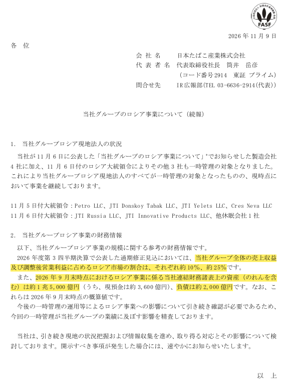

<!-- PRÜFEN: Kurs, Tageslimit (4.000 Yen), Staatsanteil (37 %) und Russland-Anteil stammen aus dem Reuters-Text vom 9.11. (über MarketScreener). Gesellschaften, Dekrete und Bilanzzahlen stammen aus der Mitteilung von Japan Tobacco vom 9.11. (Screenshot). -->
<!-- PRÜFEN: Der Freitagsverlust von 19,3 % ist aus Reuters-Zahlen nachgerechnet (Montag 5.269 Yen = -15,95 % ergibt 6.269 Yen am Freitag; Donnerstag 7.769 Yen). Das Kursplus von rund 40 % seit Jahresbeginn vor dem Absturz ist aus 5.269 Yen = -6,58 % seit Jahresbeginn nachgerechnet. -->
<!-- PRÜFEN: Aus eigener Kenntnis und nicht gegen Quellen geprüft: Altria und Tabakwerte "zuletzt gefragt" und mehr Umsatz im klassischen Zigarettengeschäft; Abzug von BAT und Imperial aus Russland; Die Liste der bereits unter Verwaltung gestellten Firmen (Nestlé, Auchan, Metro, Lemana PRO) und der weiter tätigen (Philip Morris: inzwischen geprüft und korrigiert am 13.11. nach dem PMI-Geschäftsbericht 10-K 2025: rund 6 % Umsatzanteil, 4,8 Mrd. USD Vermögen, davon 2,3 Mrd. USD Barmittel; PepsiCo, Mondelez, P&G, Raiffeisen, UniCredit im Verkauf) stammt aus einem Antwortpost des KI-Bots Grok auf X (9.11., 23:02) und ist nicht geprüft, ebenso die Aussage, das Risiko treffe vor allem Firmen aus unfreundlichen Staaten; Begründung des Kremls mit dem Umgang des Westens mit russischem Vermögen; Nestlé-Zahlen (Dekret im September, 1,6 Mrd. CHF Abschreibung, rund 2 % Umsatz, 3 bis 4 % Gewinn); Putins Aussage zur möglichen Rückkehr; Danone/Carlsberg 2023. -->
<!-- PRÜFEN: Die Dividende von Japan Tobacco wurde nicht geprüft und im Text nicht bewertet. -->

!!! kurz "Kurz gesagt"
    **Kern:** Japan Tobacco hat als einer der wenigen Konzerne trotz Krieg in Russland weitergemacht. Nun stellt der russische Staat alle Gesellschaften unter Verwaltung, und ein Viertel des operativen Gewinns steht auf dem Spiel.

    1. **Kurs:** In zwei Tagen verlor die Aktie ein Drittel, vorher stand sie seit Jahresbeginn rund 40 % im Plus.
    2. **Lage:** Das Geschäft läuft nach Angaben des Konzerns vorerst weiter, die Kontrolle liegt aber beim Staat.
    3. **Signal:** Nestlé, Metro und Auchan wurden dieses Jahr schon unter Verwaltung gestellt, Philip Morris und andere sind noch im Land.

## Ein Liebling der Anleger, der Russland nie verlassen hat

Tabakaktien gehörten zuletzt zu den gefragten Werten am Markt. Die Konzerne werfen verlässlich Cashflow ab, schütten viel aus, und das klassische Zigarettengeschäft, das viele schon abgeschrieben hatten, brachte zuletzt wieder mehr Umsatz, etwa bei Altria. Für Japan Tobacco galt das erst recht. Die Aktie lag vor dem Absturz seit Jahresbeginn rund 40 % im Plus.

Der Konzern hatte allerdings etwas getan, was viele Konkurrenten nach Kriegsbeginn nicht mehr wollten: Er blieb in Russland. Das Land ist für ihn einer der ertragsstärksten Auslandsmärkte. Rund ein Zehntel des Umsatzes entsteht dort, beim bereinigten operativen Gewinn ist es ein Viertel. Solange das Geschäft lief, war das ein Vorteil gegenüber Rivalen, die Russland verlassen hatten.

## Was jetzt passiert ist

Am 5. November unterzeichnete Präsident Putin ein Dekret, das vier Produktionsgesellschaften von Japan Tobacco unter vorläufige Verwaltung stellt. Einen Tag später folgten drei weitere Gesellschaften, darunter die Vertriebsfirma. Damit steht das gesamte Russland-Geschäft unter staatlicher Verwaltung. Der Konzern erklärt, es laufe derzeit weiter, und prüft die Folgen.

Die Mitteilung vom 9. November ist hier vollständig abgebildet. Gelb markiert sind die Zeilen, auf die es ankommt:

Gemeint sind die Anteile am Umsatz und Gewinn und die Bilanz: In Russland liegen Vermögenswerte von rund 1,5 Billionen Yen, davon gut ein Fünftel als Bargeld. Genau dieses Geld und die Erträge daraus stehen nun unter fremder Kontrolle. Die Aktie schloss am Montag bei 5.269 Yen, nach 7.769 Yen am Donnerstag. Zweimal in Folge fiel sie bis zum Tageslimit, die Börse Tokio hat den möglichen Tagesverlust daraufhin vervierfacht. Der japanische Staat hält gut ein Drittel der Anteile und ist damit selbst betroffen.

## Wie es weitergehen kann

Vorläufige Verwaltung klingt nach einem Übergang, ist aber ein Zugriff mit offenem Ausgang. Der bisherige Eigentümer bleibt zunächst auf dem Papier Eigentümer, entscheidet aber nichts mehr. Ob die Gesellschaften später verkauft, dauerhaft verwaltet oder zurückgegeben werden, entscheidet Moskau. Gewinne fließen in der Zwischenzeit kaum an die Muttergesellschaft. Für Japan Tobacco heißt das, dass ein Viertel des operativen Gewinns auf unbestimmte Zeit ausfallen kann.

Ob Japan Tobacco die Dividende trotzdem hält, hat der Konzern nicht gesagt. Das hängt von den übrigen Märkten und davon ab, wie viel der Russland-Ertrag noch zu retten ist. Auch dazu schweigt der Konzern bisher.

## Nestlé, Metro und die anderen

Der Fall steht nicht allein. In diesem Jahr hat Moskau bereits das Russland-Geschäft von Nestlé, Auchan, Metro und Lemana PRO, dem früheren Leroy Merlin, unter vorläufige Verwaltung gestellt. Bei Nestlé ist der Konzern rechtlich noch Eigentümer, hat die Werte aber abgeschrieben, und weil Russland dort nur einen kleinen Teil von Umsatz und Gewinn ausmacht, fällt das weniger ins Gewicht. Schon 2023 hatte der Kreml Danone und Carlsberg unter Verwaltung gestellt.

Weiter im Land aktiv sind Philip Morris, PepsiCo, Mondelez, Procter & Gamble sowie die Banken Raiffeisen und UniCredit, die ihr Geschäft verkaufen wollen. Philip Morris erzielt rund 6 % seines Umsatzes in Russland. Ende 2025 hatte das Russland-Geschäft rund 4,8 Mrd. Dollar Vermögen, davon etwa 2,3 Mrd. Dollar an Barmitteln, überwiegend in Rubel. Wie man zum Bleiben dieser Firmen steht, ist eine Frage für sich: Manche halten es für vertretbar, weil Mitarbeiter und Versorgung betroffen sind, andere für ein Risiko, das die Konzerne bewusst eingegangen sind. Für Anleger ist die Frage nüchterner. Moskau begründet die Eingriffe mit dem Umgang des Westens mit russischem Vermögen und hat das Instrument jetzt mehrfach genutzt. Wer bleibt, muss damit rechnen, dass der Staat irgendwann auch auf seine Firmen zugreift. Entscheidend ist dann, wie groß der Gewinnanteil ist und wie viel Geld im Land festsitzt.

## Schützt die Nähe zu Trump US-Firmen?

Auffällig ist, dass unter den bisher betroffenen Konzernen keine amerikanischen sind. Man kann fragen, ob die gute Beziehung zwischen Moskau und Washington US-Firmen vorerst schützt. Belegt ist das nicht, es bleibt eine Vermutung. Dagegen spricht, dass Russland auch die USA als unfreundlichen Staat führt und dass sich die Lage mit den Spannungen schnell ändern kann. Für Philip Morris, PepsiCo, Mondelez und Procter & Gamble gilt deshalb dasselbe wie für alle anderen: Das Risiko ist da, nur der Zeitpunkt ist offen.

## Quellen

- Reuters, „Japan Tobacco nach Beschlagnahmung von Einheiten in Russland den zweiten Tag in Folge am Tageslimit im Minus" (9.11.2026, übersetzt von MarketScreener)
- Japan Tobacco, „当社グループのロシア事業について（続報）" (9.11.2026)
- Philip Morris International, Geschäftsbericht 10-K für 2025 (Russland-Anteil am Umsatz, Vermögen und Barmittel der russischen Gesellschaften)
- Seiichiro Matsumoto, [Beitrag auf X](https://x.com/seiichiro_matsu/status/2119646550561620434) (Nikkei/CNBC)
