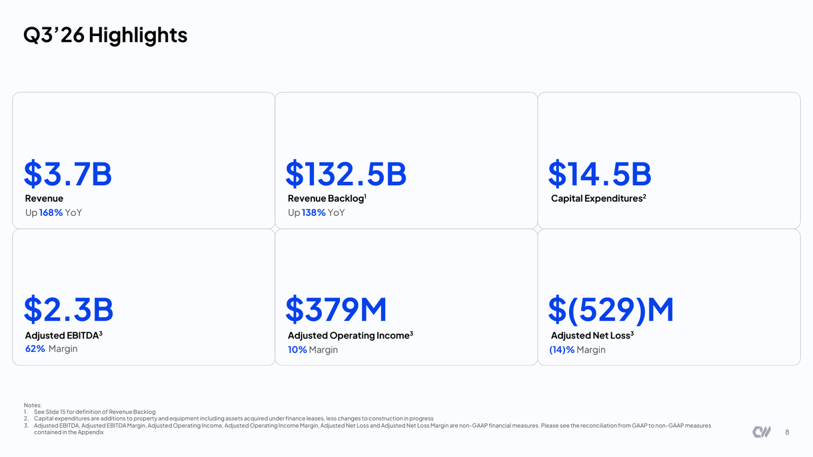
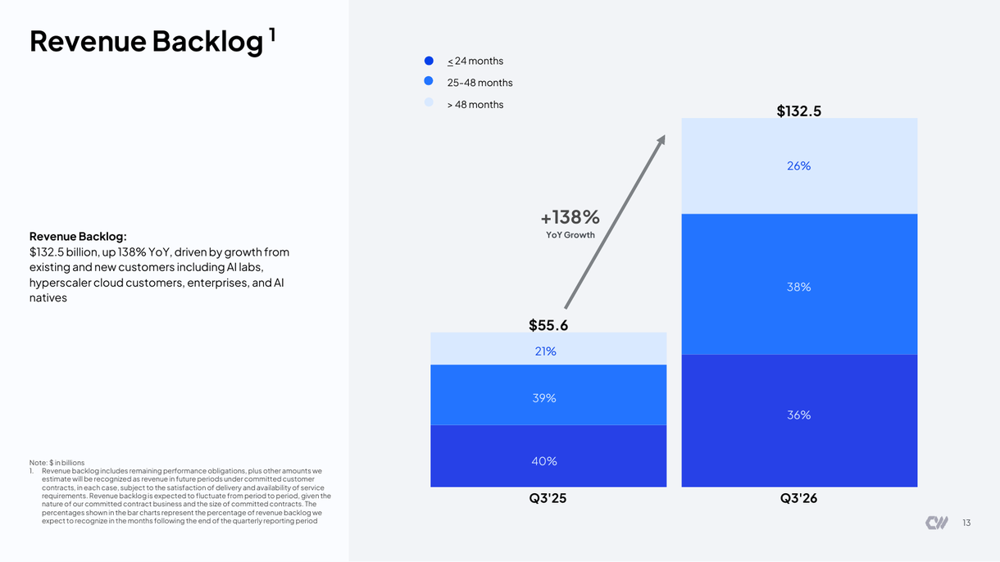
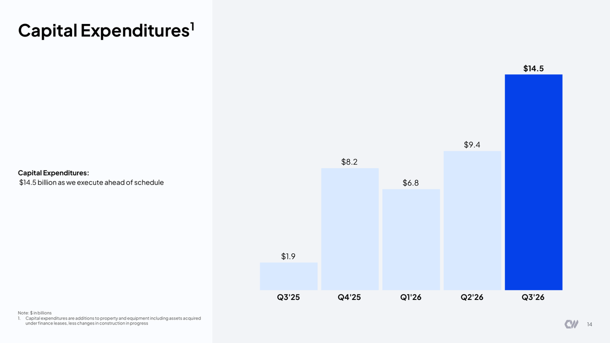
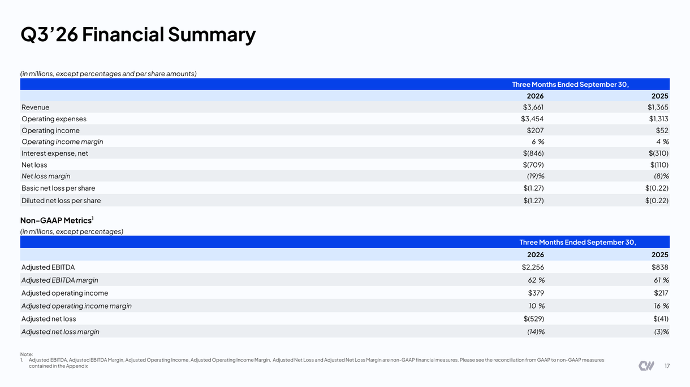

<!-- PRÜFEN: Quelle Zahlen: Präsentation CoreWeave Q3 2026 (PDF von Divi, Folien 3 bis 22). Ausblick, Zitat Intrator und Aktienzahl aus der Pressemitteilung (Zusammenfassung stocktitan.net), Originalmitteilung nicht selbst gelesen. -->
<!-- PRÜFEN: "über der eigenen Prognose": Q3-Ausblick aus August (Umsatz 3,45 bis 3,60 Mrd., bereinigtes operatives Ergebnis 200 bis 260 Mio.) stammt aus einem Pressebericht zum zweiten Quartal, nicht aus der Unternehmensunterlage. Konsens für Q3 nicht geprüft. -->
<!-- PRÜFEN: Kursreaktion nachbörslich aus tradingkey.com: zeitweise über +8 %, zuletzt rund +1,8 % bei 49,60 US-Dollar. Bitte bei Handelsstart prüfen. -->
<!-- PRÜFEN: Kein CEO-Foto von Divi (Michael Intrator) und kein Kursbild, Story deshalb nur mit Folie. Aufmacherfoto gemeinfrei (NREL), zeigt kein CoreWeave-Rechenzentrum. -->

!!! kurz "Kurz gesagt"
    **Umsatz:** 3,7 Mrd. US-Dollar (+168 %)
    **Auftragsbestand:** 132,5 Mrd. US-Dollar (+138 %)

    1. **Wachstum über Plan:** Der Umsatz liegt bei 3.661 Mio. US-Dollar (Vorjahr 1.365 Mio.), das bereinigte operative Ergebnis bei 379 Mio. (Vorjahr 217 Mio.).
    2. **Verlust wächst mit:** Der Nettoverlust steigt auf 709 Mio. US-Dollar (Vorjahr 110 Mio.), der Zinsaufwand auf 846 Mio.
    3. **Prognose angehoben:** Für 2026 peilt CoreWeave 13,0 bis 13,3 Mrd. US-Dollar Umsatz an, die Investitionen sollen bei 37 bis 39 Mrd. liegen.

## CoreWeave im dritten Quartal: Die Nachfrage ist da, die Rechnung kommt mit

CoreWeave liefert im dritten Quartal, was Anleger von einem Wachstumswert verlangen: Der Umsatz klettert auf 3.661 Mio. US-Dollar, ein Plus von 168 % gegenüber dem Vorjahresquartal und mehr als eine Milliarde über dem Vorquartal. Konzernchef Michael Intrator spricht von einem „breakout quarter“. Das bereinigte EBITDA steigt auf 2.256 Mio. US-Dollar bei einer Marge von 62 %, der höchsten seit fünf Quartalen. Das bereinigte operative Ergebnis erreicht 379 Mio. US-Dollar, nach 21 Mio. im ersten und 128 Mio. im zweiten Quartal.

Mit dem Umsatz wächst auch der Auftragsbestand. Er liegt zum Quartalsende bei 132,5 Mrd. US-Dollar, 138 % mehr als vor einem Jahr (55,6 Mrd.). Gut ein Drittel davon, 36 %, will CoreWeave in den kommenden 24 Monaten in Umsatz verwandeln, weitere 38 % in den Monaten 25 bis 48, die übrigen 26 % später. Der Bestand zeigt, dass KI-Labore, Hyperscaler und Unternehmen Rechenleistung langfristig buchen. Er zeigt auch, wie lange das Geschäft laufen muss, bis die Verträge abgearbeitet sind.

## Die Kehrseite: Investitionen und Zinsen

Die Zahlen darunter erzählen eine andere Geschichte. Die Investitionen steigen im dritten Quartal auf 14.511 Mio. US-Dollar, nach 9,4 Mrd. im zweiten und 1,9 Mrd. vor einem Jahr. Über die ersten neun Monate summieren sie sich auf 30,65 Mrd. US-Dollar, gut das Vierfache des Vorjahreswerts. Finanziert wird das zu großen Teilen mit Fremdkapital: Im Quartal hat CoreWeave rund 4,2 Mrd. US-Dollar über Wandelanleihen eingesammelt und eine Finanzierung über 2,6 Mrd. geschlossen, die erstmals auf kürzere Kundenverträge zugeschnitten ist. Zusätzlich hat das Unternehmen ein Aktienprogramm für bis zu 35 Mio. Aktien aufgelegt.

Die Folge zeigt sich in der Gewinn- und Verlustrechnung. Das operative Ergebnis nach allen Kosten liegt bei 207 Mio. US-Dollar (Vorjahr 52 Mio.), der Nettozinsaufwand aber bei 846 Mio. (Vorjahr 310 Mio.). Daraus ergibt sich ein Nettoverlust von 709 Mio. US-Dollar oder 1,27 US-Dollar je Aktie, nach 110 Mio. beziehungsweise 0,22 US-Dollar im Vorjahr. Die bereinigte operative Marge von 10 % hat sich gegenüber dem Vorquartal (5 %) verdoppelt, liegt aber unter dem Vorjahreswert von 16 %. Für das vierte Quartal stellt CoreWeave einen Zinsaufwand von 1,05 bis 1,15 Mrd. US-Dollar in Aussicht, das wäre noch einmal rund 30 % mehr.

## Prognose angehoben, Kapazität wächst weiter

Für das Gesamtjahr 2026 erwartet CoreWeave jetzt einen Umsatz von 13,0 bis 13,3 Mrd. US-Dollar und ein bereinigtes operatives Ergebnis von 1,275 bis 1,375 Mrd. Der auf ein Jahr hochgerechnete Umsatz zum Jahresende soll bei 20 bis 21 Mrd. US-Dollar liegen. Die Investitionen sollen 37 bis 39 Mrd. US-Dollar erreichen, die Untergrenze liegt damit 2 Mrd. höher als bisher. Die Rechenzentren liefern zum Quartalsende mehr als 1,7 Gigawatt aktive Leistung, vertraglich gesichert sind über 4,6 Gigawatt, davon allein 900 Megawatt im dritten Quartal neu. CoreWeave betreibt 52 aktive Rechenzentren, neun davon sind 2026 hinzugekommen. Erste Racks der neuen Nvidia-Generation Vera Rubin laufen bereits im Produktivbetrieb.

## Einordnung: Wachstum gegen Kapitalkosten

Die Aktie reagierte nachbörslich zunächst mit einem Plus von mehr als 8 %, gab einen großen Teil davon aber wieder ab. Das spiegelt die Frage, die über dem ganzen Geschäftsmodell liegt. Für das Unternehmen sprechen die gefüllten Auftragsbücher und die Margenverbesserung im Jahresverlauf. Dagegen steht, dass die Zinsen schneller wachsen als das Betriebsergebnis und jede neue Milliarde an Investitionen die Last erhöht. Entscheidend wird, ob die langfristigen Verträge die Schulden bedienen, bevor die Zinsbelastung das Wachstum überholt. Das hängt auch von den Kunden ab, deren eigene Finanzierung wiederum am Erfolg der KI-Modelle hängt.

## Quellen

- CoreWeave, Präsentation zum dritten Quartal 2026 (10.11.2026)
- CoreWeave, Pressemitteilung zum dritten Quartal 2026 (10.11.2026)

*Dieser Beitrag fasst die Berichterstattung der genannten Quellen in eigenen Worten zusammen. Alle Angaben ohne Gewähr. Keine Anlageberatung.*
