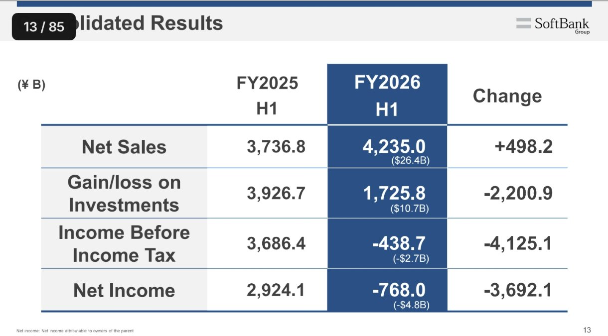
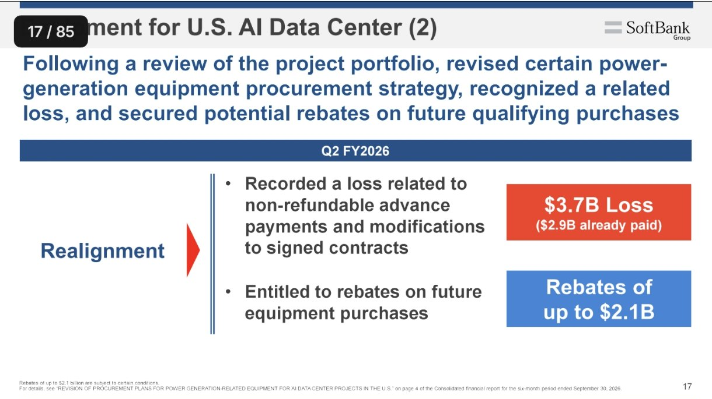
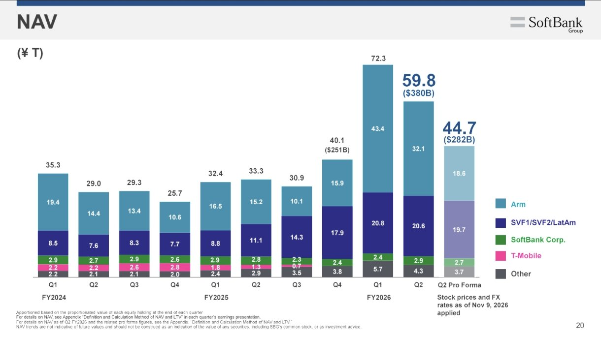
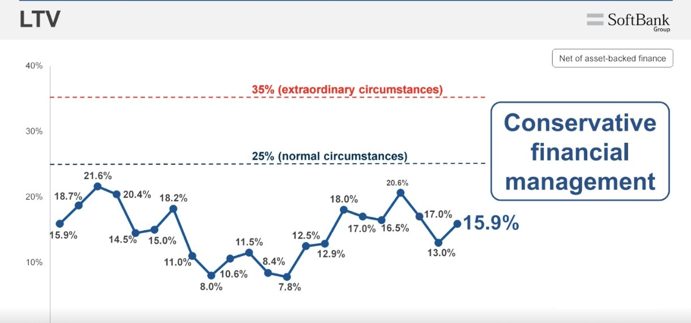
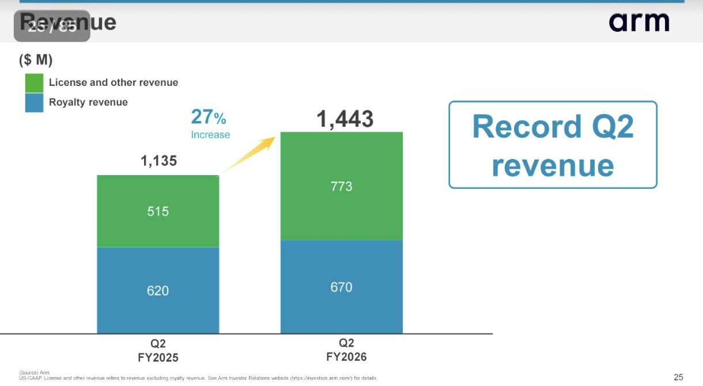

<!-- PRÜFEN: Alle Zahlen stammen aus Screenshots der Ergebnispräsentation (Folien 11 bis 33) aus einer App, nicht aus dem Originaldokument. Die Quell-URL zeigt auf die IR-Seite des Konzerns, die genaue Adresse der Präsentation ist nicht geprüft. -->
<!-- PRÜFEN: Der erste Entwurf (Bot) nannte eine Beleihungsquote von 20,6 %. Das war der Höchstwert aus dem dritten Quartal des Vorjahres; laut Folie liegt die Quote zum 30.09.2026 bei 15,9 %. Auch die Malaysia-Meldung (50 Mrd. US-Dollar) und "Arm über 1 Mrd. US-Dollar Umsatz" des Entwurfs sind entfernt, weil die Folien sie nicht belegen. -->
<!-- PRÜFEN: Dividende, Ausschüttung und Rendite stehen auf den vorliegenden Folien nicht; im Artikel wird dazu nichts behauptet. -->
<!-- PRÜFEN: Die Zahl 44,7 Billionen Yen (pro forma, Kurse und Wechselkurse vom 09.11.2026) kommt von der NAV-Folie; ob darin Effekte außer den Kursen stecken, steht in der Fußnote des Anhangs. Der Rückgang des Arm-Anteils (32,1 auf 18,6 Billionen Yen) ist aus den Balken der Folie abgelesen. -->
<!-- PRÜFEN: Das Foto zeigt Masayoshi Son bei einem Termin mit der EU-Kommission (Lizenz CC BY 4.0); es gibt kein freigestelltes CEO-Foto im Archiv, die Story hat deshalb nur die Folie. -->

!!! kurz "Kurz gesagt"
    **Umsatz:** 4,2 Billionen Yen (+13 %)
    **Ergebnis aus Beteiligungen:** 1,7 Billionen Yen (Vorjahr 3,9 Billionen Yen)
    **Periodenergebnis:** −0,8 Billionen Yen (Vorjahr +2,9 Billionen Yen)
    **Beleihungsquote:** 15,9 % (Zielmarke im Normalfall unter 25 %)

    **Kapitalverwendung:** Die Barmittel stiegen auf 5,0 Billionen Yen, die 64,6 Mrd. US-Dollar für OpenAI sind eingezahlt, die Brückenfinanzierung von 40 Mrd. US-Dollar ist vorzeitig zurückgezahlt.

SoftBank hat im Halbjahr 0,8 Billionen Yen Verlust gemacht, nach 2,9 Billionen Yen Gewinn im Vorjahr. Das Geschäft mit Beteiligungen lief schwächer, und im zweiten Quartal kamen zwei Verluste dazu, die mit dem KI-Boom zu tun haben: Vorauszahlungen für Kraftwerkstechnik und eine Bewertung der Intel-Aktien.

## Zwei Sonderposten drücken das zweite Quartal

Der Umsatz wächst um 13 % auf 4,2 Billionen Yen. Beim Ergebnis aus Beteiligungen sieht es anders aus: Es sinkt von 3,9 auf 1,7 Billionen Yen, das Ergebnis vor Steuern fällt von 3,7 Billionen Yen Gewinn auf 0,4 Billionen Yen Verlust. Das erste Quartal war mit 0,35 Billionen Yen Gewinn noch positiv, im zweiten Quartal steht ein Verlust von 1,1 Billionen Yen (rund 7,0 Mrd. US-Dollar).

Der größere Teil kommt aus den USA. Eine Beteiligungsgesellschaft von SoftBank hat Vorauszahlungen von 9,5 Mrd. US-Dollar für Kraftwerkstechnik geleistet, um sich Anlagen für KI-Rechenzentren zu sichern, bevor sie knapp werden. Nach einer Überprüfung der Projekte wird die Beschaffung teilweise geändert. Das kostet 3,7 Mrd. US-Dollar (597 Mrd. Yen), davon sind 2,9 Mrd. US-Dollar bereits bezahlt. Als Ausgleich stehen SoftBank Rabatte von bis zu 2,1 Mrd. US-Dollar auf künftige Käufe zu, unter Vorbehalt bestimmter Bedingungen.

Der zweite Posten ist die Beteiligung an Intel. Im ersten Quartal brachte sie einen Bewertungsgewinn von 1,3 Billionen Yen, im zweiten einen Verlust von 270 Mrd. Yen. Dazu kommt ein Derivateverlust von 322 Mrd. Yen: SoftBank hat im August über einen Terminkontrakt, der durch Intel-Aktien besichert ist, 7,4 Mrd. US-Dollar aufgenommen, und weil der Kurs seither gestiegen ist, steigt der Wert dieser Verpflichtung.

## Der Wert der Beteiligungen schwankt stark

Der Nettovermögenswert (NAV), also der Wert aller Beteiligungen abzüglich der Schulden der Holding, lag Ende September bei 59,8 Billionen Yen (380 Mrd. US-Dollar). Das sind rund 20 Billionen Yen mehr als im März, aber gut 12 Billionen Yen weniger als im Juni. Mit den Börsenkursen vom 9. November wären es nur noch 44,7 Billionen Yen. Hauptgrund ist Arm, deren Anteil auf der Folie von 32,1 auf 18,6 Billionen Yen zurückgeht.

Für Anleger ist das die wichtigste Unsicherheit: SoftBank bewertet seine Beteiligungen zum Marktpreis, und große Teile davon hängen an wenigen Titeln. OpenAI gehört mit 64,6 Mrd. US-Dollar investierten Mitteln und etwa 13 % Anteil dazu. Die letzte Tranche von 10 Mrd. US-Dollar floss am 1. Oktober, insgesamt hat SoftBank seit März 30 Mrd. US-Dollar nachgelegt.

## Die Bilanz bleibt vorsichtig

Die Beleihungsquote, also die Nettoverschuldung im Verhältnis zum Wert der Beteiligungen, steigt von 13,0 % im Juni auf 15,9 %. SoftBank hat sich als Obergrenze 25 % im Normalfall und 35 % in außergewöhnlichen Lagen gesetzt, der Wert liegt also deutlich darunter. Sie hängt direkt an den Kursen der Beteiligungen: Fallen sie, steigt die Quote.

Die Barmittel stiegen von 2,3 Billionen Yen im Juni auf 5,0 Billionen Yen (32 Mrd. US-Dollar). In den nächsten zwei Jahren werden Anleihen über 1,6 Billionen Yen (10 Mrd. US-Dollar) fällig, 0,6 Billionen Yen davon im kommenden Jahr. Im zweiten Quartal hat SoftBank 56,5 Mrd. US-Dollar aufgenommen und die Brückenfinanzierung von 40 Mrd. US-Dollar vor dem Termin im September zurückgezahlt.

## Arm wächst weiter

Die Tochter Arm steigerte im zweiten Quartal den Umsatz um 27 % auf 1,44 Mrd. US-Dollar, ein Rekord für ein zweites Quartal. Das bereinigte Ergebnis je Aktie stieg um 33 % auf 0,52 US-Dollar. Für das dritte Quartal rechnet Arm mit 1,54 Mrd. US-Dollar Umsatz (+24 %) und 0,56 US-Dollar je Aktie, beides über den Erwartungen der Analysten (1,52 Mrd. US-Dollar und 0,55 US-Dollar). Im NAV schlägt sich das nicht nieder, dort zählt der Börsenkurs von Arm.

## Einordnung

Der Verlust entsteht überwiegend aus Bewertungen und der Neuordnung von Vorauszahlungen. Die Zahlen zeigen, wie viel Gewicht KI inzwischen im Konzern hat: OpenAI, Arm, Intel und die Kraftwerke für Rechenzentren bestimmen, ob SoftBank Gewinn oder Verlust ausweist. Dividende und Rendite sind auf den vorliegenden Folien nicht Thema; wer SoftBank wegen der Ausschüttung hält, findet sie in den Unterlagen des Konzerns. Entscheidend für die nächsten Quartale sind der Kurs von Arm und die Frage, ob die Rabatte auf Kraftwerkstechnik wie geplant eintreffen.

## Quellen

- SoftBank Group Corp., Präsentation zu den Halbjahreszahlen FY2026 (Folien 11 bis 33)

*Dieser Beitrag fasst Informationen aus den genannten Quellen in eigenen Worten zusammen. Keine Anlageberatung.*
