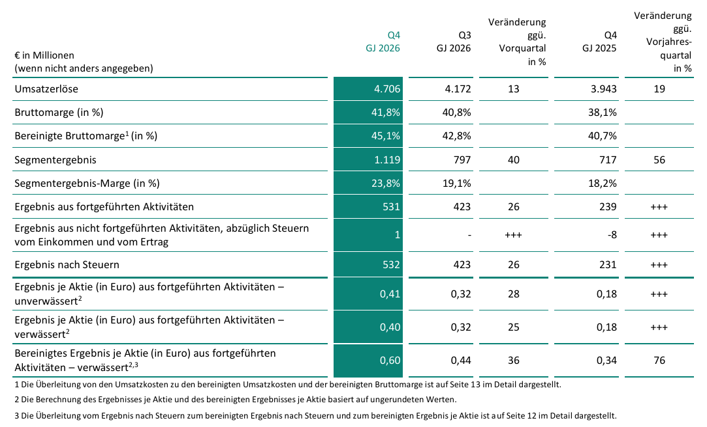

<!-- PRÜFEN: Alle Zahlen stammen aus der Presseinformation von Infineon vom 10.11.2026 (PDF, 17 Seiten). Prozentwerte zum Jahresvergleich sind teils nachgerechnet: Prognose 2027 von etwa 20 Mrd. Euro gegenüber 16,353 Mrd. Euro = +22 %; Dividende 0,38 gegenüber 0,35 Euro = +8,6 %; 494 Mio. Euro Ausschüttung gegenüber 1.512 Mio. Euro Ergebnis nach Steuern = 33 %; Investitionen 2026 = 2.184 Mio. Euro Sachanlagen plus 383 Mio. Euro immaterielle Werte = rund 2,6 Mrd. Euro (Definition des Konzerns kann leicht abweichen). -->
<!-- PRÜFEN: Konsens vor den Zahlen (Umsatz 4,69 Mrd. Euro, bereinigtes Ergebnis je Aktie 0,62 Euro), Schlusskurs 45,85 Euro am 6.11. und Rekordhoch 89,63 Euro stammen aus einem Börsennews-Artikel vom 9.11. und sind nicht gegen eine zweite Quelle geprüft. Die Kursreaktion am 10.11. ist nicht berücksichtigt. -->
<!-- PRÜFEN: Der Schwenk bei den Segmenten (neue Struktur Automotive, Edge Systems, Power Systems seit 1.7.2026) macht Vergleiche mit alten Artikeln schwierig; hier sind die Zahlen der neuen Struktur (Seite 11 der Mitteilung) verwendet. -->

!!! kurz "Kurz gesagt"
    **Umsatz Q4:** 4,7 Mrd. Euro (+19 %)
    **Segmentergebnis Q4:** 1,1 Mrd. Euro (+56 %), Marge 23,8 %
    **Bereinigtes Ergebnis je Aktie Q4:** 0,60 Euro (+76 %)
    **Gesamtjahr 2026:** Umsatz 16,4 Mrd. Euro (+12 %), Ergebnis nach Steuern 1,5 Mrd. Euro (+49 %)

    **Kapitalverwendung:** Dividende 0,38 Euro (+0,03 Euro), freier Cashflow 1,0 Mrd. Euro nach −1,1 Mrd. im Vorjahr, Investitionen rund 2,6 Mrd. Euro.

Infineon hat sich in diesem Jahr als der deutsche Profiteur des KI-Booms etabliert, auch wenn die Aktie davon zuletzt wenig hatte: Sie schloss am vergangenen Freitag bei 45,85 Euro, rund die Hälfte unter dem Rekordhoch von 89,63 Euro. Die Zahlen zum Schlussquartal zeigen, dass das Geschäft dem Kurs vorausgelaufen ist.

## Ein Rekordquartal mit einer klaren Handschrift

Der Umsatz stieg im vierten Quartal um 19 % auf 4,7 Mrd. Euro und lag damit leicht über der Erwartung der Analysten von 4,69 Mrd. Euro. Stärker als der Umsatz wuchs der Gewinn: Das Segmentergebnis legte um 56 % auf 1,1 Mrd. Euro zu, die Marge stieg von 18,2 % auf 23,8 % und übertraf damit die vom Konzern angekündigten 23 %. Das bereinigte Ergebnis je Aktie von 0,60 Euro (Vorjahr 0,34 Euro) blieb dagegen knapp unter der Erwartung von 0,62 Euro.

Die Handschrift des Quartals trägt das Segment Power Systems, zu dem die Halbleiter für die Stromversorgung von Servern und Rechenzentren zählen. Der Umsatz stieg dort um 48 % auf 1,7 Mrd. Euro, die Marge verdoppelte sich von 15,3 % auf 30,1 %. Solche Werte erreicht ein Halbleiterkonzern, wenn Kunden Chips dringend brauchen und dafür zahlen. Im Gesamtjahr wuchs Power Systems um 31 % auf 5,4 Mrd. Euro.

## Automotive trägt, Edge Systems hinkt

Automotive ist mit 2,1 Mrd. Euro (+10 %) weiter das größte Segment und liefert eine Marge von 22,0 %. Der Konzern verweist auf Elektromobilität und softwaredefinierte Fahrzeuge. Das Jahr insgesamt war mit +5 % beim Umsatz und einer Marge von 20,0 % (Vorjahr 20,4 %) allerdings ein Jahr ohne Schwung.

Edge Systems bleibt hinter dem Rest zurück. Der Umsatz lag im Quartal mit 838 Mio. Euro auf Vorjahresniveau, im Gesamtjahr stieg er um 2 %, das Segmentergebnis fiel um 8 % auf 395 Mio. Euro. Für das erste Quartal erwartet der Konzern dort einen moderaten Rückgang. Wer auf Edge-KI und Robotik als nächste Welle setzt, muss darauf noch warten.

## Der Ausblick: ein Fünftel mehr Umsatz

Für das Geschäftsjahr 2027 plant Infineon mit rund 20 Mrd. Euro Umsatz, gut 22 % mehr als 2026. Das Rechenzentrumsgeschäft soll dazu mit etwa 4 Mrd. Euro beitragen. Die Segmentergebnis-Marge soll im mittleren Zwanzigerbereich liegen, nach 19,7 % im vergangenen Jahr. Voraussetzung ist ein Wechselkurs von 1,15 Dollar je Euro, ein stärkerer Euro würde die Umsätze in Euro drücken.

Auffällig ist das erste Quartal: Der Konzern rechnet mit etwa 4,6 Mrd. Euro Umsatz, also stabil gegenüber dem Schlussquartal. In dieser Jahreszeit ist ein Rückgang üblich, die Prognose liegt nach Angaben des Konzerns deutlich über der gewohnten Saisonalität. Die Marge soll bei etwa 23 % bleiben.

## Wohin das Geld fließt

Das Wachstum kostet. Für 2027 sind Investitionen von 3,0 bis 3,5 Mrd. Euro vorgesehen, nach rund 2,6 Mrd. Euro im abgelaufenen Jahr. Das Geld geht in das vierte Fertigungsgebäude in Dresden, die Siliziumkarbidfertigung in Kulim in Malaysia, die Galliumnitrid-Fertigung auf 300-Millimeter-Wafern in Villach und in Montagewerke in Thailand und Malaysia. Der freie Cashflow soll trotzdem bei etwa 1,8 Mrd. Euro liegen, bereinigt um die großen Gebäude bei 2,2 Mrd. Euro.

Im abgelaufenen Jahr lag der freie Cashflow bei 993 Mio. Euro, nach minus 1,1 Mrd. Euro im Jahr davor, als Infineon rund 2,3 Mrd. Euro für Übernahmen ausgab. Das Schlussquartal steuerte 656 Mio. Euro bei. Dazu half allerdings ein Rückgang der Vorräte und höhere Verbindlichkeiten aus Lieferungen: Der Mittelzufluss aus der Veränderung bei Aktiva und Passiva lag bei 848 Mio. Euro, nach 132 Mio. Euro im Vorquartal. Dieser Effekt wiederholt sich nicht beliebig, der freie Cashflow der kommenden Quartale hängt stärker am Ergebnis.

Die Nettoschulden sanken zum Jahresende auf 4,7 Mrd. Euro, nach 5,2 Mrd. Euro im Vorquartal und auf dem Niveau des Vorjahres (4,7 Mrd. Euro). Die Bilanz ist mit einem Eigenkapital von 18,6 Mrd. Euro bei einer Bilanzsumme von 33,5 Mrd. Euro solide. Zusätzliche Luft könnte der geplante Verkauf des Speichergeschäfts mit NOR-Flash und F-RAM an Winbond bringen, der nach Erwartung des Konzerns im zweiten Halbjahr 2027 abgeschlossen wird und bis zu 1 Mrd. Euro einbringen kann. In der Prognose ist er nicht enthalten.

## Dividende: kleine Erhöhung, solide gedeckt

Der Vorstand will der Hauptversammlung am 25. Februar 2027 eine Dividende von 0,38 Euro je Aktie vorschlagen, 3 Cent oder 8,6 % mehr als zuletzt. Die Ausschüttung beträgt rund 494 Mio. Euro, das sind etwa ein Drittel des Ergebnisses nach Steuern von 1,5 Mrd. Euro und die Hälfte des freien Cashflows. Die Dividendenrendite liegt bei dem Kurs vom Freitag unter 1 %. Als Dividendenwert bietet Infineon wegen der niedrigen Rendite wenig, der Reiz liegt im Wachstum. Der Konzern will die Dividende auch bei stagnierendem Ergebnis zumindest konstant halten und den Rest ins Wachstum stecken.

## Fazit

Das Quartal zeigt, dass Infineon vom KI-Zyklus profitiert, und der Ausblick für 2027 legt nach. Dagegen stehen die hohen Investitionen, die den freien Cashflow belasten, Nettoschulden von 4,7 Mrd. Euro, ein Edge-Geschäft ohne Wachstum und aktienbasierte Vergütungen, die sich auf 396 Mio. Euro mehr als verdoppelt haben (Vorjahr 188 Mio. Euro). Auch die Abhängigkeit von der Rechenzentrumsnachfrage ist größer geworden, wie der Ausverkauf bei US-Chipwerten in den letzten Tagen zeigte. Entscheidend wird, ob Power Systems die Marge von rund 30 % auch halten kann, wenn die Fabriken in Dresden und Kulim hochlaufen.

## Quellen

- Infineon Technologies AG, Presseinformation „Infineon schließt GJ 2026 mit Rekordquartal ab …" (10.11.2026)
- Börsennews, „Vor den Jahreszahlen: Infineon fast 50 Prozent unter Rekordhoch" (9.11.2026)
