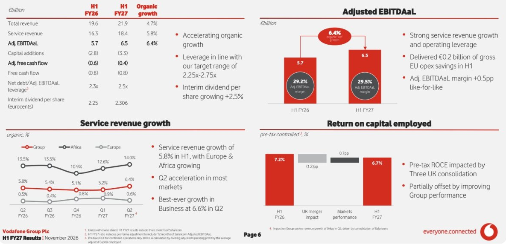
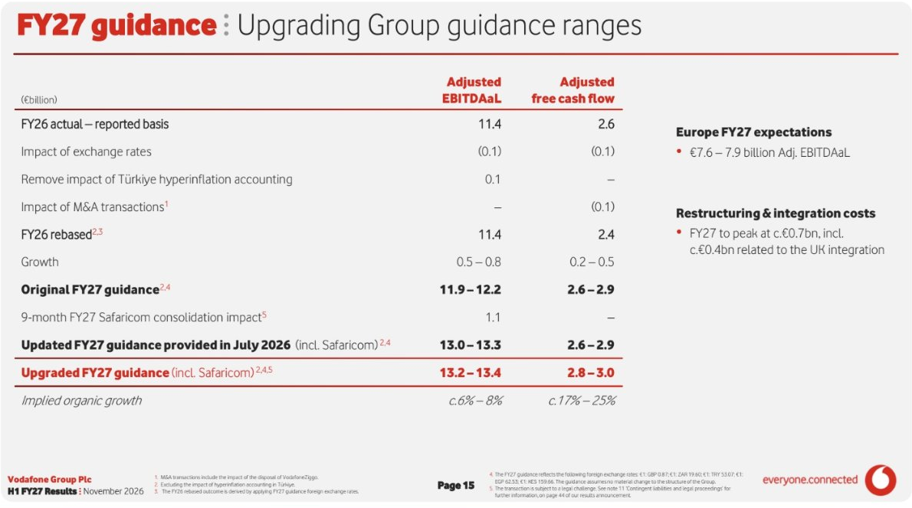

<!-- PRÜFEN: Alle Zahlen stammen aus Screenshots der Ergebnispräsentation (H1 FY27, Seiten 6 bis 21) aus einer App, nicht aus dem Originaldokument. Prozentwerte zum Jahresvergleich sind teils nachgerechnet: Umsatz 21.853 gegenüber 19.609 Mio. Euro = +11,4 %. -->
<!-- PRÜFEN: Das Datum der Veröffentlichung steht auf den Folien nur als "November 2026". Die Quartalsangabe der App lautet "Q2 2027" (Geschäftsjahr bis März 2027), Halbjahr bis 30. September 2026. -->
<!-- PRÜFEN: Der Hinweis zu Deutschland (Q2 mit leichtem Rückgang der Serviceumsätze, Gerichtsurteil zu historischen Preiserhöhungen mit -0,3 Prozentpunkten, voller Effekt ab Q3) stammt aus der Deutschland-Folie; Wert für Q2 ist aus der Grafik abgelesen (rund -0,5 %). -->
<!-- PRÜFEN: Die Übernahme der Mehrheit an Safaricom steht laut Fußnote unter dem Vorbehalt einer rechtlichen Anfechtung in Kenia; Details im Original-Bericht (Seite 44) nachlesen. Die Dividende je Aktie wird in Eurocent ausgewiesen (2,306 Eurocent), die Gesamtausschüttung ist nicht angegeben. -->
<!-- PRÜFEN: Das Foto zeigt die Vodafone-Zentrale in Düsseldorf; ein freigestelltes CEO-Foto von Margherita Della Valle liegt nicht im Archiv, die Story hat deshalb nur die Folie. -->

!!! kurz "Kurz gesagt"
    **Umsatz:** 21,9 Mrd. Euro (+11 %, organisch +4,7 %)
    **Bereinigtes EBITDAaL:** 6,5 Mrd. Euro (+6,4 % organisch)
    **Periodenergebnis:** −3,6 Mrd. Euro (Vorjahr +1,1 Mrd. Euro)
    **Zwischendividende:** 2,306 Eurocent (+2,5 %)

    **Kapitalverwendung:** Die Nettoverschuldung stieg durch Zukäufe auf das 2,5-Fache des Ergebnisses, der bereinigte freie Cashflow liegt im Halbjahr bei −0,4 Mrd. Euro, die Jahresprognose dafür steigt auf 2,8 bis 3,0 Mrd. Euro.

Ein Verlust von 3,6 Mrd. Euro nach einem Gewinn von 1,1 Mrd. Euro im Vorjahr sieht nach einem schweren Halbjahr aus. Bei Vodafone ist es ein Halbjahr, in dem das Geschäft besser läuft und die Bilanz bereinigt wird. Die beiden größten Posten sind Buchhaltung: 4,85 Mrd. Euro Abschreibung auf Deutschland und 2,2 Mrd. Euro abgeschriebene Steuerforderungen in Großbritannien, die sich nicht auf Zahlungen auswirken.

## Warum der Verlust nicht das Bild bestimmt

Die Abschreibung auf Deutschland begründet der Konzern mit gestiegenen Renditen deutscher Staatsanleihen und einem Urteil des Europäischen Gerichtshofs. Höhere Zinsen drücken den Barwert künftiger Erträge, am Geschäft selbst ändert das zunächst nichts. Dazu kommt ein Sondergewinn von 3,0 Mrd. Euro, weil die bisherige Beteiligung an Safaricom bei der Übernahme der Mehrheit neu bewertet wurde. Das Betriebsergebnis fällt dadurch von 2,2 Mrd. auf 0,5 Mrd. Euro, der Verlust vor Steuern bleibt klein (0,4 Mrd. Euro), und erst die Steuerposition macht daraus den Verlust von 3,6 Mrd. Euro.

Operativ wächst der Umsatz berichtet um 11 % auf 21,9 Mrd. Euro, organisch sind es 4,7 %. Der Unterschied kommt aus den Zukäufen: Three in Großbritannien, Safaricom in Kenia und die Telekom-Rumänien-Geschäfte. Das bereinigte EBITDAaL, die für Telekomkonzerne wichtigste Ertragsgröße, steigt organisch um 6,4 % auf 6,5 Mrd. Euro, die Marge um 0,5 Prozentpunkte auf 29,5 %.

## Afrika läuft, Deutschland hinkt

Afrika trägt 32 % des Konzernergebnisses und wächst zweistellig: Die Serviceumsätze steigen um 13,4 %, das bereinigte EBITDAaL um 18,0 % auf 2,1 Mrd. Euro. Safaricom in Kenia hat dabei den größten Anteil, Vodafone hält dort nach dem Kauf von 15 % für 1,4 Mrd. Euro nun 55 %. Die Übernahme steht unter dem Vorbehalt einer rechtlichen Anfechtung in Kenia.

Deutschland ist mit 33 % der größte Ergebnisbringer, aber der schwächste Teil: Die Serviceumsätze wachsen im Halbjahr nur um 0,4 %, im zweiten Quartal gingen sie leicht zurück. Das bereinigte EBITDAaL sinkt um 3,2 % auf 2,1 Mrd. Euro. Gründe sind der Rückgang beim Fernsehgeschäft, ein Gerichtsurteil zu früheren Preiserhöhungen, das ab dem dritten Quartal voll durchschlägt, und höhere Kosten für das Digitalgeschäft mit Firmenkunden. Als Lichtblick nennt der Konzern, dass die Kundenzufriedenheit hierzulande nun auf Platz zwei steht und die Kundenzahlen im Mobilfunk sich bei allen Marken verbessert haben. Weitere 2.300 Stellen werden in Deutschland abgebaut.

Großbritannien gehört seit dem Zusammenschluss mit Three vollständig Vodafone. Das Ergebnis wächst um 5,9 % auf 1,0 Mrd. Euro, nach 50 Mio. Euro Einsparungen im Halbjahr werden im zweiten Halbjahr rund 100 Mio. Euro erwartet. Bis 2030 sollen es 0,8 Mrd. Euro jährlich an Kosten und Investitionen sein.

## Prognose steigt, Verschuldung auch

Für das Geschäftsjahr bis März 2027 hebt Vodafone das bereinigte EBITDAaL auf 13,2 bis 13,4 Mrd. Euro an, zuvor waren es 13,0 bis 13,3 Mrd. Euro. Der bereinigte freie Cashflow soll 2,8 bis 3,0 Mrd. Euro erreichen, nach 2,6 bis 2,9 Mrd. Euro. Darin steckt die Konsolidierung von Safaricom. Organisch entspricht das einem Wachstum von etwa 6 bis 8 % beim Ergebnis und 17 bis 25 % beim Cashflow, der im ersten Halbjahr mit −0,4 Mrd. Euro noch negativ ist. Der Konzern verweist auf die üblichen Schwankungen: Rund 60 % der Investitionen fallen im zweiten Halbjahr an, im vierten Quartal werden Forderungen aus Handyverkäufen verkauft.

Die Nettoverschuldung ist von 25,4 auf 33,5 Mrd. Euro gestiegen, vor allem durch Zukäufe von 6,1 Mrd. Euro. Das entspricht dem 2,5-Fachen des bereinigten EBITDAaL und liegt in der Mitte der angestrebten Spanne von 2,25 bis 2,75. Der Verkauf der Hälfte der Beteiligung an VodafoneZiggo brachte rund 1 Mrd. Euro. Die durchschnittlichen Zinsen auf die festverzinslichen Schulden betragen etwa 3 %. Die Rendite auf das eingesetzte Kapital fiel von 7,2 % auf 6,7 %, weil die Konsolidierung von Three das eingesetzte Kapital erhöht.

## Dividende: kleine Erhöhung

Die Zwischendividende beträgt 2,306 Eurocent und damit 2,5 % mehr als im Vorjahr. Sie entspricht der Hälfte der letzten Jahresdividende von 4,6125 Eurocent, die ebenfalls um 2,5 % gestiegen war. Vodafone verfolgt seit dem Geschäftsjahr 2026 eine progressive Dividendenpolitik, also jährlich leicht steigende Beträge. Die Anhebung der Prognose und der Cashflow-Ausblick sprechen dafür, dass das so bleibt, die Verschuldung und die Einmalkosten von bis zu 0,7 Mrd. Euro in diesem Jahr für den Umbau lassen aber wenig Spielraum für mehr.

## Fazit

Das Halbjahr zeigt ein Unternehmen, das mit Zukäufen und Sparprogrammen wächst und gleichzeitig am Heimatmarkt Deutschland kämpft. Für Anleger spricht, dass die Prognose steigt, der Cashflow im zweiten Halbjahr anzieht und die Dividende progressiv bleibt. Dagegen stehen die höhere Verschuldung, die niedrige Kapitalrendite von 6,7 % und ein Deutschlandgeschäft, bei dem das Urteil zu den Preiserhöhungen erst ab dem dritten Quartal voll wirkt. Entscheidend für die Dividende ist, ob der freie Cashflow im zweiten Halbjahr die Prognose trägt.

## Quellen

- Vodafone Group Plc, „H1 FY27 Results" (Präsentation, November 2026)
