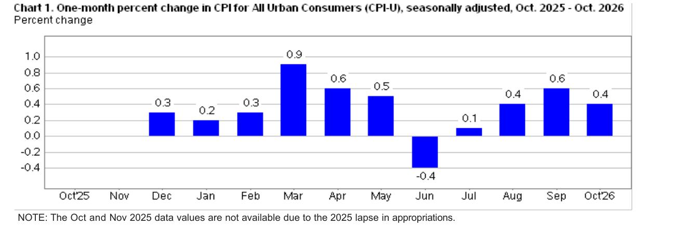
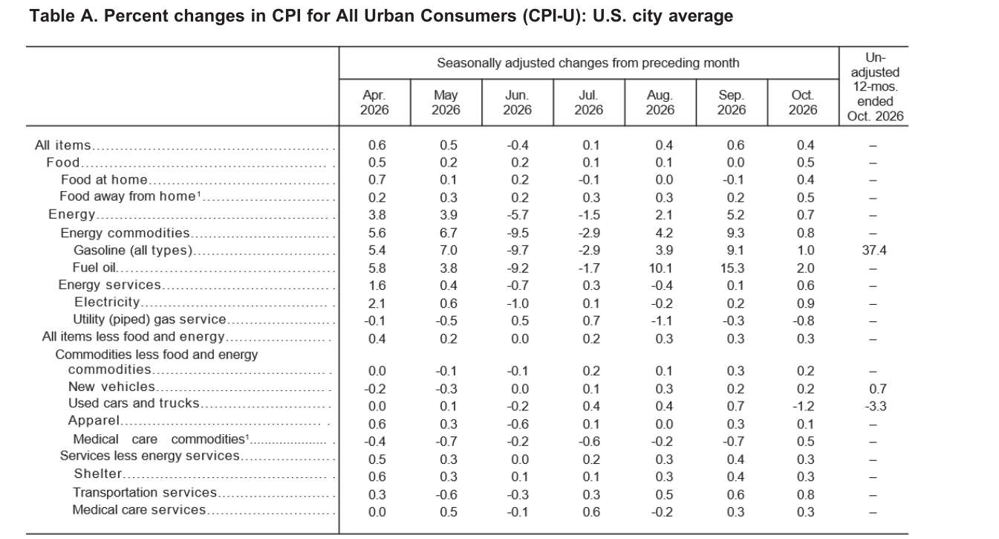

<!-- PRÜFEN: Alle Zahlen stammen aus dem Bericht des Bureau of Labor Statistics (USDL-26-1685, Seiten 1 bis 4, Tabelle A), den Divi als PDF geschickt hat. Die Quell-URL ist die allgemeine Adresse der Mitteilung, nicht die des PDFs. -->
<!-- PRÜFEN: Die Jahresraten für September (Gesamtindex 3,7 %, Kernrate 2,6 %, Vorgabe 3,6 % und 2,5 %, August 3,4 % und 2,4 %) stammen aus Screenshots einer Börsen-App und der Grafik 2 im Bericht. Prognosewerte für den Oktober liegen nicht vor, daher kein Vergleich mit den Erwartungen. -->
<!-- PRÜFEN: Selbst berechnet sind: Summe der Monatswerte von März bis Oktober (0,9 + 0,6 + 0,5 − 0,4 + 0,1 + 0,4 + 0,6 + 0,4 = 3,1 %), das Muster der Kernrate seit Juni (0,0 / 0,2 / 0,3 / 0,3 / 0,3 aus Tabelle A) und die Hochrechnung 0,3 % je Monat auf ein Jahr (rund 3,7 %). -->
<!-- PRÜFEN: Die Jahresrate für Benzin (+37,4 %), Neuwagen (+0,7 %) und Gebrauchtwagen (−3,3 %) steht als einzige Jahresrate für Oktober in Tabelle A; ob sie wie alle anderen Reihen vergleichbar ist, sollte im Original (Seite 2 und Hinweis zur Datenlücke) gegengelesen werden. -->

!!! kurz "Kurz gesagt"
    **Verbraucherpreise:** +0,4 % zum Vormonat (September +0,6 %)
    **Kernrate (ohne Energie und Lebensmittel):** +0,3 % (wie im August und September)
    **Energie:** +0,7 % (September +5,2 %), Benzin +1,0 %
    **Lebensmittel:** +0,5 % (September 0,0 %)
    **Jahresrate Oktober:** nicht veröffentlicht

Die Teuerung in den USA hat sich im Oktober etwas verlangsamt und bleibt hoch: Die Verbraucherpreise stiegen um 0,4 % zum Vormonat, nach 0,6 % im September. Der Rückgang geht vor allem auf Energie zurück. Dahinter läuft die Kernrate seit drei Monaten unverändert bei 0,3 %, und genau diese Zahl entscheidet, ob der Preisdruck breiter wird.

## Energie beruhigt sich, Lebensmittel ziehen an

Im September hatten die Energiepreise um 5,2 % angezogen, vor allem durch Benzin (+9,1 %) und Heizöl (+15,3 %). Im Oktober legte der Energieindex nur noch um 0,7 % zu, Benzin um 1,0 %. Vor der Saisonbereinigung sanken die Benzinpreise im Oktober sogar um 0,7 %. Strom wurde um 0,9 % teurer, Erdgas um 0,8 % billiger.

Dafür kamen die Lebensmittel zurück: Nach einem unveränderten September stiegen sie um 0,5 %. Im Supermarkt legten Snacks um 1,0 % und Rindfleisch um 0,9 % zu, Obst und Gemüse sowie Milchprodukte um jeweils 0,6 %. Restaurantpreise stiegen um 0,5 %, vollbediente Lokale sogar um 0,7 %. Getränke ohne Alkohol wurden dagegen um 0,3 % billiger.

## Die Kernrate zieht seit dem Sommer an

Ohne Energie und Lebensmittel stiegen die Preise im Oktober um 0,3 %, wie schon im August und September. Im Juni hatte der Wert noch bei 0,0 % gelegen, im Juli bei 0,2 %. Hochgerechnet auf ein Jahr ergäbe ein Wert von 0,3 % je Monat rund 3,7 %, auch das ist ein Hinweis darauf, dass der Preisdruck im Kern stärker ist als die Jahresrate von zuletzt 2,6 % andeutet. Die Hochrechnung ist eine reine Rechenübung, einzelne Monate schwanken stark.

Die Wohnkosten stiegen um 0,3 % und tragen damit mehr als 30 % zum Monatsanstieg bei, die Mieten um 0,2 % und die Eigentümermiete um 0,3 %. Teurer wurden außerdem Freizeit (+0,8 %), Kfz-Versicherungen (+0,7 %), Krankenhausleistungen (+0,8 %) und Verkehrsdienstleistungen (+0,8 %). Gebrauchtwagen wurden um 1,2 % billiger, nach einem Plus von 0,7 % im September, und bremsten den Gesamtwert.

## Die Jahresrate fehlt

Die in Märkten meistbeachtete Zahl, die Jahresrate, liegt für den Oktober nicht vor. Wegen einer Haushaltssperre im Jahr 2025 konnte die Behörde im Oktober 2025 keine Preise erheben, deshalb fehlt der Vergleichswert, und für die meisten Reihen gibt es keine Jahresrate. Eine Ausnahme ist Benzin mit einem Plus von 37,4 % im Jahresvergleich, bei Neuwagen sind es 0,7 %, bei Gebrauchtwagen −3,3 %. Zuletzt, im September, lag die Gesamtteuerung bei 3,7 % und die Kernrate bei 2,6 %, beide etwas über den Erwartungen von 3,6 % und 2,5 %.

Seit dem Frühjahr summieren sich die Monatswerte auf gut 3 %: Nach einem Sprung von 0,9 % im März folgte ein Minus von 0,4 % im Juni, danach stiegen die Preise wieder jeden Monat.

## Einordnung

Der Oktober liefert zwei Lesarten. Die erste: Der Energieschock vom September klingt ab, und Gebrauchtwagen werden billiger, die Gesamtrate gibt nach. Die zweite: Die Kernrate liegt bei 0,3 % und damit über dem Niveau des Frühsommers, Lebensmittel und Dienstleistungen ziehen an. Für Anleger mit Aktien aus konsumnahen Branchen oder mit Anleihen ist das die entscheidende Größe, weil sie Kosten, Zinsen und Margen gleichermaßen berührt. Auch für November 2025 liegen keine Preisdaten vor, die Lücke betrifft also die nächste Veröffentlichung ebenfalls. Der nächste Bericht erscheint am 10. Dezember 2026.

## Quellen

- U.S. Bureau of Labor Statistics, Consumer Price Index – October 2026 (USDL-26-1685, 10.11.2026)

*Dieser Beitrag fasst Informationen aus den genannten Quellen in eigenen Worten zusammen. Keine Anlageberatung.*
