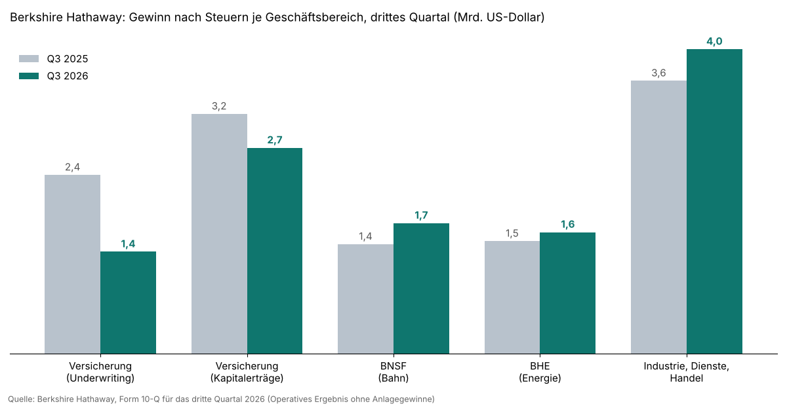

!!! kurz "Kurz gesagt"
    **Nettogewinn:** 22,1 Mrd. US-Dollar (−28 %)
    **Operativer Gewinn:** 12,7 Mrd. US-Dollar (−5,8 %)
    **Dividende:** keine, stattdessen Aktienrückkauf

    Die Schlagzeile klingt nach Rückschlag. Sie bildet vor allem den Börsenverlauf ab. Das Tagesgeschäft wächst, nur die Autoversicherung Geico schwächelt.

Wer auf die Überschriften des Wochenendes schaut, sieht bei Berkshire Hathaway einen Konzern auf dem Rückzug. Der Gewinn ist um mehr als ein Viertel gefallen. Die Zahlen erzählen etwas anderes. Der Einbruch kommt aus der Bewertung des Aktienportfolios und aus einem Versicherer, der nach einem außergewöhnlich guten Vorjahr normalisiert. Die Betriebe, die Greg Abel als Konzernchef führen will, verdienen mehr.

## Warum der Gewinn fällt

Berkshire muss Kursgewinne und -verluste seines gewaltigen Aktienportfolios im Ergebnis ausweisen. Im Vorjahresquartal fielen diese Anlagegewinne außergewöhnlich hoch aus, jetzt nur noch etwa halb so hoch. Das drückt den Nettogewinn auf 22,1 Milliarden Dollar. Buffett hat stets empfohlen, auf das operative Ergebnis zu schauen. Es sank nur um 5,8 Prozent auf 12,7 Milliarden Dollar.

Den Rest der Lücke erklärt die Versicherung. Der Gewinn aus dem eigentlichen Versicherungsgeschäft fiel um 43 Prozent. Großschäden gab es in den ersten neun Monaten keine, der Rückgang hat also andere Gründe. Dazu kommen niedrigere Zinsen: Die Kapitalerträge der Versicherer sanken um 14 Prozent, weil das viele Geld in kurzlaufenden Staatsanleihen weniger abwirft.

## Geico bleibt die Schwachstelle

Der Autoversicherer Geico verdiente vor Steuern 982 Millionen Dollar nach 1,77 Milliarden im Vorjahr. Die Kosten für Schäden und Verwaltung stiegen auf 91,4 Prozent der Prämien, vor einem Jahr waren es 84,3 Prozent. Ursache sind mehr Unfälle und teurere Schäden bei Verletzungen. Gleichzeitig sinkt die durchschnittliche Prämie je Vertrag. Geico wächst also bei der Zahl der Kunden, verdient an jedem einzelnen aber weniger. Hier muss Abel nachsteuern, und es ist die Zahl, die über die kommenden Quartale entscheidet.

## Die Betriebe liefern

Dem steht eine Reihe guter Nachrichten gegenüber. Die Bahn BNSF steigerte ihren Gewinn um 19 Prozent, Berkshire Hathaway Energy um 8 Prozent, die Sammlung aus Industrie-, Dienstleistungs- und Handelsfirmen um 12 Prozent. Als Gründe nennt der Konzern höhere Frachtmengen und bessere Abläufe bei der Bahn sowie stärkere Industriegeschäfte. Abel hatte in seinem Aktionärsbrief die Bahn ausdrücklich zu mehr Effizienz verpflichtet. Nach einem Quartal ist das noch kein Trend. Es ist aber ein Anfang in die gewünschte Richtung.

## Rückkauf statt Dividende

Berkshire kaufte im dritten Quartal eigene Aktien für rund 9,6 Milliarden Dollar zurück, in den ersten neun Monaten waren es 14,4 Milliarden. Der Konzern tut das nur, wenn der Preis unter dem inneren Wert liegt, den Abel einschätzt. Dass er trotz Rekordkurs kauft, spricht für die Einschätzung der Konzernspitze. Gestoppt wird der Rückkauf erst, wenn Cash und Staatsanleihen unter 30 Milliarden Dollar fallen.

Davon ist Berkshire weit entfernt. Der Konzern hält zusammengerechnet rund 357 Milliarden Dollar. Die Zahl taucht in Berichten mit 377 Milliarden auf. Der Unterschied sind 20,5 Milliarden Dollar für Staatsanleihen, die zum Stichtag gekauft, aber erst im Oktober bezahlt wurden. Die Bilanz zieht sie ab, 357 Milliarden ist die belastbare Zahl. Sie ist gegenüber dem Vorquartal zum zweiten Mal in Folge gesunken, weil Berkshire investiert: In diesem Jahr kamen der Chemiekonzern OxyChem für 9,4 Milliarden Dollar und im Juli der Hausbauer Taylor Morrison für 6,8 Milliarden dazu. An der Börse kaufte Berkshire im Quartal Aktien für 2,4 Milliarden Dollar und verkaufte für 2,8 Milliarden. Zu den größten Positionen zählen [Alphabet](/news/alphabet-q3-2026-quartalszahlen), American Express, [Apple](/news/apple-geschaeftsbericht-2026), Bank of America und Coca-Cola. Die genauen Bewegungen veröffentlicht Berkshire Mitte November.

## Was das für Dividendenanleger heißt

Berkshire zahlt keine Dividende und wird das nach Buffetts Linie auch nicht tun. Die Rendite für Aktionäre entsteht über den Rückkauf: Jede zurückgekaufte Aktie erhöht den Anteil der verbleibenden am Konzern. Für Anleger, die laufende Ausschüttungen brauchen, ersetzt das keine Dividende. Als Baustein neben Ausschüttern kann es trotzdem passen, schon weil Berkshire in schwachen Börsenphasen oft stabiler läuft. Die Aktie liegt seit Jahresbeginn bei plus 13 Prozent, der S&P 500 bei etwa plus 8 Prozent.

Ein Hebel kommt von außen. Der riesige Geldberg wirft umso mehr ab, je höher die Zinsen stehen. Erhöht die Fed im Dezember, wie es der Markt derzeit erwartet, steigen auch Berkshires Kapitalerträge wieder. Die Führung ist ebenfalls neu sortiert: Warren Buffett hat den Vorsitz im September an seinen Sohn Howard übergeben, das operative Geschäft führt Greg Abel seit Januar.

## Quellen

- [Berkshire Hathaway Inc.: Form 10-Q für das Quartal zum 30. September 2026 (SEC)](https://www.sec.gov/cgi-bin/browse-edgar?action=getcompany&CIK=0001067983&type=10-Q)
- The Wall Street Journal: Berkshire Hathaway’s Quarterly Profit Falls After Investment Gains Shrink, 7.11.2026
- Handelsblatt: Berichterstattung zu den Berkshire-Zahlen, 7.11.2026
- Foto: Hurstbergn, [Wikimedia Commons](https://commons.wikimedia.org/wiki/File:Omaha_Skyline_viewed_from_Harrah%27s,_August_2026.jpg), CC0

*Dieser Beitrag fasst Unternehmensangaben und Berichterstattung der genannten Quellen in eigenen Worten zusammen. Eigene Berechnungen sind als solche gekennzeichnet. Alle Angaben ohne Gewähr.*
