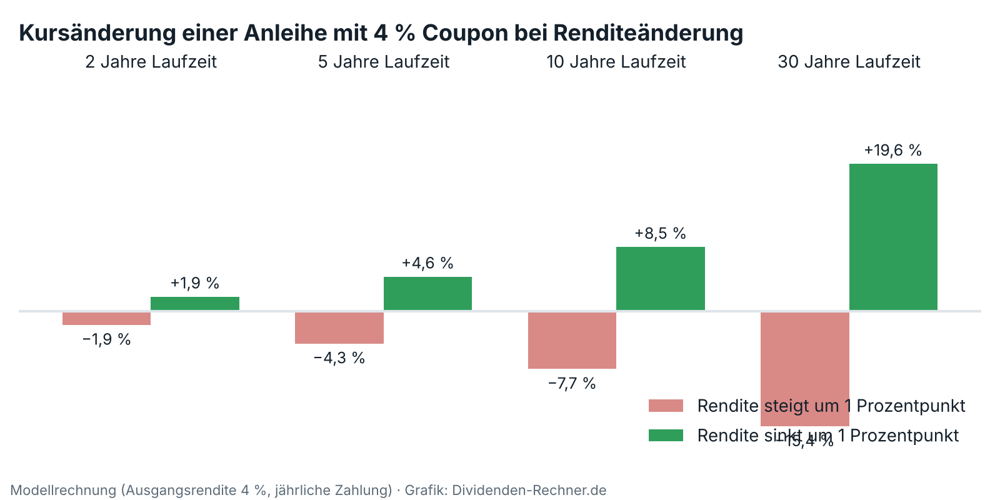

!!! kurz "Kurz gesagt"
    **UBS-Einstufung Fixed Income:** „Attraktiv“
    **Rendite 10-jährige US-Staatsanleihen:** rund 4,8 % (5.11.2026)

    1. **Die These:** Höhere Anfangsrenditen bringen laufende Erträge und ein Polster, falls die Zinsen weiter steigen. Fallen sie, steigen die Kurse. Abwarten, bis sich die Lage beruhigt hat, hält die UBS für einen Fehler.
    2. **Die Auswahl:** Hochwertige Anleihen mit mittlerer bis langer Laufzeit, Unternehmensanleihen guter Bonität mit mittlerer Laufzeit, Schwellenländeranleihen mit eher kurzer Laufzeit. Bei den längsten Laufzeiten mahnt die UBS zur Vorsicht.
    3. **Für Dividendenanleger:** Anleihen und Dividenden erfüllen unterschiedliche Aufgaben. Der Coupon ist fest, die Dividende kann wachsen oder gekürzt werden.

## Warum Anleihen wieder interessant sind

Die Renditen von Anleihen sind seit Beginn der Pandemie zum ersten Mal wieder stark gestiegen. Das macht Anleihen attraktiver, bringt aber auch Schwankungen. Die UBS nennt als Gründe Sorgen über Staatsschulden (mit unvermindert starkem Fokus auf Frankreich), geopolitische Spannungen und Engpässe bei der Energieversorgung infolge des Nahostkonflikts. Anleger verlangen mehr Rendite als Ausgleich für diese Risiken.

Das Chief Investment Office der UBS beschreibt in seiner Studie „Wie können Anleger von Anleihen profitieren – und wo ergeben sich Chancen?“ vom 29. Oktober 2026 eine bewusst unbequeme Empfehlung: Anleger sollten nicht warten, bis sich die Lage beruhigt hat. Höhere Anfangsrenditen bieten laufende Erträge und ein größeres Polster, falls die Renditen weiter steigen. Zudem könnten Anleihen profitieren, wenn die Inflation nachlässt oder das Wachstum schwächer wird. Die UBS stuft Fixed Income insgesamt als „Attraktiv“ ein. Dazu gehört der Hinweis, dass eine Bank mit Anlageprodukten im Angebot spricht. Die Studie ist eine allgemeine Information und keine persönliche Empfehlung.

## Wie eine Anleihe funktioniert

Eine Anleihe ist ein Darlehen. Der Anleger leiht einem Staat oder einem Unternehmen Geld und bekommt dafür feste Zinsen, die Coupons, und am Ende den Nennwert zurück. Erträge entstehen aus drei Quellen: den Coupons, den Kursänderungen und der Wiederanlage der Coupons.

Wichtig ist die Gegenbewegung von Kurs und Rendite. Steigt der Kurs einer bestehenden Anleihe mit festem Coupon, zahlt der Käufer für dieselben Zinsen mehr, die Rendite sinkt. Fällt der Kurs, steigt die Rendite. Wie stark der Kurs reagiert, zeigt die Duration: Je länger die Restlaufzeit, desto größer die Bewegung.

Die Grafik ist eine eigene Modellrechnung und kein UBS-Datenmaterial. Eine Anleihe mit 4 % Coupon, die zu 100 notiert, verliert bei einem Renditeanstieg um einen Prozentpunkt bei 2 Jahren Laufzeit knapp 2 %, bei 10 Jahren etwa 7,7 % und bei 30 Jahren gut 15 %. Fällt die Rendite um einen Punkt, gewinnt die Anleihe entsprechend: gut 8 % bei 10 Jahren, knapp 20 % bei 30 Jahren.

Zwei Anleihen mit gleicher Laufzeit können unterschiedlich viel bringen. Der Grund ist vor allem das Kreditrisiko: Schuldner mit schwächerer Bonität müssen mehr Rendite bieten, weil das Risiko eines Zahlungsausfalls höher ist. Hinzu kommen Liquidität (schwer handelbare Anleihen brauchen einen Aufschlag), Besteuerung, Angebot und Ratings. Die Kurve der Renditen über die Laufzeiten ändert sich zudem selten parallel, kurze, mittlere und lange Anleihen entwickeln sich deshalb unterschiedlich.

## Welche Rolle Anleihen im Portfolio spielen

Nach Einschätzung der UBS sollen Anleihen nicht nur mit Aktien um Rendite konkurrieren. Sie können Erträge liefern, Kapital erhalten und das Risiko streuen. Qualitätsanleihen sind dabei besonders wertvoll als Gegengewicht zu Aktien, aber der Vorteil ist laut UBS nicht unveränderlich: Analysen von US-Daten über ein Jahrhundert zeigen, dass Phasen mit niedriger oder wenig schwankender Inflation stets mit besserer Streuwirkung einhergingen. Bei hoher Inflation lässt sie nach.

Auch die Art der Anleihe zählt. Erstklassige Anleihen und solche mit Investment-Grade-Rating eignen sich besser für Kapitalerhalt und Streuung. Hochzinsanleihen mit niedrigerem Rating bewegen sich näher am Aktienmarkt. Statt den Höchststand der Renditen abzupassen, sollten Anleger zuerst prüfen, ob ihre Anleihen zu den finanziellen Zielen und zur langfristigen Aufteilung des Vermögens passen.

## Wo die UBS aktuell Chancen sieht

| Bereich | Einschätzung der UBS | Hinweis der UBS |
|---|---|---|
| Hochwertige Anleihen, mittlere bis lange Laufzeit | Potenzial für Kursgewinne, wertvolle Streuung. Der Renditeanstieg hat Chancen eröffnet, die Laufzeit etwas zu verlängern. | Bei den längsten Laufzeiten mehr Vorsicht |
| Unternehmensanleihen guter Bonität (höheres Investment Grade) | Attraktiver Zinsertrag bei mittleren Laufzeiten | Anleger mit Ertragsfokus ziehen kürzere Laufzeiten vor |
| Schwellenländeranleihen | Attraktive risikobereinigte Erträge: gute Renditen, günstige technische Faktoren, solide Fundamentaldaten | Höheres Kredit- und Marktrisiko, kurze Laufzeit begrenzt es |
| Ertragsstrategien, die an Zinsen gekoppelt sind | Ergänzung zu klassischen Anleihen | Komplex, mögliche Liquiditätsengpässe und Emittentenrisiko, kein Ersatz für Kernbestände |

Warum die UBS bei den längsten Laufzeiten vorsichtig ist: Zweifel an der Tragfähigkeit der öffentlichen Finanzen, die zunehmenden Anleiheemissionen rund um künstliche Intelligenz und die Möglichkeit, dass die Laufzeitprämie hoch bleibt. Die Laufzeitprämie ist der Aufschlag, den Anleger für lange Laufzeiten und die damit verbundene Zinsempfindlichkeit verlangen. Der Anleiheinvestor PIMCO hat im Juni gezeigt, wie sich diese Emissionen auswirken: Die großen Cloud-Konzerne (Hyperscaler) stellten bis Ende Mai laut PIMCO mehr als 30 % der neu ausgegebenen US-Unternehmensanleihen mit 30 Jahren Laufzeit, rund 32 Milliarden Dollar. Den Anstieg der Zehnjahresrendite seit Ende Februar führt PIMCO nur zu etwa einem Viertel auf die Laufzeitprämie zurück (13 von 51 Basispunkten), den Rest auf veränderte Erwartungen an die US-Notenbank.

## Was Dividendenanleger daraus mitnehmen

Die Rendite zehnjähriger US-Staatsanleihen lag am 5. November bei rund 4,84 %. Zum Vergleich: [Unilever](../unilever-reiner-pflegekonzern-dividende-rueckkauf/) kommt bei einer Quartalsdividende von 0,4664 Euro auf gut 3 % Dividendenrendite, [CVS Health](../cvs-health-q3-2026-aufspaltung-prognose/) auf 3,3 %. Das zeigt den Unterschied: Der Anleihe-Coupon ist fest vereinbart, und der Staat oder das Unternehmen muss ihn zahlen. Die Dividende ist freiwillig und kann gekürzt werden, sie kann aber auch wachsen. CVS hat seine Dividende seit Januar 2024 nicht mehr erhöht, andere Firmen erhöhen jedes Jahr.

Für die Praxis ergeben sich drei Fragen, die zu den Hinweisen der UBS passen:

- **Welche Aufgabe soll die Anleihe übernehmen?** Kapitalerhalt und Streuung sprechen für hochwertige Anleihen. Wer Ertrag sucht, nimmt mehr Kredit- oder Laufzeitrisiko in Kauf.
- **Wie lange kann ich Kursschwankungen aushalten?** Die Modellrechnung zeigt, dass lange Laufzeiten kräftig schwanken. Wer bis zur Fälligkeit hält, bekommt den Nennwert zurück, sofern der Schuldner zahlt.
- **In welcher Währung rechne ich?** Die 4,84 % gelten für US-Staatsanleihen in US-Dollar. Wer in Euro denkt, trägt ein Währungsrisiko.

Die Studie bleibt allgemein und nennt keine einzelnen Anleihen. Wie hoch die Zinsen im Dezember sind, entscheidet auch die US-Notenbank. Der Markt rechnet laut CME FedWatch mit über 65 % Wahrscheinlichkeit mit einer Erhöhung am 9. Dezember, wie in unserer [Wochenbilanz](../marktuebersicht-ki-trade-woche-2-bis-6-november-2026/) beschrieben.

## Was dagegen spricht

- **Steigende Zinsen kosten Kurse.** Wer jetzt kauft und die Renditen steigen weiter, sitzt vorübergehend auf einem Verlust, vor allem bei langen Laufzeiten.
- **Inflation schwächt die Streuwirkung.** Die UBS selbst sagt, dass der Vorteil von Anleihen gegenüber Aktien in Phasen hoher Inflation schwindet.
- **Die Staatsverschuldung steigt.** Das kann die Laufzeitprämie hoch halten.
- **Komplexe Produkte** mit zinsabhängigen Erträgen bringen Beschränkungen, geringere Handelbarkeit und das Risiko des Emittenten mit sich.
- **Die Studie stammt von einer Bank**, die Anlageprodukte verkauft. Sie ersetzt keine eigene Beratung.

## Worauf wir achten

- Die US-Zinsentscheidung am 9. Dezember und die Erwartungen davor.
- Die US-Inflationszahlen am 10. November.
- Neue Anleiheemissionen der großen KI-Konzerne und die Reaktion der Märkte.
- Ob die Renditen langer Laufzeiten weiter steigen.

Das ist eine Einordnung und keine Anlageberatung.

## Quellen

- UBS Chief Investment Office GWM, „Wie können Anleger von Anleihen profitieren – und wo ergeben sich Chancen?“, Investment strategy insights, 29.10.2026 (PDF, Autoren: Matthew Carter, Frederick Mellors, Achim Peijan, Daisy Tseng)
- [PIMCO: AI financing needs do not override cyclical drivers of yield, Credit Market Lens, 1.6.2026](https://www.pimco.com/eu/en/insights/ai-financing-needs-do-not-override-cyclical-drivers-of-yield)
- CNBC über StockTitan, Börsenbericht vom 6.11.2026 (Zinserwartung der Fed)
- Eigene Berechnung: Modellrechnung zur Kursänderung (Anleihe mit 4 % Coupon, jährliche Zahlung)

*Dieser Beitrag fasst die genannten Quellen in eigenen Worten zusammen. Die Grafik ist eine eigene Modellrechnung. Alle Angaben ohne Gewähr.*
