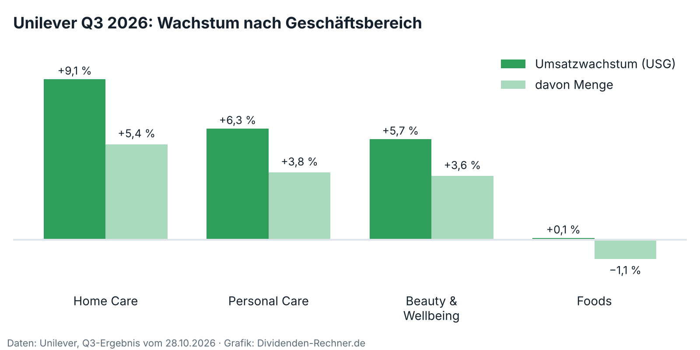

!!! kurz "Kurz gesagt"
    **Quartalsdividende:** 0,4664 € (+3 % zum Vorjahr)
    **Rendite:** gut 3 % bei rund 59,60 €

    Unilever gibt nach dem Eis auch die Lebensmittel ab und bleibt als reiner Pflegekonzern übrig. Das Wachstum ist gut, die Bilanz bekommt Luft. Offen ist, wie die Dividende nach dem Umbau aussieht.

Wer sich Unilever vor ein paar Jahren ins Depot gelegt hat, besaß einen Konzern, in dem Eis, Mayonnaise und Shampoo unter einem Dach lagen. Diese Zeiten sind bald vorbei. Das Eis ist seit Dezember 2025 als eigene Börsenfirma abgespalten, die Lebensmittel mit Knorr und Hellmann's gehen bis spätestens Mitte 2027 an den Gewürzhersteller McCormick. Übrig bleibt ein Unternehmen mit rund 39 Milliarden Euro Umsatz, das ausschließlich Körperpflege, Beauty und Haushaltsprodukte verkauft. Für Dividendenanleger ist entscheidend, ob dieser kleinere Konzern die Ausschüttung tragen kann.

## Warum sich Unilever trennt

Die Zahlen des dritten Quartals liefern die Begründung. Der Umsatz wuchs um 5,2 %, davon 2,9 Punkte aus höherer Menge. Die Jahresziele hob der Konzern an. Doch das Wachstum verteilt sich ungleich: Haushaltsprodukte legten um 9,1 % zu, Körperpflege um 6,3 %, die Lebensmittel nur um 0,1 %, bei sinkender Menge. Genau dieses Geschäft gibt Unilever ab.

Der Umbau verbessert zudem die Bilanz. McCormick zahlt 15,7 Milliarden US-Dollar in bar, die Lebensmittelsparte wird mit rund 44,8 Milliarden bewertet. Das Geld soll in den Schuldenabbau fließen und in Aktienrückkäufe von 6 Milliarden Euro bis 2029. Weniger Aktien bedeuten, dass sich dieselbe Dividendensumme auf weniger Papiere verteilt. Dazu kommt ein Sparziel von 1 Milliarde Euro bis 2029, [auf dem Investor Event](../unilever-investor-event-reines-pflegegeschaeft/) vorgestellt, und eine neue Führung ab Januar 2027. Mittelfristig peilt Unilever 4 bis 6 % Wachstum im Jahr an. Die Details zum Quartal stehen im [Bericht zu den Zahlen](../unilever-q3-2026-trading-statement/).

## Die offene Dividendenfrage

Die Quartalsdividende liegt bei 0,4664 Euro, gut 3 % mehr als vor einem Jahr, aufs Jahr gerechnet rund 1,87 Euro und bei 59,60 Euro Kurs eine Rendite von gut 3 %. Eine Aussage zur Dividendenpolitik nach dem Umbau hat Unilever weder bei den Zahlen noch auf dem Investor Event gemacht. Das ist die Lücke im Bild. Mit Eis und Lebensmitteln verlässt ein großer Teil der Erträge den Konzern, die Dividende muss künftig aus dem Pflegegeschäft kommen, das höhere Margen, aber weniger Umsatz hat. Rückkäufe und Schuldenabbau sprechen dafür, dass der Spielraum reicht. Zugesagt ist damit nichts.

## Risiken

Der Deal ist noch nicht abgeschlossen, die McCormick-Aktionäre und die Behörden müssen zustimmen. Scheitert er, fehlen das Geld und die klare Struktur. Das Sparziel ist nur zum Teil frei verfügbar, weil ein Teil Kosten deckt, die nach dem Verkauf der Lebensmittel übrig bleiben. Und mehr als zwei Punkte des Wachstums kamen aus höheren Preisen, die Unilever mit Rohstoffkosten begründet. Sinken diese, könnte der Spielraum schrumpfen. Auch das Margenziel ist mit einer „moderaten“ Verbesserung bescheiden: Der Umbau soll zuerst Wachstum und Struktur bringen, die Ertragskraft folgt in kleinen Schritten.

## Worauf es als Nächstes ankommt

Die Zustimmung der McCormick-Aktionäre, eine Aussage zur Dividendenpolitik und die Frage, ob das Mengenwachstum im Pflegegeschäft bei mindestens 3 % bleibt. Die Zahlen für das Gesamtjahr folgen im Frühjahr 2027.

Das ist eine Einordnung der Zahlen und keine Kaufempfehlung.

## Quellen

- [Unilever: Q3-2026-Ergebnis „Continued strong performance in the third quarter“, 28.10.2026](https://www.unilever.com/news/press-and-media/press-releases/2026/continued-strong-performance-in-the-third-quarter/)
- [Unilever: Vorabmeldung zum Investor Event, 3.11.2026](https://www.unilever.com/investors/)
- [Investing.com: Unilever targets €1 billion in savings by 2029](https://in.investing.com/news/stock-market-news/unilever-targets-1-billion-in-savings-by-2029-93CH-5675880)
- [ad-hoc-news: Unilever stock weighs 1 billion euro savings plan after investor event, 5.11.2026](https://www.ad-hoc-news.de/boerse/news/corporate-news/unilever-stock-weighs-1-billion-euro-savings-plan-after-investor-event/70462629)
- [ad-hoc-news: Unilever stock faces strategy test with 1 billion euros savings plan, 4.11.2026](https://www.ad-hoc-news.de/boerse/news/corporate-news/unilever-stock-faces-strategy-test-with-1-billion-euros-savings-plan/70455630)
- [MarketScreener: Unilever confirms McCormick foods deal for USD 44.8 billion](https://www.marketscreener.com/news/unilever-confirms-mccormick-foods-deal-for-usd44-8-billion-ce7e51dedd8af521)
- [Food Engineering: McCormick to combine with Unilever Foods business](https://www.foodengineeringmag.com/articles/103615-mccormick-to-combine-with-unilever-foods-business)
- [Börse Express: Unilever-Aktie, 1,5-Milliarden-Buyback bis Juli, 2.5.2026](https://www.boerse-express.com/news/articles/unilever-aktie-15-milliarden-buyback-bis-juli-900607)

*Dieser Beitrag fasst Unternehmensangaben und Berichterstattung der genannten Quellen in eigenen Worten zusammen. Eigene Berechnungen sind als solche gekennzeichnet. Alle Angaben ohne Gewähr.*
