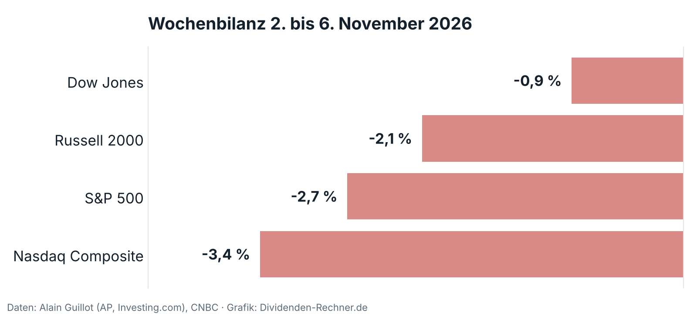
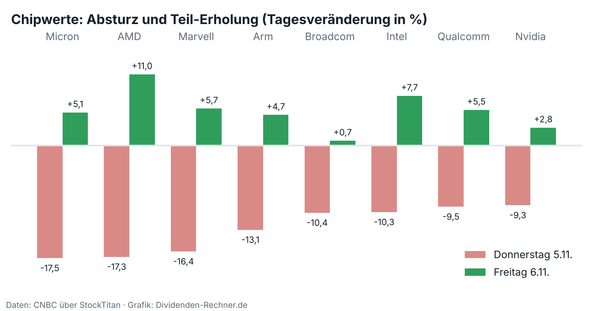

!!! kurz "Kurz gesagt"
    **Nasdaq Composite:** −3,4 % in der Woche
    **S&P 500:** −2,7 % in der Woche
    **Dow Jones:** −0,9 % in der Woche

    Auslöser des Ausverkaufs war die Kongresswahl, verstärkt haben ihn hohe Bewertungen und Zinssorgen. Gegen eine Trendwende im KI-Boom sprechen die Investitionspläne und Auftragsbücher der Konzerne.

Die Woche begann ruhig und endete als die schwächste seit Juni. Zuerst fiel der Ölpreis, weil sich eine Annäherung zwischen den USA und dem Iran abzeichnete: Brent rutschte unter 100 Dollar, eine Woche zuvor waren es noch rund 112. Dann gewannen die Demokraten beide Kammern des Kongresses, und der Dow sprang am Mittwoch um 3 %. Am Donnerstag kippte alles. Der Nasdaq verlor 5,5 %, der S&P 500 4,4 %, der schwächste Handelstag seit April 2025, und alle elf Sektoren schlossen im Minus. Am stärksten traf es die Unternehmen, die den KI-Ausbau beliefern.

## Politik als Auslöser, Bewertung als Verstärker

Der Ausverkauf hat einen politischen Kern. Die Demokraten gewannen auch dort, wo viele Rechenzentren entstehen, etwa in Texas, und steigende Strompreise waren dort ein Wahlkampfthema. Anleger fürchten nun Auflagen und höhere Kosten für den Netzanschluss. Die UBS sieht rund 30 % der bis 2028 erwarteten neuen Rechenzentrumskapazität in den USA in Gefahr, allein in Texas 18 Gigawatt. Gesetze gibt es bisher keine, es geht um die Erwartung.

Dass diese Erwartung so heftig durchschlug, liegt an der Ausgangslage. Nach einem langen Anstieg war viel Gutes in den Kursen eingepreist, und die Stimmung hatte schon vorher gelitten: Alphabet, Amazon und Intel hatten enttäuscht, Apple und Palantir gaben schwächere Ausblicke. Nvidia fiel am Donnerstag unter den Schlusskurs von Ende 2025, der Jahresgewinn vieler KI-Werte war dünner, als es die Schlagzeilen vermuten ließen.

Hinzu kommen die Zinsen. Der Markt sieht die Wahrscheinlichkeit einer Zinserhöhung am 9. Dezember bei über 65 %. Der Arbeitsmarktbericht vom Freitag verschärfte das: 165.000 neue Stellen statt der erwarteten 60.000, die Arbeitslosenquote sank auf 4,1 %. Für die Konjunktur ist das gut, für Wachstumsaktien mit Gewinnen in ferner Zukunft ist es ein Problem, denn die Renditen stiegen.

## Was gegen eine Wende spricht

Die Konzerne planen unverändert. Die großen Cloud-Anbieter investierten im dritten Quartal rund 227 Milliarden Dollar, für 2026 werden 803 bis 828 Milliarden erwartet. Amazon kündigte für 2027 „deutlich mehr“ an. Die UBS rechnet eher mit einer Verschiebung von 2027 auf 2028 als mit einer Absage, und die Auftragsbücher sind voll: Quanta Services meldete einen Rekordbestand von 63,7 Milliarden Dollar, bei Micron sind über 75 % der Produktion für 2027 bereits zugesagt. Lam Research startete einen Rückkauf über 25 Milliarden Dollar, das Management sieht die Lage gelassener als der Markt.

Am Freitag holten acht große Chipwerte im Schnitt gut ein Drittel der Verluste wieder auf, Intel zwei Drittel, Broadcom nur 6 %.

Ein Erholungstag entscheidet nichts. Zum Test wird die kommende Woche: Fallen die US-Inflationszahlen am Dienstag hoch aus oder kommen aus den Bundesstaaten konkrete Auflagen für Rechenzentren, kann die Korrektur weitergehen. Beide Lager haben Argumente, und der Markt gewichtet sie im Wochentakt neu.

## Was das für Dividendenanleger heißt

Der Dow mit seinen Standardwerten verlor 0,9 %, der Nasdaq 3,4 %. Dividendentitel sind damit glimpflicher davongekommen, eine Garantie ist das nicht. Mehrere Unternehmen hoben in der Woche ihre Ausschüttung an: [**Simon Property Group**](../simon-property-group-q3-2026-dividende-erhoehung/) auf 2,30 US-Dollar je Quartal, [**Regency Centers**](../regency-centers-q3-2026-dividende-erhoehung/) um 6 % auf 0,80 US-Dollar, und [**Enbridge**](../enbridge-q3-2026-rekord-ebitda-prognose-bestaetigt/) zum 31. Mal in Folge. [**Lam Research**](../lam-research-startet-25-mrd-usd-rueckkauf-und-dividende/) zahlt 0,33 US-Dollar und stockt den Rückkauf auf. Versorger wie [**Con Edison**](../con-edison-q3-2026-zahlen/) und [**PPL**](../ppl-corporation-q3-2026-zahlen/) lieferten solide Zahlen, stehen aber in einer Zwickmühle: Der Strombedarf der Rechenzentren treibt ihr Wachstum, zugleich wächst der politische Druck auf die Strompreise.

Der Maßstab bleibt die Rendite zehnjähriger US-Staatsanleihen, am Donnerstag rund 4,84 %. Solange sichere Anleihen so viel abwerfen, müssen Dividendenaktien mit steigenden Ausschüttungen überzeugen. Wie Anleihen funktionieren und was die UBS dazu sagt, erklärt [unser Beitrag zu Anleihen](../anleihen-ubs-chancen-renditen-portfolio/).

## Quellen

- Alain Guillot, „Stock Market Recap, November 6, 2026“ (Indexdaten von AP und Investing.com)
- CNBC über StockTitan, „The Stock Market Today Live, November 6, 2026“ (Chipwerte, Arbeitsmarkt, Zinserwartung, Zitat Jefferies)
- Finimize, „UBS flags a post-midterms speed bump for data centers“, 4.11.2026
- TIKR, „Micron sinks 6% as Democratic sweep stokes fears of an AI slowdown in build“, 4.11.2026
- Business Insider über Hargreaves Lansdown, Auswertung der Investitionen großer Cloud-Konzerne, 30.10.2026
- La Nación (AP), „How major US stock indexes fared Wednesday 11/4/2026“
- Trading-Treff, „Nasdaq 100: Wahlergebnis bremst KI-Rally“, 4.11.2026
- Eigene Auswertungen: Unternehmensmeldungen auf Dividenden-Rechner.de

*Dieser Beitrag fasst die Berichterstattung der genannten Medien in eigenen Worten zusammen. Kurzzitate sind als solche gekennzeichnet. Die Grafiken sind eigene Darstellungen auf Basis der genannten Daten. Alle Angaben ohne Gewähr.*
