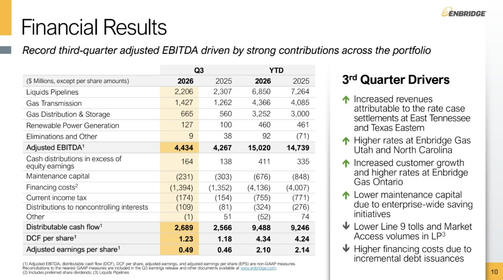
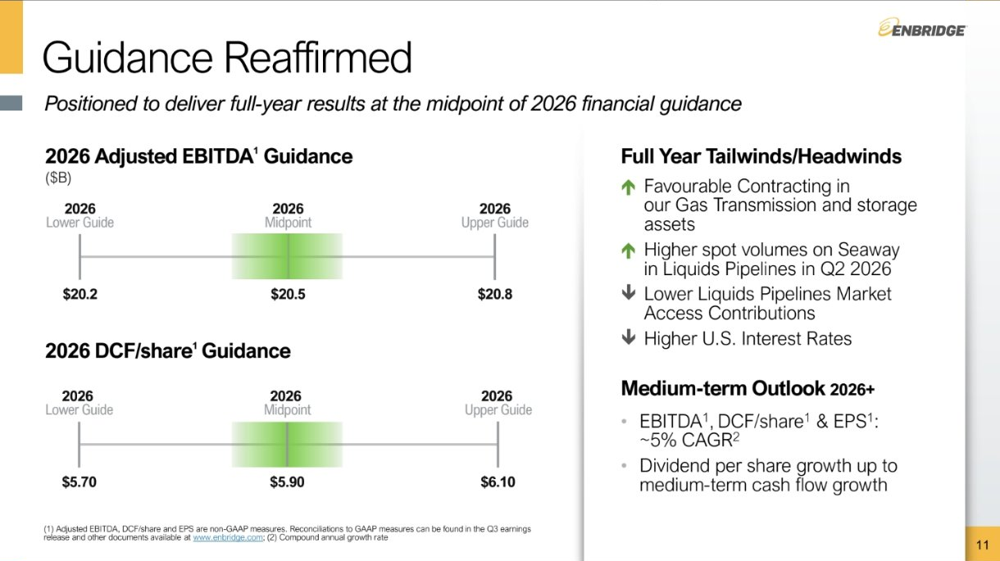
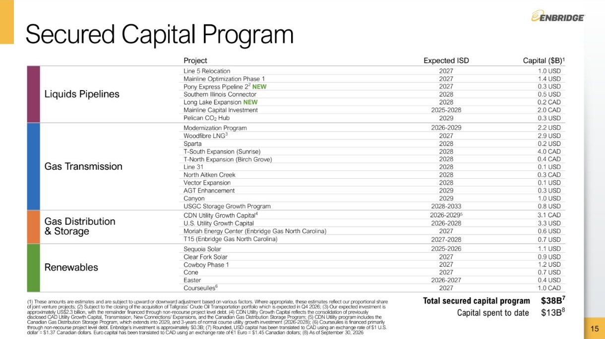
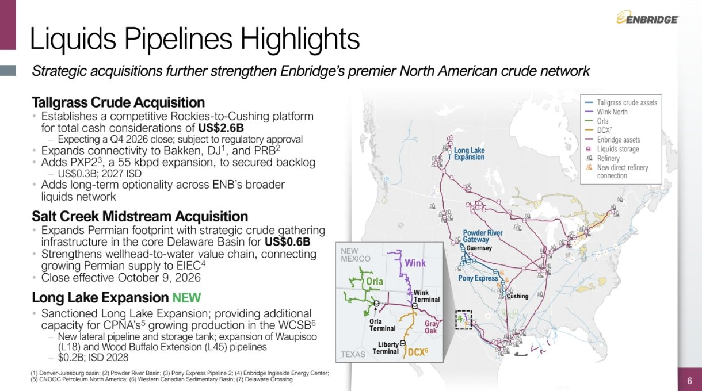

<!-- PRÜFEN: Quelle: Präsentation Enbridge Q3 2026 (Screenshots von Divi, Folien 4 bis 15). Pressemitteilung nicht gelesen; Umsatz und Nettogewinn stehen nicht auf den Folien. Währung: kanadische Dollar (Folie "$ Millions", Kapitalfolie "in billions of CAD"), im Text als C$ angegeben. -->
<!-- PRÜFEN: Divi nannte "Greg Abel"; die Folie nennt Greg Ebel (President & CEO, Ruhestand Ende 2026) und Michelle Harradence (ab 1.1.2027). Name nach Folie übernommen; CEO-Foto von Divi gilt als Ebel. Kein Kursbild; Kursreaktion nicht geprüft. -->
<!-- PRÜFEN: Aufmacherfoto (Pipelines) und Logo von Divi, Quelle/Rechte unverifiziert. "Dividende steigt im 31. Jahr in Folge" aus Folie "31 consecutive years of annual dividend increases"; Betrag der neuen Dividende steht nicht in den Folien. -->

!!! kurz "Kurz gesagt"
    **EBITDA:** 4,4 Mrd. C$ (+4 %)
    **Cashflow:** 2,7 Mrd. C$ (+5 %)

    1. **Rekord im dritten Quartal:** Das bereinigte EBITDA steigt auf 4.434 Mio. C$ (Vorjahr 4.267 Mio.), getragen von Gasleitungen und Gasversorgern.
    2. **Prognose bestätigt:** Für 2026 peilt Enbridge 20,2 bis 20,8 Mrd. C$ EBITDA an und liegt zur Mitte des Korridors.
    3. **Führungswechsel:** Konzernchef Greg Ebel geht Ende 2026, Michelle Harradence folgt am 1. Januar 2027.

## Enbridge im dritten Quartal: Gasgeschäft treibt das Rekord-EBITDA

Der kanadische Pipelinekonzern Enbridge hat im dritten Quartal 2026 ein bereinigtes EBITDA von 4.434 Mio. kanadischen Dollar (C$) erzielt, nach 4.267 Mio. C$ im Vorjahresquartal (+4 %). Über die ersten neun Monate liegt es bei 15.020 Mio. C$ (+2 %). Der ausschüttbare Cashflow (DCF) steigt im Quartal auf 2.689 Mio. C$ (Vorjahr 2.566 Mio.), je Aktie auf 1,23 C$ (+4 %). Der bereinigte Gewinn je Aktie liegt bei 0,49 C$ (+7 %), nach neun Monaten bei 2,10 C$ (Vorjahr 2,14 C$).

Der Zuwachs kommt aus den Gassparten. Die Gasleitungen (Gas Transmission) steigern das EBITDA von 1.262 auf 1.427 Mio. C$, die Gasversorger und Speicher (Gas Distribution & Storage) von 560 auf 665 Mio. C$, die erneuerbare Stromerzeugung von 100 auf 127 Mio. C$. Die Ölpipelines (Liquids Pipelines) verdienen dagegen weniger: 2.206 statt 2.307 Mio. C$.

## Was den Quartalsgewinn bewegt hat

Als Treiber nennt Enbridge höhere Erlöse durch Tarifabschlüsse bei den Leitungen East Tennessee und Texas Eastern, höhere Tarife bei Enbridge Gas in Utah und North Carolina sowie mehr Kunden und höhere Tarife bei Enbridge Gas Ontario. Die Ausgaben für die Instandhaltung sanken auf 231 Mio. C$ (Vorjahr 303 Mio.), weil der Konzern Sparprogramme umgesetzt hat. Dämpfend wirkten niedrigere Gebühren bei der Ölleitung Line 9 und geringere Mengen im Market-Access-Geschäft der Ölpipelines sowie höhere Finanzierungskosten durch neue Schulden. Die Finanzierungskosten stiegen auf 1.394 Mio. C$ (Vorjahr 1.352 Mio.).

## Prognose bestätigt, Ziel bei mittelfristig 5 % Wachstum

Enbridge bestätigt die Prognose für 2026 und will bei der Mitte des Korridors landen: 20,5 Mrd. C$ bereinigtes EBITDA (Spanne 20,2 bis 20,8 Mrd.) und 5,90 C$ Cashflow je Aktie (Spanne 5,70 bis 6,10 C$). Für die Jahre danach nennt der Konzern ein Wachstum von rund 5 % pro Jahr bei EBITDA, Cashflow je Aktie und Gewinn je Aktie. Die Dividende soll höchstens so schnell wachsen wie der mittelfristige Cashflow. Als Rückenwind sieht Enbridge günstige Verträge bei Gasleitungen und Speichern, als Gegenwind niedrigere Beiträge aus dem Market-Access-Geschäft der Ölpipelines und höhere US-Zinsen.

## Dividende, Rückgabe an Aktionäre und Investitionen

Enbridge hat die Dividende laut Folie 31 Jahre in Folge jährlich erhöht. Die Ausschüttung soll 60 bis 70 % des ausschüttbaren Cashflows betragen. In den vergangenen fünf Jahren flossen 39 Mrd. US-Dollar an die Aktionäre, für die nächsten fünf Jahre erwartet der Konzern 40 bis 45 Mrd. US-Dollar. Für das jährliche Wachstumskapital von 10 bis 11 Mrd. C$ nennt die Folie Eigenfinanzierung beim Eigenkapital, die Verschuldung soll beim 4,5- bis 5,0-Fachen des EBITDA bleiben. Das gesicherte Investitionsprogramm umfasst 38 Mrd. C$, davon sind 13 Mrd. bereits ausgegeben.

## Zukäufe bei Pipelines und Gasversorgern

Bei den Ölpipelines baut Enbridge das Netz aus: Der Kauf der Tallgrass-Rohölsparte für 2,6 Mrd. US-Dollar soll im vierten Quartal abgeschlossen werden und braucht noch die Zustimmung der Behörden. Den Kauf von Salt Creek Midstream für 0,6 Mrd. US-Dollar hat Enbridge am 9. Oktober vollzogen. Dazu kommt die neue Erweiterung Long Lake. Bei den Gasversorgern will Enbridge Gas Utah Vermögenswerte von Laramie Energy für 0,5 Mrd. US-Dollar kaufen, der Abschluss ist für das vierte Quartal geplant.

## Führungswechsel zum Jahresende

Konzernchef Greg Ebel geht Ende 2026 in den Ruhestand. Michelle Harradence übernimmt laut Präsentation am 1. Januar 2027 das Amt als President und CEO. Die nächsten Termine: Die Prognose für 2027 veröffentlicht Enbridge am 2. Dezember 2026, der Enbridge Day folgt am 31. März 2027.

## Was die Zahlen offen lassen

Die Folien nennen weder Umsatz noch Nettogewinn und keine Höhe der neuen Dividende. Auch wie die Aktie auf die Zahlen reagiert, ist hier nicht geprüft. Der Rückgang bei den Ölpipelines zeigt, dass das Wachstum derzeit vom Gasgeschäft getragen wird; ob die Zukäufe das ausgleichen, hängt vom Abschluss im vierten Quartal ab.

## Quellen

- Enbridge, Präsentation zum dritten Quartal 2026 (Q3 2026)

*Dieser Beitrag fasst die Berichterstattung der genannten Quellen in eigenen Worten zusammen. Alle Angaben ohne Gewähr.*
