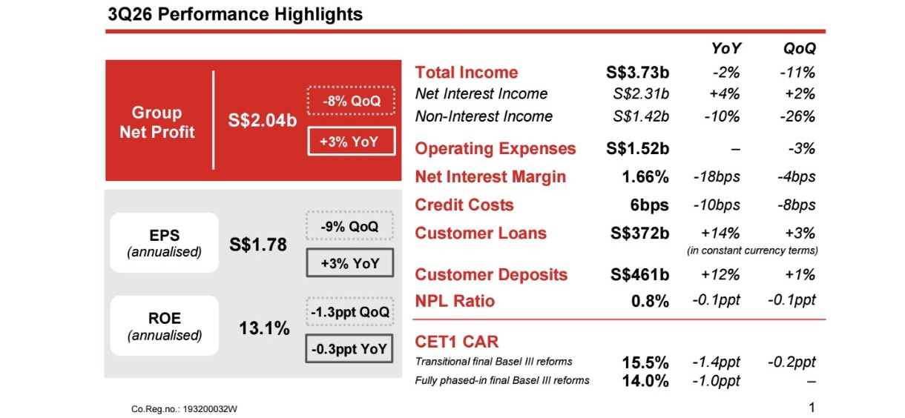
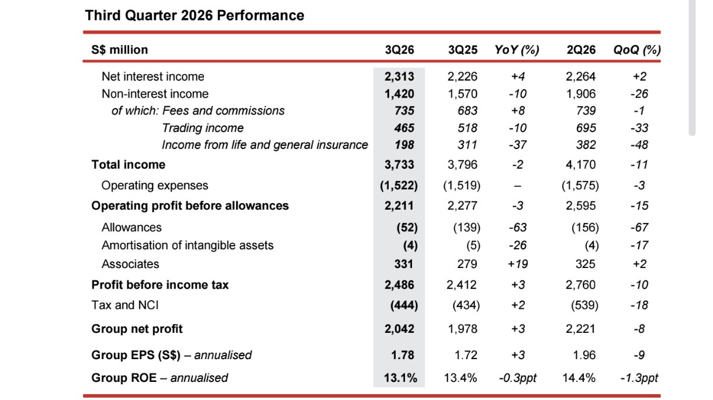
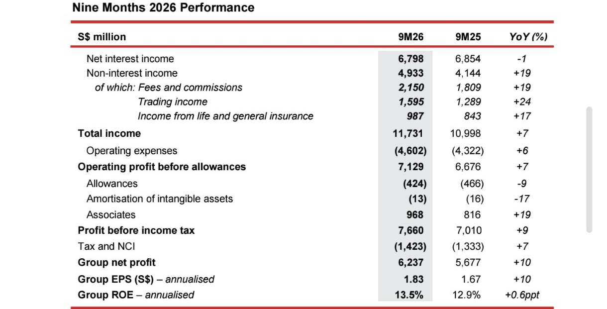
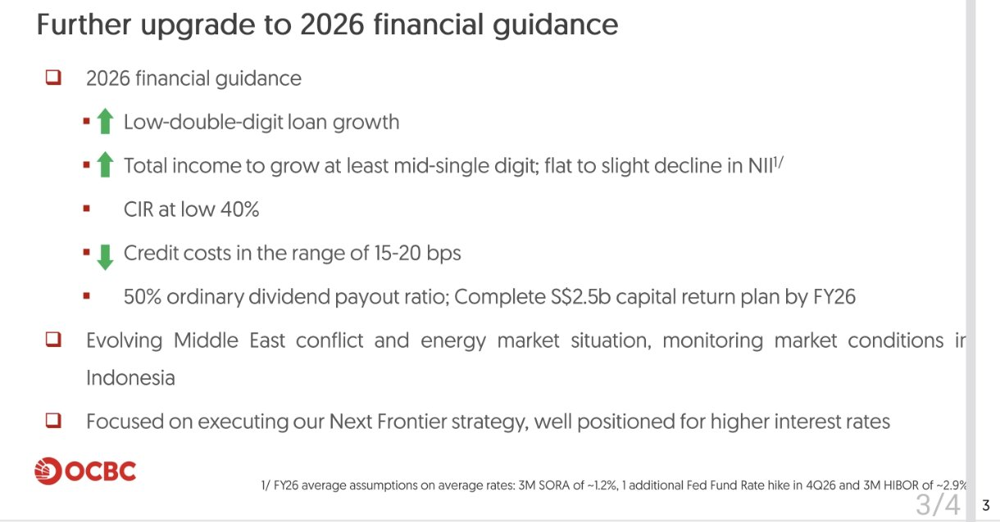

<!-- PRÜFEN: Quelle: Pressemitteilung "Third Quarter 2026 Results" und CEO-Präsentation von OCBC vom 06.11.2026 (Screenshots von Divi, Seiten 1 bis 8 und Folien 2 und 3). Kein Kursbild, keine Kursreaktion geprüft. -->
<!-- PRÜFEN: Aufmacherfoto (OCBC-Zentrale, nur 580 px, hochgerechnet) und CEO-Foto (Tan Teck Long, 371 px) von Divi, Rechte unverifiziert. Logo aus der Pressemitteilung ausgeschnitten, kleine Auflösung. -->
<!-- PRÜFEN: "Rückkaufprogramm" in der Story: Die Folie sagt "Complete S$2.5b capital return plan by FY26" (Kapitalrückgabe, Art nicht genannt); Wortlaut ggf. anpassen. Dividende je Aktie steht nicht in den Screenshots. -->

!!! kurz "Kurz gesagt"
    **Erträge:** 3,73 Mrd. S$ (−2 %)
    **Gewinn:** 2,04 Mrd. S$ (+3 %)

    1. **Bankgeschäft auf Rekord:** Der Gewinn der Banking Operations steigt auf 1,90 Mrd. S$ (+16 % zum Vorjahr, +8 % zum Vorquartal).
    2. **Versicherungstochter drückt:** Great Eastern verbucht Wertverluste auf Anleihen, der Konzerngewinn liegt 8 % unter dem Rekord des zweiten Quartals.
    3. **Prognose erneut angehoben:** Kredite sollen niedrig zweistellig wachsen, die Erträge mindestens mittel einstellig; Dividendenquote 50 %.

## OCBC im dritten Quartal: Gewinn 3 % höher, Bankgeschäft auf Rekord

Oversea-Chinese Banking Corporation (OCBC), eine der drei großen Banken Singapurs, hat im dritten Quartal 2026 einen Konzerngewinn von 2,04 Mrd. Singapur-Dollar (S$) erzielt. Das sind 3 % mehr als vor einem Jahr und 8 % weniger als im zweiten Quartal, das einen Rekord markiert hatte. Der Gewinn je Aktie liegt auf das Jahr gerechnet bei 1,78 S$ (+3 %), die Eigenkapitalrendite bei 13,1 % (Vorjahr 13,4 %). Die Erträge sinken um 2 % auf 3,73 Mrd. S$, die Kosten bleiben mit 1,52 Mrd. S$ unverändert.

Das reine Bankgeschäft läuft dagegen auf Rekordniveau. Der Gewinn der Banking Operations steigt zum Vorquartal um 8 % auf 1,90 Mrd. S$. Die Erträge und der Gewinn des Bankgeschäfts erreichen laut CEO Tan Teck Long neue Höchststände (+7 % und +16 % zum Vorjahr).

## Zinsüberschuss und Gebühren wachsen, die Marge schrumpft

Der Zinsüberschuss steigt um 4 % auf 2,31 Mrd. S$, der höchste Wert seit sechs Quartalen. Die Kredite an Kunden wachsen um 14 % auf 372 Mrd. S$ (währungsbereinigt +14 %), die Einlagen um 12 % auf 461 Mrd. S$. Die Zinsmarge sinkt um 18 Basispunkte auf 1,66 %, weil das Zinsniveau im Jahresvergleich niedriger liegt. Im Vergleich zum Vorquartal drückte der Anstieg der US-Zinsen die Marge, weil sich die Finanzierung schneller verteuerte als die Erträge aus den Krediten. Laut Mitteilung sollen sich höhere US-Zinsen in den kommenden Quartalen positiv auswirken, wenn die Anlagen neu bewertet werden.

Die Gebühren steigen um 8 % auf 735 Mio. S$, getragen von Vermögensverwaltung, Krediten und Handelsfinanzierung. Der Kundenhandel erreicht mit 480 Mio. S$ einen Rekord (+29 % laut CEO). Das gesamte Handelsergebnis fällt dagegen um 10 % auf 465 Mio. S$.

## Great Eastern verbucht Verluste auf Anleihen

Die Belastung kommt von Great Eastern, der Versicherungstochter. Der Versicherungsertrag fällt um 37 % zum Vorjahr und um 48 % zum Vorquartal. Great Eastern verbuchte Bewertungsverluste auf seine Anleihebestände, weil die Zinsen im Quartal stiegen, und es fehlten die hohen Gewinne aus Aktien, die im zweiten Quartal angefallen waren. Das Geschäft selbst läuft laut OCBC stabil: Der Wert des Neugeschäfts (NBEV) wächst um 14 %, die Marge liegt bei 57,5 % (Vorquartal 51,0 %). Der Beitrag von Great Eastern zum Konzernergebnis für die neun Monate steigt um 5 % auf 941 Mio. S$.

## Wenig Vorsorge für Kreditausfälle

Die Qualität der Kredite bleibt gut. Die Quote notleidender Kredite sinkt auf 0,8 % (Vorjahr 0,9 %), die Deckung der notleidenden Vermögenswerte liegt bei 168 %. Für Risikovorsorge setzt OCBC nur 52 Mio. S$ an, nach 139 Mio. S$ im Vorjahr. Die Kreditkosten betragen 6 Basispunkte. Die harte Kernkapitalquote (CET1) liegt bei 15,5 % und damit 1,4 Prozentpunkte unter dem Vorjahr, bei voller Anwendung der neuen Baseler Regeln bei 14,0 %.

## Neun Monate: Rekordgewinn von 6,24 Mrd. S$

Über die ersten neun Monate steigt der Gewinn um 10 % auf einen Rekord von 6,24 Mrd. S$. Die Erträge wachsen um 7 % auf 11,73 Mrd. S$, die Zinserträge sinken leicht um 1 %, die Erträge ohne Zinsen legen um 19 % zu. Bei den Gebühren aus der Vermögensverwaltung gibt es ein Plus von 25 % auf 1,33 Mrd. S$.

## Prognose für 2026 erneut angehoben

OCBC erhöht die Ziele für 2026. Das Kreditwachstum soll im niedrigen zweistelligen Bereich liegen, die Erträge um mindestens einen mittleren einstelligen Satz steigen, wobei der Zinsüberschuss gleich bleiben oder leicht sinken soll. Das Verhältnis von Kosten zu Erträgen soll bei niedrigen 40 % liegen, die Kreditkosten bei 15 bis 20 Basispunkten. Die Ausschüttungsquote der ordentlichen Dividende bleibt bei 50 %, dazu will OCBC ein Kapitalrückgabeprogramm von 2,5 Mrd. S$ bis zum Ende des Geschäftsjahres 2026 abschließen. Als Annahme gilt unter anderem eine weitere Zinserhöhung der US-Notenbank im vierten Quartal.

## Was die Zahlen offen lassen

Laut Konzernchef Tan Teck Long bleibt die Lage unsicher: Geopolitische Spannungen und Inflationsrisiken belasten die Aussichten, vieles hängt davon ab, ob sich die Energiepreise nach dem Krieg im Nahen Osten beruhigen. Auch die Lage in Indonesien beobachte die Bank genau. Zur Höhe der Dividende je Aktie machen die Unterlagen keine Angaben. Wie sich die Aktie nach den Zahlen entwickelt, ist hier nicht geprüft.

## Quellen

- OCBC, Pressemitteilung „Third Quarter 2026 Results“, 6.11.2026
- OCBC, CEO-Präsentation zum dritten Quartal 2026

*Dieser Beitrag fasst die Berichterstattung der genannten Quellen in eigenen Worten zusammen. Alle Angaben ohne Gewähr.*
