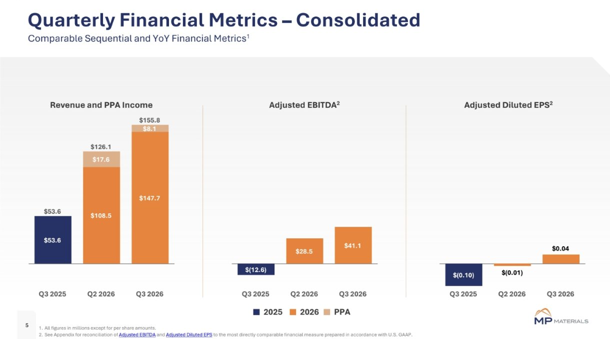
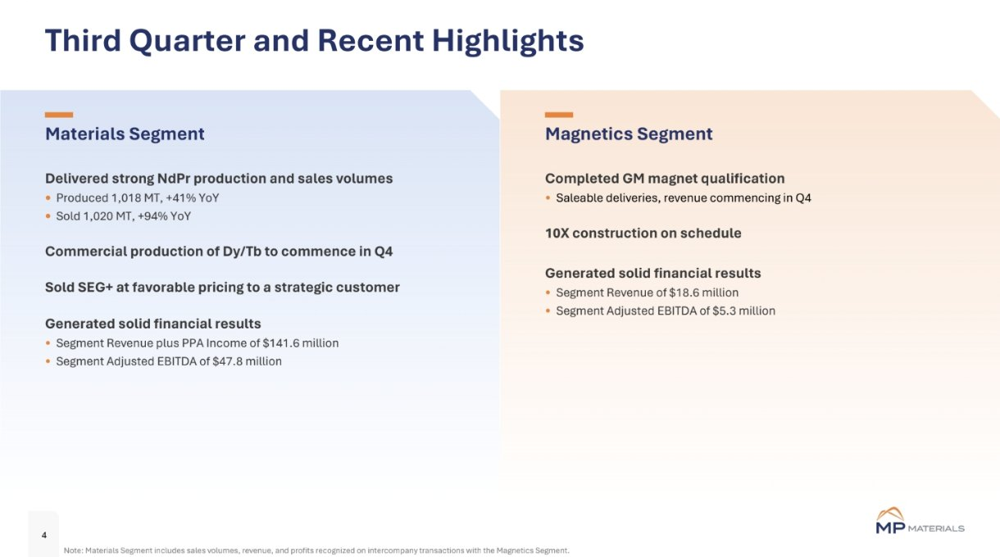
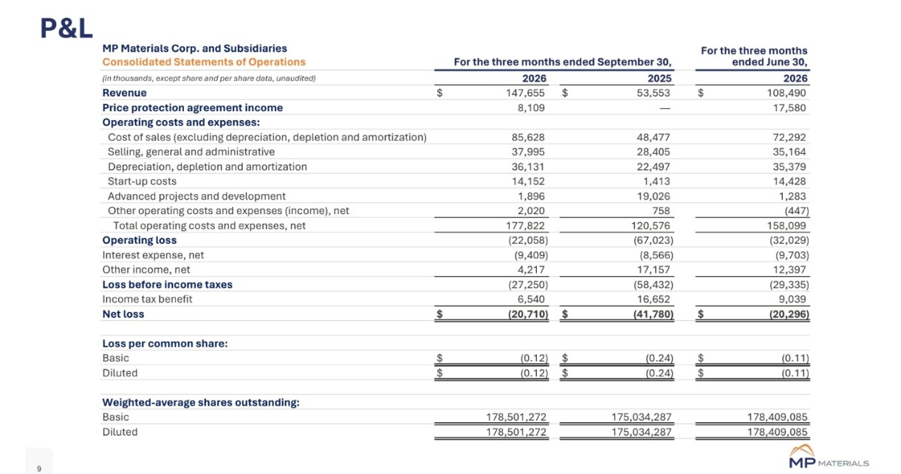

<!-- PRÜFEN: Quelle: 8-K / Pressemitteilung Q3 2026 vom 05.11.2026 (SEC), Präsentation (Screenshots von Divi, Folien 4, 5, 9) und Yahoo Finance (Kurs, Screenshot von Divi). Erwartungen der Analysten (FactSet −0,02 USD) laut MarketScreener-Schlagzeile, nicht selbst geprüft. -->
<!-- PRÜFEN: Aufmacherfoto und CEO-Foto von Divi (Rechte/Pressebild-Status unverifiziert); CEO-Name von Divi genannt. Aufmacher: Foto der Anlage Mountain Pass angenommen, Bildunterschrift nicht bestätigt. -->
<!-- PRÜFEN: Kein Kursbild in der Story (nur Folie). Kursrückgang 5.11. (−6,04 %) lag VOR der Veröffentlichung (Zahlen nach Börsenschluss, Call 14 Uhr Pazifik); vorbörslich +4,56 % laut Yahoo Finance, Stand 5:08 Uhr EST am 6.11. -->
<!-- PRÜFEN: "Preisschutz-Abkommen" (PPA) = Preisuntergrenze des Pentagons für NdPr (110 US-Dollar je kg seit 1.10.2025, laut Mining.com vom 6.11.2025); Zuordnung der 8,1 Mio. zur Preisuntergrenze nach Folie "Revenue and PPA Income". -->

!!! kurz "Kurz gesagt"
    **Umsatz:** 148 Mio. $ (+176 %)
    **Verlust:** 21 Mio. $ (zuvor 42)

    1. **Umsatz fast verdreifacht:** Der Umsatz steigt auf 147,7 Mio. US-Dollar (Vorjahr 53,6 Mio.), dazu kommen 8,1 Mio. Dollar Ausgleichszahlung aus dem Preisschutz-Abkommen.
    2. **Bereinigt im Plus:** Das bereinigte EBITDA liegt bei 41,1 Mio. US-Dollar (Vorjahr minus 12,6 Mio.), der bereinigte Gewinn je Aktie bei 0,04 US-Dollar (Vorjahr minus 0,10).
    3. **Magnete folgen im vierten Quartal:** Die Qualifizierung für GM ist abgeschlossen, Umsatz daraus gibt es ab dem vierten Quartal.

## MP Materials im dritten Quartal: Neodym treibt den Umsatz

MP Materials, der größte Förderer Seltener Erden in den USA, hat im dritten Quartal 2026 deutlich mehr umgesetzt. Der Umsatz stieg um 176 % auf 147,7 Mio. US-Dollar, im zweiten Quartal waren es 108,5 Mio. gewesen. Zusammen mit 8,1 Mio. US-Dollar aus dem Preisschutz-Abkommen (PPA) mit dem US-Verteidigungsministerium ergeben sich 155,8 Mio. US-Dollar. Das bereinigte EBITDA drehte von minus 12,6 auf plus 41,1 Mio. US-Dollar, im zweiten Quartal lag es bei 28,5 Mio. Der bereinigte Gewinn je Aktie betrug 0,04 US-Dollar nach minus 0,10 vor einem Jahr. Analysten hatten laut FactSet mit einem kleinen Verlust gerechnet (minus 0,02 US-Dollar).

Der Zuwachs kommt fast vollständig aus dem Geschäft mit dem Rohstoff. Die Sparte Materials erlöste 133,5 Mio. US-Dollar (+322 %) und verdiente bereinigt 47,8 Mio. US-Dollar. Produziert wurden 1.018 Tonnen Neodym-Praseodym-Oxid (NdPr), 41 % mehr als im Vorjahr, verkauft 1.020 Tonnen (+94 %). Die Gesamtproduktion an Seltenerd-Oxiden sank dagegen um 3 % auf 12.887 Tonnen. Dazu kam ein Verkauf des Produkts SEG+ für 31,6 Mio. US-Dollar an einen US-Kunden aus der Luft- und Raumfahrt und Verteidigung, laut Unternehmen zu günstigen Preisen.

## Magnete: Qualifizierung bei GM geschafft, Umsatz erst ab Q4

Im Magnetgeschäft ist der Umsatz noch klein und gesunken. Die Sparte Magnetics erlöste 18,6 Mio. US-Dollar (−15 %), das bereinigte EBITDA fiel um 44 % auf 5,3 Mio. US-Dollar. Der Fortschritt liegt anderswo: Die Qualifizierung der Magnete für den Autohersteller GM ist abgeschlossen, die Auslieferung der verkaufsfähigen Magnete beginnt, Umsatz daraus erwartet das Unternehmen ab dem vierten Quartal. Auch der Bau der geplanten 10X-Anlage laufe nach Plan, so die Folie zu den Quartalsergebnissen. Die kommerzielle Produktion der schweren Seltenen Erden Dysprosium und Terbium soll im vierten Quartal starten.

Konzernchef James Litinsky sagte laut Mitteilung, das Quartal markiere „einen Wendepunkt für unser Geschäft und unsere Mission“ (im Original: „inflection point“).

## Unter dem Strich bleibt ein Verlust

Nach den Regeln der US-Rechnungslegung (GAAP) steht weiter ein Nettoverlust von 20,7 Mio. US-Dollar, nach 41,8 Mio. vor einem Jahr. Je Aktie sind das 0,12 US-Dollar Verlust (Vorjahr 0,24). Der Betriebsverlust lag bei 22,1 Mio. US-Dollar (Vorjahr 67,0 Mio.). Belastend wirkten unter anderem Anlaufkosten von 14,2 Mio. US-Dollar für neue Anlagen und eine Rückstellung von 6,4 Mio. US-Dollar auf nicht zum Kerngeschäft gehörende Bestände.

## Finanzlage: Der Ausbau kostet Geld

Die liquiden Mittel und kurzfristigen Anlagen lagen Ende September bei 1.337,9 Mio. US-Dollar, Ende 2025 waren es 1.830,3 Mio. gewesen. Die langfristigen Schulden beliefen sich auf 936,3 Mio. US-Dollar. Das Geld fließt in den Ausbau von Magnetfertigung und Trennanlagen. Eine Dividende zahlt MP Materials nicht.

## Die Aktie: Verlust vor den Zahlen, Plus danach

Die Aktie schloss am Donnerstag, dem 5. November, bei 33,74 US-Dollar und verlor 6,04 %. Die Zahlen kamen nach Börsenschluss, der Rückgang hat mit ihnen also nichts zu tun. Vorbörslich legte der Kurs am Freitagmorgen laut Yahoo Finance um 4,56 % auf 35,25 US-Dollar zu.

## Was die Zahlen offen lassen

Ein Ausblick mit konkreten Zielen fehlt, die Mitteilung nennt keine Prognose. Wie stark der Umsatz im Magnetgeschäft ab dem vierten Quartal steigt, ist offen, ebenso der Zeitplan der 10X-Anlage über die Aussage „im Plan“ hinaus. Der Gewinn hängt zudem an den Preisen für NdPr: Die Mitteilung nennt keinen realisierten Preis, spricht aber von „stärkeren Marktpreisen“ als Umsatztreiber. Ein Teil des Ergebnisses stützt sich auf die Ausgleichszahlung aus dem Preisschutz-Abkommen.

## Quellen

- MP Materials, Pressemitteilung „Third Quarter 2026 Results“ (Form 8-K), 5.11.2026, [sec.gov](https://www.sec.gov/Archives/edgar/data/0001801368/000180136826000056/mpmcq32026er.htm)
- MP Materials, Präsentation „Q3 2026 Results“, 5.11.2026
- Yahoo Finance, Kursanzeige MP, 6.11.2026
- MarketScreener, „Earnings Flash (MP) MP Materials Corp. Posts Q3 Adjusted EPS $0.04 per Share, vs. FactSet Est of $-0.02“, 2026

*Dieser Beitrag fasst die Berichterstattung der genannten Quellen in eigenen Worten zusammen. Alle Angaben ohne Gewähr.*
