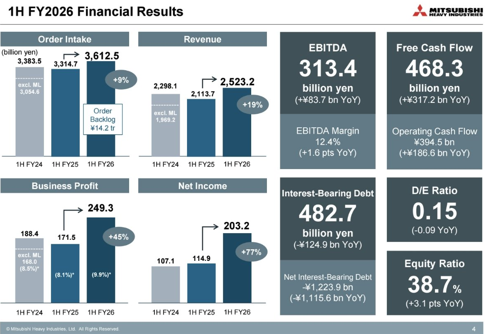
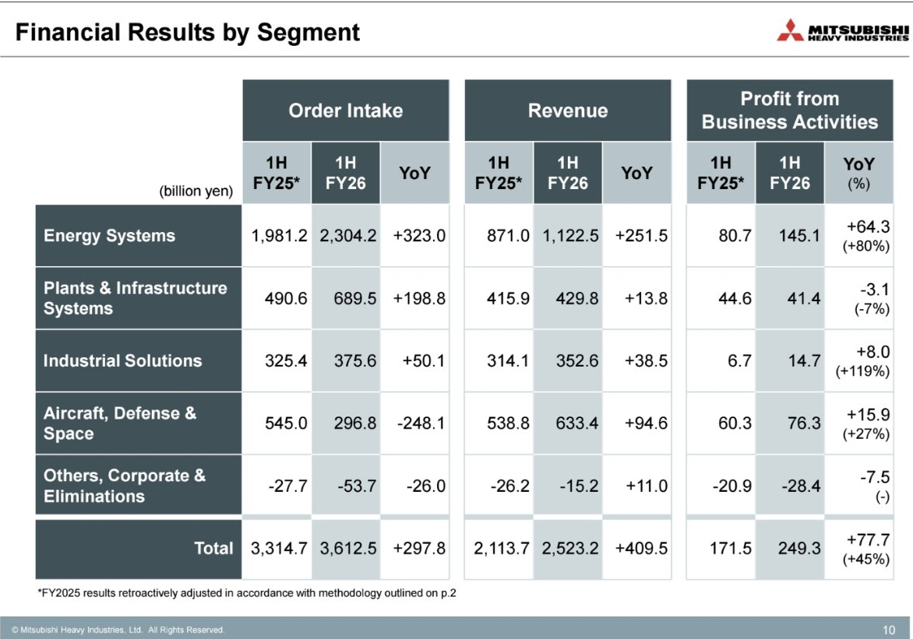
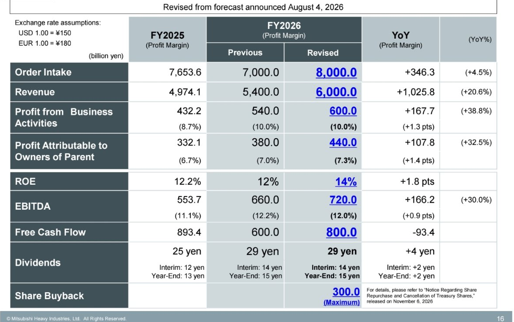
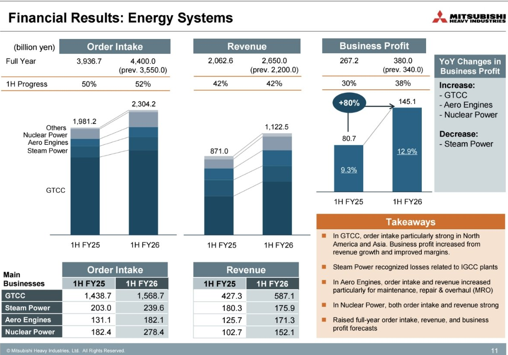

<!-- PRÜFEN: Quelle: Präsentation von Mitsubishi Heavy zum 1. Halbjahr FY2026 vom 06.11.2026 (Screenshots von Divi, Folien 4, 10, 11, 16, 17, 19, 20) und Investing.com (06.11.2026, Kursrückgang). Pressemitteilung/Originallink nachtragen (mhi.com). -->
<!-- PRÜFEN: Aufmacherfoto und Logo kommen vom Bot (tools/asset.request). Kein CEO-Foto vorhanden, Story ohne Portrait; Folie unten links (Prognose). Kursbild fehlt. -->
<!-- PRÜFEN: Kursrückgang von 8,3 % laut Investing.com ohne unternehmensspezifische Ursache; Uhrzeit der Veröffentlichung der Zahlen nicht ermittelt, Zusammenhang daher offen. -->

!!! kurz "Kurz gesagt"
    **Umsatz:** 2.523 Mrd. Yen (+19 %)
    **Gewinn:** 249 Mrd. Yen (+45 %)

    1. **Energiegeschäft als Motor:** Die Sparte Energy Systems verdient mit 145 Mrd. Yen fast doppelt so viel wie ein Jahr zuvor (+80 %), getragen von Gasturbinen (GTCC), Flugzeugtriebwerken und Kernkraft.
    2. **Prognose angehoben:** Für das Geschäftsjahr erwartet Mitsubishi Heavy jetzt 6,0 Bio. Yen Umsatz (zuvor 5,4) und 600 Mrd. Yen Geschäftsgewinn (zuvor 540), das sind 38,8 % mehr als im Vorjahr.
    3. **Mehr Geld für Aktionäre:** Die Dividende steigt auf 29 Yen (Vorjahr 25 Yen), dazu kommt ein Rückkauf über bis zu 300 Mrd. Yen.

## Mitsubishi Heavy im Halbjahr: Das Energiegeschäft trägt fast den ganzen Zuwachs

Mitsubishi Heavy Industries hat im ersten Halbjahr des Geschäftsjahres 2026/27 (April bis September) mehr umgesetzt und deutlich mehr verdient. Der Umsatz stieg um 19,4 % auf 2.523 Mrd. Yen, der Geschäftsgewinn (Profit from Business Activities) um 45,3 % auf 249 Mrd. Yen. Die Marge erhöhte sich von 8,1 % auf 9,9 %. Der Nettogewinn legte um 76,9 % auf 203 Mrd. Yen zu, auch weil Währungsgewinne und Finanzerträge dazukamen. Der Auftragseingang wuchs um 9,0 % auf 3.613 Mrd. Yen, der Auftragsbestand stieg gegenüber dem Ende des Vorjahres um 988 Mrd. auf 14,2 Bio. Yen.

Das meiste davon stammt aus einer Sparte. Energy Systems steigerte den Geschäftsgewinn um 64 Mrd. auf 145 Mrd. Yen (+80 %), den Umsatz um 29 % auf 1.123 Mrd. Yen. Nach Angaben des Konzerns lagen die Aufträge für Gasturbinen-Kombikraftwerke (GTCC) vor allem in Nordamerika und Asien deutlich höher, dazu kommen Flugzeugtriebwerke (vor allem Wartung und Überholung) und Kernkraft. Der Bedarf an zusätzlicher Stromerzeugung durch Rechenzentren und neue Industrieanlagen gilt am Markt als Treiber der Gasturbinen-Nachfrage. Das ist die Einordnung des Marktes, keine Aussage der Folien.

## Wo es schwächer läuft: Anlagenbau, Dampfturbinen und Aufträge im Verteidigungsgeschäft

Nicht überall wächst es. Die Sparte Plants & Infrastructure Systems (Verfahrenstechnik, Metallmaschinen) verdient mit 41 Mrd. Yen 7 % weniger, weil im Vorjahr margenstarke Projekte den Vergleich erschweren. Bei den Dampfturbinen belasten Verluste aus zwei Kohlevergasungs-Kraftwerken (IGCC), die 2021 in der Präfektur Fukushima geliefert wurden. Allein dafür sind im Halbjahr 70 Mrd. Yen an Einmalaufwand angefallen (Vorjahr: 30 Mrd. für ein Projekt in Südafrika). Für das ganze Jahr plant Mitsubishi Heavy 90 Mrd. Yen Einmalaufwand ein, darunter 70 Mrd. für diese Kraftwerke und 20 Mrd. als Risikopuffer.

Die Sparte Aircraft, Defense & Space steigerte den Geschäftsgewinn um 27 % auf 76 Mrd. Yen, den Umsatz um 94,6 Mrd. auf 633 Mrd. Yen. Der Auftragseingang sank dagegen um 248 Mrd. auf 297 Mrd. Yen. Grund ist ein hoher Vorjahreswert durch Großaufträge im Verteidigungsgeschäft (Defense & Space: 154 Mrd. Yen nach 428 Mrd.). Die Sparte Industrial Solutions mit Motoren, Turboladern und Klimatechnik verdoppelte ihren Gewinn mehr als auf 14,7 Mrd. Yen (+119 %).

## Höhere Prognose: 600 Mrd. Yen Geschäftsgewinn, Dividende 29 Yen

Mitsubishi Heavy hebt für das gesamte Geschäftsjahr alle Zielgrößen an. Der Umsatz soll auf 6,0 Bio. Yen steigen (zuvor 5,4 Bio.), das sind 20,6 % mehr als im Vorjahr. Der Geschäftsgewinn soll 600 Mrd. Yen erreichen (zuvor 540 Mrd., Vorjahr 432 Mrd., +38,8 %), der Nettogewinn 440 Mrd. Yen (zuvor 380 Mrd., +32,5 %). Die Eigenkapitalrendite soll bei 14 % liegen, zuvor waren 12 % geplant. Der Auftragseingang soll auf 8,0 Bio. Yen steigen (zuvor 7,0 Bio.), der freie Cashflow auf 800 Mrd. Yen (zuvor 600 Mrd.). Das größte Plus der Anhebung entfällt auf Umsatz und Marge mit 194 Mrd. Yen, nach 83 Mrd. in der ursprünglichen Planung. Auf der Folie zur Gewinnentwicklung schreibt der Konzern, er sehe sich auf Kurs, den Geschäftsgewinn auch über 700 Mrd. Yen hinaus zu steigern (aus dem Englischen übersetzt).

Für Aktionäre gibt es mehr Geld. Die Dividende soll für das Geschäftsjahr bei 29 Yen liegen (Vorjahr 25 Yen, +16 %), davon 14 Yen als Zwischendividende und 15 Yen zum Jahresende. Diese Zahl hatte der Konzern schon im August geplant, sie bleibt unverändert. Neu ist der Aktienrückkauf: Nach Angaben von Investing.com kauft Mitsubishi Heavy bis zum 8. November 2027 bis zu 120 Millionen eigene Aktien für höchstens 300 Mrd. Yen zurück. Das entspricht 3,6 % der ausgegebenen Aktien. Bei dem Kurs vom Freitag von 2.797,50 Yen ergibt die Dividende rechnerisch eine Rendite von etwa 1,0 %.

## Finanzlage: Mehr Kasse als Schulden

Die Bilanz ist solide. Der freie Cashflow stieg im Halbjahr um 317 Mrd. auf 468 Mrd. Yen, der operative Cashflow um 187 Mrd. auf 395 Mrd. Yen. Die zinstragenden Schulden sanken um 125 Mrd. auf 483 Mrd. Yen, die liquiden Mittel stiegen auf 1.707 Mrd. Yen. Nach Abzug der Schulden bleibt ein Nettoguthaben von 1.224 Mrd. Yen. Die Eigenkapitalquote liegt bei 38,7 %, das Verhältnis von Schulden zu Eigenkapital bei 0,15. Dieses Polster macht den Rückkauf möglich.

## Die Aktie fällt trotzdem

An der Börse hilft das wenig. Die Aktie verlor am Freitag in Tokio laut Investing.com 8,3 % auf 2.797,50 Yen, den niedrigsten Stand seit Mai 2025. Einen unternehmensspezifischen Grund nennt der Bericht nicht. Auslöser war die Sorge um den KI-Investitionsboom, die den japanischen Leitindex Nikkei 225 zeitweise um 7,1 % einbrechen ließ und den ganzen Markt erfasste. Mitsubishi Heavy fiel damit stärker als der Index. Das passt zur Lage am Vortag an der Wall Street, wo vor allem Chip- und KI-Werte verkauft wurden. Gasturbinen und Kraftwerkstechnik gelten als Profiteure des Rechenzentrumsbooms, daher trifft die Stimmung auch Industriewerte wie diesen. Das ist eine Einordnung, keine Aussage des Konzerns.

## Was die Zahlen offen lassen

Die Prognose enthält ausdrücklich nicht die Folgen der Lage im Nahen Osten. Der direkte Einfluss auf Aufträge und Lieferketten sei derzeit begrenzt, so der Konzern, die Entwicklung werde aber beobachtet. Die Prognose beruht außerdem auf Wechselkursen von 150 Yen je Dollar und 180 Yen je Euro. Ein stärkerer Yen würde die Umrechnung der Auslandsumsätze dämpfen. Dazu kommt die Abhängigkeit vom Energiegeschäft: Dessen Aufträge sind laut Plan für das Gesamtjahr auf 4,4 Bio. Yen angehoben, GTCC allein auf 3,0 Bio. Yen. Fällt die Nachfrage nach Kraftwerken, trifft das den Konzern stärker als die anderen Sparten. Das ist keine Empfehlung und keine Prognose, sondern die Beschreibung der Zahlen.

## Quellen

- Mitsubishi Heavy Industries, Präsentation „1H FY2026 Financial Results“, 6.11.2026
- Investing.com, „Mitsubishi Heavy shares slide 8% to near 18-month low despite raised outlook“, 6.11.2026

*Dieser Beitrag fasst die Berichterstattung der genannten Quellen in eigenen Worten zusammen. Alle Angaben ohne Gewähr.*
