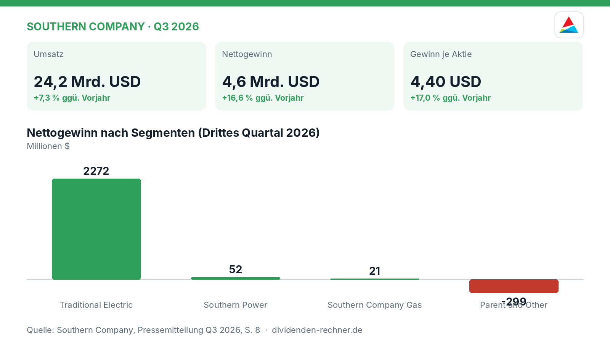
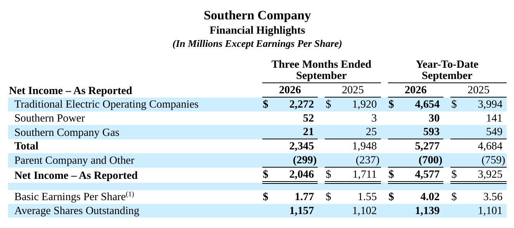

<!-- PRÜFEN: Aufmacherfoto ist automatisch von Wikimedia Commons gewaehlt: bitte pruefen, ob es zum Artikel passt (sonst image-Zeilen entfernen, dann entsteht ein Titelbild automatisch). -->
<!-- PRÜFEN: Diese Werte wurden im Berichtstext nicht gefunden: Grafik Traditional Electric: 2272; Grafik Parent and Other: -299 -->
<!-- PRÜFEN: Quelle: https://www.sec.gov/Archives/edgar/data/92122/000009212226000071/ex99-pressreleaseq32026.htm -->
<!-- PRÜFEN: Ausschnitte aus dem Bericht im Text (f1): bitte prüfen, ob Zuschnitt und Platz passen. Unpassende Bildzeilen einfach löschen. -->

!!! kurz "Kurz gesagt"
    **Umsatz:** 24,2 Mrd. USD (+7,3 %)
    **Gewinn:** 4,6 Mrd. USD (+16,6 %)

    1. **Treiber:** Das traditionelle Stromgeschäft und wärmeres Wetter stützen das Ergebnis, während das Segment Southern Power den Gewinn steigert.
    2. **Kapital:** Der Bericht nennt Details zu regulatorischen Einflüssen und dem Kundenzuwachs bei rund 9,0 Millionen angeschlossenen Haushalten.
    3. **Ausblick:** Anhaltend hohe Nachfrage durch Großkunden und Rechenzentren erfordert umfangreiche Neuinvestitionen in Netze und Erzeugung.

## Southern Company wächst bei Umsatz und Gewinn im dritten Quartal 2026

Southern Company blickt auf ein erfolgreiches drittes Quartal zurück. Im Neunmonatszeitraum bis zum 30. September **2026** steigerte der Energiekonzern den Umsatz auf **24,2 Mrd. USD**, was einem Zuwachs von **7,3 %** gegenüber dem Vorjahreszeitraum entspricht. Der Nettogewinn nach GAAP kletterte im selben Zeitraum auf **4,6 Mrd. USD** beziehungsweise **4,577 Mrd. USD**, was einem Plus von **16,6 %** entspricht. Bereinigte Non-GAAP-Zahlen heben das Ergebnis je Aktie auf **4,40 USD** nach **3,76 USD** im Vorjahr.

*Eigene Darstellung nach Daten aus: Southern Company, Quartalszahlen Q3 2026 vom 2026-11-05 · [Original](https://www.sec.gov/Archives/edgar/data/92122/000009212226000071/ex99-pressreleaseq32026.htm).*

### Operative Treiber und Spartenentwicklung

Das Wachstum stützt sich vor allem auf das klassische Stromgeschäft. Die traditionellen elektrischen Versorgungsunternehmen trugen im dritten Quartal **2,3 Mrd. USD** zum Nettogewinn bei. Zusätzliche Impulse lieferten wärmeres Wetter, eine höhere Kundennachfrage sowie steigende Erlöse aus Groß- und Industrieabnehmern. Auch Southern Power trug mit verbesserten Quartalsergebnissen positiv bei. Das Management verweist auf eine anhaltend hohe Nachfrage im Südosten der USA.

*Finanzhighlights nach Segmenten. Quelle: Southern Company, Quartalszahlen Q3 2026 vom 2026-11-05 · [Original](https://www.sec.gov/Archives/edgar/data/92122/000009212226000071/ex99-pressreleaseq32026.htm). Ausschnitt nur zugeschnitten, sonst unverändert.*

> „Die Region wächst in einem beispiellosen und transformatorischen Tempo, und wir sind hervorragend aufgestellt.“
>
 > — Chris Womack, Vorstandschef von Southern Company (aus dem Englischen übersetzt)

### Kundenbasis und Netzinvestitionen

Die Zahl der regulierten Kunden wuchs konzernweit auf rund **9,0 Millionen** Abnehmer, davon entfallen **4,6 Millionen** auf die klassischen Stromversorger und **4,4 Millionen** auf das Gasgeschäft. Gleichzeitig steht der Konzern vor großen Herausforderungen: Die stark wachsende Nachfrage durch Rechenzentren und große Gewerbekunden erfordert erhebliche Investitionen in neue Kraftwerke und das Übertragungsnetz, was die Bilanz und den Kapitalbedarf fordert.

### Ausblick und Netzstrukturen

Das Unternehmen setzt auf den Ausbau seiner Infrastruktur, um die Versorgungssicherheit im Südosten zu gewährleisten. Neben den Chancen durch den steigenden Strombedarf bleiben jedoch die Risiken durch steigende Zinskosten, regulatorische Vorgaben und den kapitalintensiven Netzausbau bestehen.

## Die wichtigsten Zahlen im Überblick

| Kennzahl | Wert | Veränderung zum Vorjahr | Quelle |
|---|---|---|---|
| Umsatz | 24,2 Mrd. USD | +7,3 % | S. 3 |
| Nettogewinn | 4,6 Mrd. USD | +16,6 % | S. 19 |
| Gewinn je Aktie | 4,40 USD | +17,0 % | S. 1 |

*Quelle: Southern Company, Quartalszahlen Q3 2026 vom 2026-11-05. Rechenwege eigene Berechnung. Keine Anlageberatung.*
