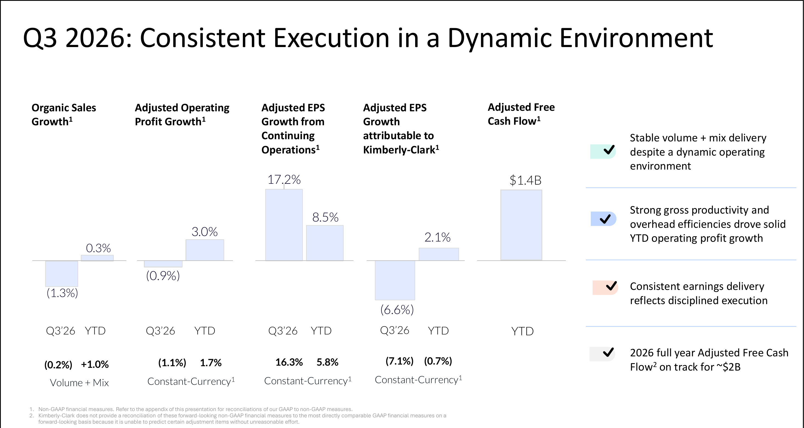
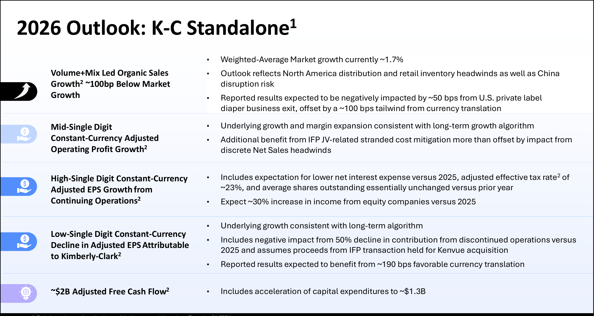

<!-- PRÜFEN: Quelle: Kimberly-Clark, Q3-2026-Pressemitteilung und Praesentation vom 05.11.2026 (PDF von Divi). Konsens: 247wallst.com (EPS 1,65 USD, Umsatz 4,12 Mrd. USD). Kursreaktion nicht ermittelt (Investing.com nicht abrufbar). -->
<!-- PRÜFEN: Aufmacherfoto fehlt noch (tools/asset.request). Portrait Mike Hsu von Divi (freigestellt aus kleinem Foto 625x465). Story: kein Kursbild, Folie unten links (Folie 15). -->
<!-- PRÜFEN: Originallink der Pressemitteilung nachtragen (investor.kimberly-clark.com). -->

!!! kurz "Kurz gesagt"
    **Umsatz:** 4,13 Mrd. US-Dollar (−0,4 %)
    **Bereinigter Betriebsgewinn:** 677 Mio. US-Dollar (−0,9 %)

    1. **Gewinn je Aktie besser als erwartet:** Das bereinigte Ergebnis je Aktie aus dem fortgeführten Geschäft steigt um 17,2 % auf 1,70 US-Dollar. Analysten hatten laut 247wallst mit 1,65 US-Dollar gerechnet. Haupttreiber sind niedrigere Zinsen und eine niedrigere Steuerquote.
    2. **Umsatz schwächer:** Der organische Umsatz sinkt um 1,3 %. Rund 2,7 Prozentpunkte gehen auf die Störung durch Social-Media-Kritik in China zurück.
    3. **Kenvue abgeschlossen, Prognose bestätigt:** Die Übernahme von Kenvue ist seit dem 2. November vollzogen. Die Jahresprognose für Kimberly-Clark ohne Kenvue bleibt unverändert.

## Kimberly-Clark im dritten Quartal: der Gewinn steigt, das Geschäft stockt in China

Kimberly-Clark (Huggies, Kleenex, Cottonelle, Kotex) hat im dritten Quartal 2026 bereinigt mehr verdient, aber weniger verkauft. Der Nettoumsatz lag bei 4,13 Mrd. US-Dollar und damit um 0,4 % unter dem Vorjahr (4,15 Mrd.). Organisch, also ohne Währungs- und Konsolidierungseffekte, sank er um 1,3 %. Das bereinigte Ergebnis je Aktie aus dem fortgeführten Geschäft stieg um 17,2 % auf 1,70 US-Dollar. Das ist laut 247wallst das sechste Quartal in Folge über der Erwartung. Der Ergebniszuwachs kommt aber vor allem aus niedrigeren Zinskosten (32 statt 59 Mio. US-Dollar) und einer niedrigeren bereinigten Steuerquote (19,5 statt 26,5 %), nicht aus dem operativen Geschäft: Der bereinigte Betriebsgewinn fiel um 0,9 % auf 677 Mio. US-Dollar.

Die Zahlen sind überlagert vom Ereignis der Woche: Am 2. November hat Kimberly-Clark den Konsumgüterkonzern Kenvue (Tylenol, Listerine, Neutrogena) übernommen. Konzernchef Mike Hsu nannte das einen „prägenden Moment“ in der 154-jährigen Konzerngeschichte. Die Prognose gilt laut Mitteilung für Kimberly-Clark allein, also ohne Kenvue.

*Ausschnitt aus der Präsentation von Kimberly-Clark zum Q3 2026 (Folie 15, „Consistent Execution in a Dynamic Environment“).*

### Die wichtigsten Zahlen im Überblick

| Kennzahl | Q3 2026 | Veränderung zum Vorjahr |
|---|---|---|
| Nettoumsatz | 4,13 Mrd. US-Dollar | −0,4 % |
| Organischer Umsatz | – | −1,3 % |
| Bereinigter Bruttogewinn (Marge) | 35,5 % | −1,3 Prozentpunkte |
| Bereinigter Betriebsgewinn | 677 Mio. US-Dollar | −0,9 % |
| Bereinigtes EPS, fortgeführtes Geschäft | 1,70 US-Dollar | +17,2 % |
| Bereinigtes EPS je Aktionär von Kimberly-Clark | 1,70 US-Dollar | −6,6 % |

Das ausgewiesene Ergebnis je Aktie von Kimberly-Clark lag bei 5,37 US-Dollar (Vorjahr: 1,34). Der Sprung geht auf einen Gewinn von rund 1,4 Mrd. US-Dollar vor Steuern aus dem Abschluss des Verkaufs der Sparten „International Family Care and Professional“ (IFP) zurück, die zum 1. Juli 2026 in ein Gemeinschaftsunternehmen mit Suzano übergingen. Er ist ein Einmaleffekt. Die beiden bereinigten Größen („fortgeführtes Geschäft“ und „je Aktionär von Kimberly-Clark“) unterscheiden sich, weil bei der zweiten das ausgegliederte Geschäft noch mitzählt.

### Was gut lief

- **Nordamerika:** Die Menge wächst um 2,0 %, der organische Umsatz um 0,4 %, der operative Gewinn um 2,7 % auf 657 Mio. US-Dollar. Das Unternehmen nennt stärkere Produktivität und niedrigere Werbeausgaben.
- **Gewinn je Aktie:** Plus 17,2 % bei bereinigtem Ergebnis je Aktie aus dem fortgeführten Geschäft. Nach neun Monaten steht ein Plus von 8,5 % auf 5,10 US-Dollar.
- **Cashflow:** Der operative Cashflow lag nach neun Monaten bei 2,4 Mrd. US-Dollar (Vorjahr 1,8 Mrd.). Für 2026 peilt der Konzern einen bereinigten freien Cashflow von rund 2 Mrd. US-Dollar an.
- **Schulden und Dividende:** Die Gesamtschulden des fortgeführten Geschäfts sanken auf 6,5 Mrd. US-Dollar (Jahresende 2025: 7,2 Mrd.). Kimberly-Clark zahlt seit 92 Jahren eine Dividende und hat sie seit 54 Jahren in Folge erhöht. In den ersten neun Monaten flossen 1,3 Mrd. US-Dollar an die Aktionäre.

### Was weniger gut lief

- **China:** Nach Kritik an der Windelqualität in sozialen Medien brach das Geschäft in China ein. Das kostete im Quartal rund 270 Basispunkte organisches Wachstum im Konzern und etwa 770 Basispunkte in der Auslandssparte „International Personal Care“. Der operative Gewinn dieser Sparte fiel um 32,7 % auf 144 Mio. US-Dollar.
- **Preise und Marge:** Die bereinigte Bruttomarge sank um 130 Basispunkte auf 35,5 %, weil Preissenkungen und Kostensteigerungen nicht ausgeglichen wurden. In Nordamerika drückten mehr Rabattaktionen die Preise um 1,8 %.
- **Handelslager:** In Nordamerika kostete der Lagerabbau im Handel rund 130 Basispunkte organisches Wachstum.
- **Ergebnis je Aktionär von Kimberly-Clark:** Das bereinigte Ergebnis je Aktionär von Kimberly-Clark sank um 6,6 %, weil das ausgegliederte Geschäft weniger beiträgt.

### Prognose 2026 (ohne Kenvue)

| Kennzahl | Prognose 2026 |
|---|---|
| Organisches Umsatzwachstum | etwa 1,0 Prozentpunkt unter dem Marktwachstum (zuletzt rund 1,7 %) |
| Bereinigter Betriebsgewinn (währungsbereinigt) | Wachstum im mittleren einstelligen Bereich |
| Bereinigtes EPS, fortgeführtes Geschäft (währungsbereinigt) | Wachstum im hohen einstelligen Bereich |
| Bereinigtes EPS je Aktionär von Kimberly-Clark (währungsbereinigt) | Rückgang im niedrigen einstelligen Bereich |
| Bereinigter freier Cashflow | rund 2 Mrd. US-Dollar |

Die Prognose rechnet laut Präsentation mit Gegenwind in Nordamerika durch Lager- und Vertriebseffekte sowie mit dem China-Risiko.

*Ausschnitt aus der Präsentation von Kimberly-Clark (Folie 18, „2026 Outlook: K-C Standalone“).*

### Kenvue: Chancen und Schulden

Mit Kenvue entsteht laut Präsentation ein Konsumgüter- und Gesundheitskonzern mit zehn Marken, die jeweils über eine Milliarde US-Dollar Umsatz machen. Die erwarteten jährlichen Kostenvorteile (Synergien) nennt das Unternehmen mit rund 2,1 Mrd. US-Dollar. Dem stehen höhere Schulden gegenüber: Kimberly-Clark erwartet am ersten Tag nach Abschluss eine Bruttoverschuldung vom rund 2,9-Fachen des bereinigten EBITDA und will bis Ende 2028 eine Nettoverschuldung von etwa dem Zweifachen erreichen. Die Anleihen laufen zeitlich gestaffelt aus, in den kommenden Jahren stehen jeweils zwischen 0,6 und 2,5 Mrd. US-Dollar zur Rückzahlung an.

### Einordnung für Anleger

Das Quartal zeigt ein Unternehmen, das beim Gewinn mehr liefert, als der Umsatz hergibt. Das tragen vor allem Zins- und Steuerverbesserungen, weniger das Geschäft. China und der Preisdruck belasten, Nordamerika wächst über die Menge. Entscheidend wird nun die Integration von Kenvue und der Schuldenabbau: Er muss die Dividende, die seit mehr als fünf Jahrzehnten wächst, weiter tragen. Die Zahlen sind Unternehmensangaben und keine Anlageberatung.

*Weitere Quelle: [247wallst](https://247wallst.com/cards/kimberly-clark-q3-2026-earnings-kmb-01m6nr124wn6fbqaryc7cy9h48) (Analystenerwartungen).*

*Quelle: Kimberly-Clark, Pressemitteilung und Präsentation zum dritten Quartal 2026 vom 5. November 2026.*
