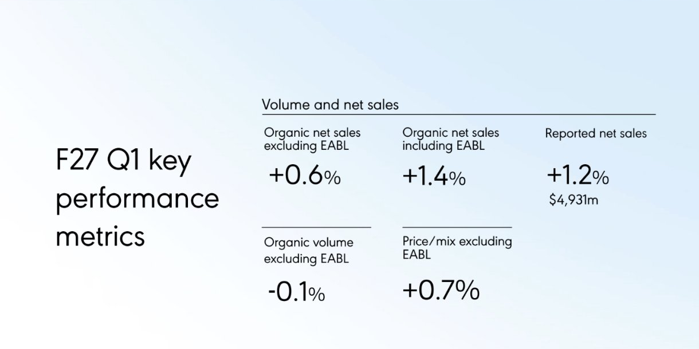
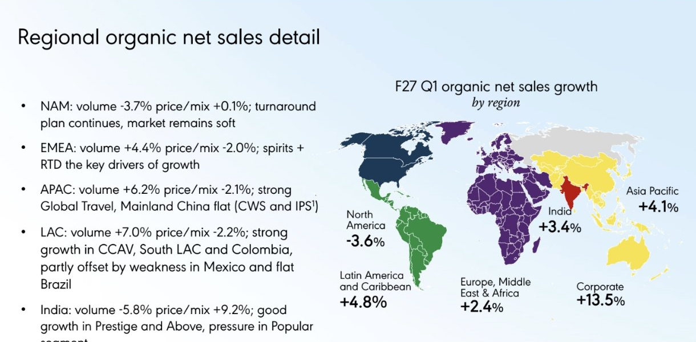
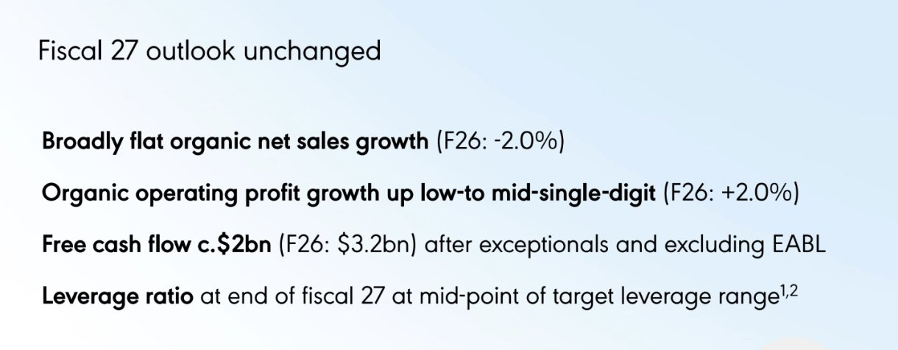

<!-- PRÜFEN: Quelle: Diageo, Q1-FY27-Handelsupdate (Praesentation, Folien 4 bis 11 als Handy-Screenshots von Divi). Konsens/Analystenstimmen: Reuters via RTE, Investing.com. -->
<!-- PRÜFEN: Aufmacherfoto fehlt noch (tools/asset.request). Kursbild = Diageo-ADR (NYSE: DEO, USD, Yahoo, 04.11. Schluss 97,70, vorboerslich 100,39). Portrait Sir Dave Lewis von Divi (freigestellt). -->
<!-- PRÜFEN: Originallink der Diageo-Mitteilung nachtragen. -->

!!! kurz "Kurz gesagt"
    **Umsatz:** 4,93 Mrd. US-Dollar (+1,2 %)
    **Organisch:** +1,4 % (ohne EABL +0,6 %)

    1. **Besser als erwartet:** Das organische Umsatzwachstum ohne die ostafrikanische Brauerei EABL liegt bei +0,6 %. Analysten hatten laut einer vom Konzern zusammengestellten Umfrage ein Minus von 0,4 % erwartet (Reuters).
    2. **Nordamerika bleibt der Problemmarkt:** Der organische Umsatz sinkt um 3,6 %, erwartet war ein Rückgang um 6,7 %. Analysten führen den Unterschied auf Lieferzeitpunkte zurück (Reuters).
    3. **Prognose bestätigt, Dividende niedrig:** Für das Geschäftsjahr 2027 erwartet Diageo einen flachen organischen Umsatz und einen organisch wachsenden operativen Gewinn im niedrigen bis mittleren einstelligen Bereich. Die Dividende wurde im Februar und August 2026 auf 50 US-Cent je Aktie für das Geschäftsjahr 2026 halbiert.

## Diageo im ersten Quartal: kleiner Schritt nach vorn, Nordamerika bremst weiter

Der Spirituosenkonzern Diageo (Johnnie Walker, Guinness, Smirnoff, Don Julio) hat für das erste Quartal des Geschäftsjahres 2027 (Juli bis September 2026) ein leichtes Umsatzplus gemeldet. Der berichtete Nettoumsatz stieg um 1,2 % auf 4,93 Mrd. US-Dollar. Organisch, also bereinigt um Währungs- und Konsolidierungseffekte, wuchs er ohne East African Breweries (EABL) um 0,6 % und mit EABL um 1,4 %. Das Volumen sank ohne EABL um 0,1 %, Preis und Mix legten um 0,7 % zu. Mit EABL stieg das Volumen um 1,1 %, Preis und Mix um 0,3 %. EABL verkauft Diageo an den japanischen Konzern Asahi, deshalb weist das Unternehmen beide Werte aus.

Die Börse reagierte mit Kursgewinnen: Die Aktie legte laut Reuters um 3,5 % zu, liegt aber weiterhin deutlich unter den Kursen von 2022. Konzernchef Sir Dave Lewis, der im Januar 2026 von Tesco kam, nannte das Ergebnis „einen kleinen Schritt in die richtige Richtung“. Der Markt bleibe schwierig, geopolitische Spannungen sorgten für Schwankungen. Die Prognose für das Gesamtjahr bleibt unverändert.

*Ausschnitt aus der Präsentation von Diageo zum Q1 des Geschäftsjahres 2027 (Folie 4, „F27 Q1 key performance metrics“).*

### Die wichtigsten Zahlen im Überblick

| Kennzahl | Q1 FY27 |
|---|---|
| Berichteter Nettoumsatz | 4.931 Mio. US-Dollar (+1,2 %) |
| Organischer Nettoumsatz ohne EABL | +0,6 % |
| Organischer Nettoumsatz mit EABL | +1,4 % |
| Volumen ohne EABL | −0,1 % |
| Preis/Mix ohne EABL | +0,7 % |

### Die Regionen im Überblick

| Region | Organischer Nettoumsatz | Volumen | Preis/Mix |
|---|---|---|---|
| Nordamerika | −3,6 % | −3,7 % | +0,1 % |
| Europa, Naher Osten, Afrika | +2,4 % | +4,4 % | −2,0 % |
| Asien-Pazifik | +4,1 % | +6,2 % | −2,1 % |
| Lateinamerika und Karibik | +4,8 % | +7,0 % | −2,2 % |
| Indien | +3,4 % | −5,8 % | +9,2 % |
| Konzernbereich („Corporate“) | +13,5 % | – | – |

*Ausschnitt aus der Präsentation von Diageo (Folie 5, „Regional organic net sales detail“).*

### Was gut lief

- **Nordamerika besser als befürchtet:** Der Umsatz sank um 3,6 %, Analysten hatten mit −6,7 % gerechnet. Diageo nennt als Treiber Guinness und Johnnie Walker sowie „shipment phasing“, also zeitliche Verschiebungen bei Lieferungen. Analysten sagen laut Reuters, dass genau diese Verschiebungen den Unterschied erklären und nicht die Maßnahmen des neuen Konzernchefs.
- **Wachstum in Asien, Lateinamerika und Europa:** Asien-Pazifik (+4,1 %) schlug die Erwartung von +0,8 %, Lateinamerika (+4,8 %) lag im Plan, Europa, Naher Osten und Afrika wuchsen um 2,4 %. In Asien-Pazifik helfen laut Diageo der Reiseverkehr („Global Travel“), in Europa Spirituosen und Fertigmixgetränke.
- **Volumen wächst in den meisten Regionen:** In allen Regionen außer Nordamerika und Indien legt die Menge deutlich zu, in Lateinamerika um 7,0 %.

### Was weniger gut lief

- **Nordamerika bleibt die größte Baustelle:** Die Region macht rund 36 % des Nettoumsatzes aus (Investing.com). Das Volumen sank um 3,7 %. Don Julio, Casamigos und Crown Royal verloren laut Reuters weiter zweistellig. Diageo erwartet für das Gesamtjahr in Nordamerika einen Rückgang im mittleren einstelligen Bereich bei einem um rund 3 % sinkenden Markt (Investing.com).
- **Preisnachlässe:** In Europa, Naher Osten, Afrika, Lateinamerika und Asien-Pazifik liegen die Preise je Einheit (Preis/Mix) um etwa 2 % niedriger. Der Analyst James Edwardes Jones (RBC) spricht laut Reuters von einer Preisdeflation, mit der Diageo auf knappere Haushaltskassen reagiert. Lewis hat zugesagt, dass das nicht zulasten der Gewinne gehen soll.
- **Indien:** Das Volumen fiel um 5,8 %, ein höherer Preis/Mix von 9,2 % glich das aus. Der Umsatz wuchs um 3,4 %, Analysten hatten 6,4 % erwartet (Investing.com).
- **Zölle und Währungen:** Für das Geschäftsjahr 2027 rechnet Diageo mit rund 100 Mio. US-Dollar Zollbelastung vor Gegenmaßnahmen und etwa 70 Mio. US-Dollar danach. Währungseffekte kosten laut Präsentation rund 100 Mio. US-Dollar Umsatz und 25 Mio. US-Dollar operativen Gewinn.

### Ausblick für das Geschäftsjahr 2027

| Kennzahl | Prognose 2027 | Geschäftsjahr 2026 |
|---|---|---|
| Organisches Umsatzwachstum | etwa unverändert | −2,0 % |
| Organisches operatives Ergebnis | niedriges bis mittleres einstelliges Plus | +2,0 % |
| Free Cashflow | rund 2 Mrd. US-Dollar | 3,2 Mrd. US-Dollar |
| Verschuldung (Ende GJ 27) | Mitte der Zielspanne | – |

Zudem nennt Diageo technische Eckwerte: Die Steuerquote soll bei rund 25 % liegen (Vorjahr 24,3 %), der durchschnittliche Zinssatz bei rund 4 % (Vorjahr 3,9 %) und die Investitionen bei rund 1,25 Mrd. US-Dollar (Vorjahr 1,2 Mrd.). Der Free Cashflow wird nach Sonderposten und ohne EABL gerechnet.

*Ausschnitt aus der Präsentation von Diageo (Folie 6, „Fiscal 27 outlook unchanged“).*

### Dividende und Konzernumbau

Diageo hat die Dividende im Zuge des Umbaus deutlich gekürzt: Die Zwischendividende im Februar 2026 lag bei 20 US-Cent nach 40,5 Cent im Vorjahr. Für das Geschäftsjahr 2026 zahlt der Konzern insgesamt 50 US-Cent je Aktie, nach 103,48 Cent im Jahr davor. Die Schlussdividende betrug 30 US-Cent. Künftig soll die Ausschüttung 30 bis 50 % des Gewinns betragen, zuvor waren es 63 %. Mit dem Geld soll die Bilanz gestärkt werden, der Nettoschuldenstand lag zuletzt bei rund 21,7 Mrd. US-Dollar im Durchschnitt (ii.co.uk). Lewis hat dem Konzern ein Sparprogramm von 1 Mrd. US-Dollar über drei Jahre verordnet und tausende Stellen gestrichen (Reuters).

### Einordnung für Anleger

Das Quartal ist besser als erwartet, aber kein Wendepunkt: Nordamerika schrumpft weiter, das Wachstum anderswo entsteht teilweise über niedrigere Preise, und die Besserung in den USA geht laut Analysten zum Teil auf Lieferzeitpunkte zurück. Für Dividendenanleger zählt vor allem, dass die Ausschüttung nach der Halbierung nun auf einem niedrigeren, durch die Gewinne besser gedeckten Niveau steht, der Konzern aber noch hoch verschuldet ist. Die Zahlen sind Unternehmensangaben und keine Anlageberatung.

*Weitere Quellen: [Reuters via RTÉ](https://www.rte.ie/news/business/2026/1105/1598065-diageo-quarterly-results/) (Erwartungen, Analystenstimmen, Kursreaktion), [Investing.com](https://www.investing.com/news/earnings/diageo-beats-estimates-with-first-quarter-revenue-growth-5002432) (Konsens nach Regionen, Prognose Nordamerika), [ii.co.uk](https://www.ii.co.uk/analysis-commentary/ii-view-cost-savings-spearhead-recovery-plan-diageo-ii540158) (Dividende, Sparprogramm), [AJ Bell](https://www.ajbell.co.uk/news/articles/diageo-hacks-dividend-lowers-sales-view-amid-soft-us-and-china-trade) (Zwischendividende).*

*Quelle: Diageo, Präsentation zum Handelsupdate für das erste Quartal des Geschäftsjahres 2027 vom 5. November 2026.*
