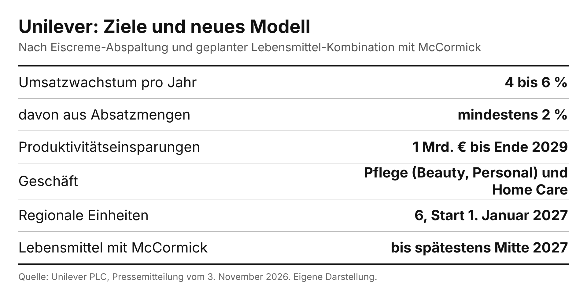
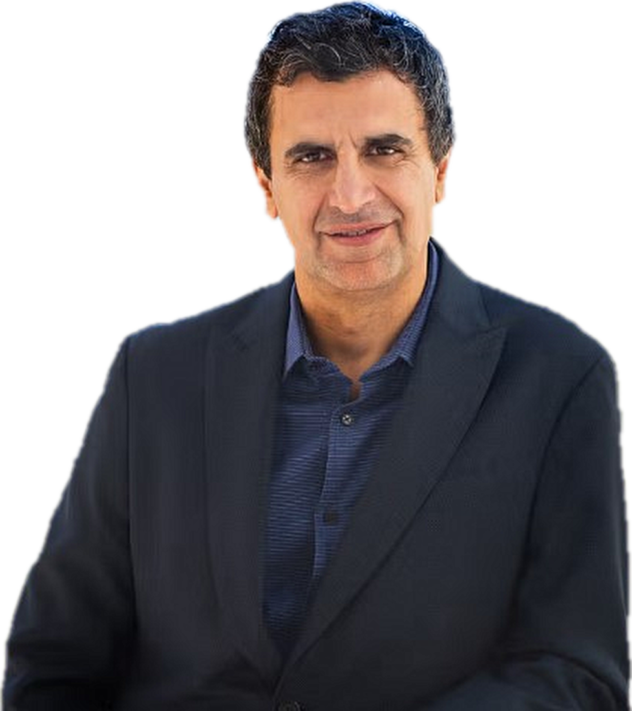

<!-- PRÜFEN: Es liegt nur die Pressemitteilung vom 03.11.2026 (Vorabmeldung) vor, nicht die Präsentation des Investor Events am 04.11. (8:30 Uhr Ostküste, 14:30 Uhr deutscher Zeit). Folien, Marge und Prognose zum Gewinn fehlen deshalb. Bitte nach dem Event Folien nachreichen. -->
<!-- PRÜFEN: Dieser Artikel ersetzt die Kurzmeldung 8088_1911 vom Vorabend. Eine zweite Kurzmeldung zum selben Thema (8076_1923-unilever-investor-event-2027-prognose-einsparungen.md) ist noch online. Bitte eine der beiden entfernen. -->
<!-- PRÜFEN: Aufmacherfoto fehlt noch, die Fotoanfrage ist angelegt, der Bot ergänzt es. Das Kursbild (Yahoo, UNA.AS, 09:47 Uhr CET, 57,62 EUR, -1,30 %) zeigt nur den frühen Handel, ein späterer Screenshot wäre aussagekräftiger. Nutzungsbedingungen von Yahoo und Rechte am Foto von Fernando Fernandez prüfen. -->
<!-- PRÜFEN: Das Zitat von Fernando Fernandez stammt aus der Pressemitteilung (englisch, hier sinngemäß übersetzt). Die Aussage über Wachstumsziele vor dem Hintergrund der Lebensmittel-Transaktion mit McCormick ist aus der Meldung, nicht aus einer Präsentation. -->

!!! kurz "Kurz gesagt"
    **Einsparungen:** 1 Mrd. Euro bis 2029
    **Umsatzwachstum:** 4 bis 6 % pro Jahr

    1. **Umbau:** Nach der Abspaltung des Eisgeschäfts im Dezember 2025 und der geplanten Zusammenführung der Lebensmittel mit McCormick bis spätestens Mitte 2027 bleibt ein reines Pflegegeschäft.
    2. **Führung:** Sechs regionale Einheiten, neues Führungsteam ab 1. Januar 2027. Nordamerika bekommt einen externen Chef.
    3. **Offen:** Das Sparziel hängt auch am Abschluss der Lebensmittel-Transaktion. Zahlen zu Marge und Gewinn nennt die Meldung nicht.

## Unilever wird zum reinen Pflegekonzern

Unilever lädt am 4. November zu einem Investor Event und hat vorab die Eckpunkte veröffentlicht. Nach der Abspaltung des **Eisgeschäfts** im Dezember 2025 und der geplanten Zusammenführung des **Lebensmittelgeschäfts** mit McCormick, die spätestens Mitte 2027 abgeschlossen sein soll, bleibt ein Unternehmen aus den Bereichen **Beauty & Personal Care** und **Home Care**. Alle Kategorien teilen laut Unilever Wissenschaft und Technologie, ein Modell zur Nachfragesteigerung und gemeinsame Vertriebswege.

Unilever will künftig in drei Kategorien berichten: Beauty & Personal Care, Home Care und Sonstiges. Regional gibt es fünf Berichtsregionen: Nordamerika, Europa, Lateinamerika/Afrika/Naher Osten/Türkei, Indien sowie Asien.

## Sparprogramm und Wachstumsziele

Bis Ende 2029 will Unilever **1 Mrd. Euro** durch Produktivität einsparen. Das Geld soll aus der Vereinfachung der Organisation, neu gestalteten Prozessen und Technologie kommen. Außerdem sollen Kosten wegfallen, die nach der Lebensmittel-Transaktion „übrig bleiben" (im Englischen „stranded costs"), also Aufwand, der bisher von der abgegebenen Sparte mitgetragen wurde.

Das mittelfristige Ziel lautet: **4 bis 6 Prozent** jährliches zugrunde liegendes Umsatzwachstum, davon mindestens **2 Prozent** aus Absatzmengen, dazu eine „moderate" Verbesserung der operativen Marge. Unilever will damit zum oberen Drittel bei der Rendite für Aktionäre gehören. Für 2027 erwartet das Unternehmen Ergebnisse im Rahmen dieser Ziele.

*Ziele und neues Modell im Überblick. Quelle: Unilever PLC, Pressemitteilung vom 3. November 2026. Eigene Darstellung.*

## Neues Modell und neue Köpfe

Das neue Modell folgt dem Prinzip „globale Strategie, lokale Umsetzung". Eine schlanke Zentrale kümmert sich um Portfolio, Ressourcen und die globalen Marken. Die Märkte verantworten Geschäft, Lieferkette und Vertrieb und werden in sechs Einheiten unter regionalen Präsidenten zusammengefasst. Die Führungsriege ändert sich zum 1. Januar 2027:

- Leandro Barreto wird Chief Growth and Marketing Officer, Eduardo Campanella Chief Strategy Officer.
- Herrish Patel führt Europa, Reginaldo Ecclissato Lateinamerika, Afrika, Naher Osten und Türkei.
- Benjie Yap leitet Südasien-Pazifik, Aseem Puri Nordostasien. Priya Nair bleibt Chefin von Hindustan Unilever und führt Indien.
- Der Präsident für Nordamerika kommt von außen und startet am 1. Januar, die Bekanntgabe folgt in den nächsten Wochen.

Das Modell soll schrittweise 2027 eingeführt werden, abhängig von Gesprächen mit den Betriebsräten, und voll wirken, sobald die Lebensmittel-Transaktion abgeschlossen ist.

!!! zitat "Fernando Fernandez, Chief Executive Officer von Unilever"
    {: .zitatfoto }
    „Wir bauen von einer Position der Stärke aus. Unsere Priorität ist nachhaltiges, wettbewerbsfähiges Wachstum über Absatzmengen und eine stetige Ergebnissteigerung in harten Währungen."

    Aus dem Englischen übersetzt, aus der Pressemitteilung. Foto: Unilever

## Einordnung

Die Pläne sind ein klarer Schnitt: weniger Komplexität, ein Sparziel mit Jahreszahl und Wachstum vor allem über Mengen statt nur über Preise. Für Anleger bleiben offene Punkte. Die Meldung nennt keine Marge und keinen Gewinn, das Sparziel reicht bis 2029, und es hängt auch am Abschluss der Lebensmittel-Transaktion mit McCormick. Einen Teil der Einsparungen gleichen Kosten aus, die nach der Abgabe der Sparten ohnehin übrig bleiben. Die Aktie notierte am Mittwochmorgen bei 57,62 Euro (minus 1,3 Prozent). Dieser Beitrag ist keine Anlageberatung.
