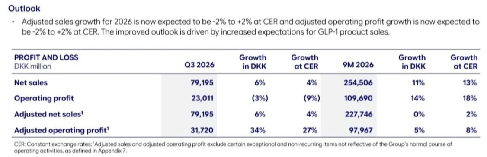

<!-- PRÜFEN: Es liegt keine Präsentation vor. Zahlen stammen aus dem Wortlaut der Pressemitteilung (Company Announcement Nr. 65/2026, 4. November 2026) in zwei Nachdrucken. Folienausschnitt für die Story bitte nachreichen. -->
<!-- PRÜFEN: Aufmacherfoto fehlt noch, die Fotoanfrage (Wegovy/Injektionspen, Produktion) ist angelegt, der Bot ergänzt es. -->
<!-- PRÜFEN: Nicht in meinen Quellen: Nettogewinn, Gewinn je Aktie, Umsatz je Segment (Adipositas/Diabetes), Free Cashflow, frühere Prognosespanne. Deshalb stehen sie nicht im Text. Bitte aus Bericht ergänzen. -->
<!-- PRÜFEN: Berichteter Umsatz für 9 Monate (254,5 Mrd. DKK) weicht stark vom bereinigten (227,7 Mrd. DKK) ab. Grund steht nicht in meinen Quellen, deshalb bewusst nur bereinigte Zahlen als Haupt-Kennzahl. -->
<!-- PRÜFEN: Kursangabe (283,10 DKK, +4,79 % am Mittwoch 09:09 Uhr, 5 Tage +8,74 %) stammt aus dem eigenen Yahoo-Finance-Screenshot vom 04.11.2026. Nutzungsbedingungen von Yahoo prüfen. Foto von Mike Doustdar (Name in der Pressemitteilung: Doustdar): Nutzungsrecht prüfen. -->

!!! kurz "Kurz gesagt"
    **Umsatz:** 79,2 Mrd. DKK (+4 %)
    **Gewinn (bereinigt):** 31,7 Mrd. DKK (+27 %)

    *Veränderungen zum Vorjahr, währungsbereinigt.*

    1. **Treiber:** Mehr Absatz von GLP-1-Mitteln (Wegovy, Ozempic), vor allem gegen Fettleibigkeit. Die neue Wegovy-Pille setzt im ersten Quartal nach Marktstart 5,4 Mrd. DKK um.
    2. **Prognose:** Novo hebt die Jahresprognose an. Bereinigter Umsatz und bereinigter Betriebsgewinn sollen währungsbereinigt zwischen minus 2 % und plus 2 % wachsen.
    3. **Einordnung:** Der berichtete Betriebsgewinn fällt um 3 % auf 23,0 Mrd. DKK, weil Novo 8,7 Mrd. DKK abschreibt. Das Plus beim bereinigten Gewinn hängt auch an Umbaukosten von 9 Mrd. DKK im Vorjahr.

## Gewinn springt, aber auch wegen des niedrigen Vorjahres

Novo Nordisk setzt im dritten Quartal 2026 **79,2 Mrd. DKK** um. Das sind 6 Prozent mehr als vor einem Jahr, währungsbereinigt 4 Prozent. Der **bereinigte Betriebsgewinn** steigt um 34 Prozent auf **31,7 Mrd. DKK**, währungsbereinigt um 27 Prozent. Der berichtete Betriebsgewinn liegt dagegen mit 23,0 Mrd. DKK um 3 Prozent unter dem Vorjahr (währungsbereinigt minus 9 Prozent).

Der Unterschied hat zwei Gründe. Erstens bucht Novo im Quartal **Abschreibungen von 8,7 Mrd. DKK** ohne Zahlungsfluss: 4,6 Mrd. DKK auf den Wirkstoff Ziltivekimab und 4,1 Mrd. DKK, weil das Produktionsnetz verkleinert wird. Die bereinigten Zahlen rechnen das heraus. Zweitens enthielt das dritte Quartal 2025 Umbaukosten von 9 Mrd. DKK, das macht den Vergleich für 2026 leichter. Über neun Monate wächst der bereinigte Betriebsgewinn um 5 Prozent auf 98,0 Mrd. DKK, währungsbereinigt um 8 Prozent. Der bereinigte Umsatz liegt über neun Monate auf Vorjahresniveau (währungsbereinigt plus 2 Prozent).

*Ausblick und Kennzahlen zum dritten Quartal 2026. Quelle: Novo Nordisk, Finanzbericht Q3 2026. Ausschnitt nur zugeschnitten, sonst unverändert.*

## Wegovy-Pille und Marktanteile

Wachstumstreiber sind GLP-1-Mittel in den USA und im internationalen Geschäft, vor allem gegen Fettleibigkeit. Die **Wegovy-Pille** erlöst im Quartal 5,4 Mrd. DKK und ist inzwischen in acht Märkten gestartet, darunter USA, Großbritannien, Deutschland und die Vereinigten Arabischen Emirate. Bei neuen Patienten im US-Markt für Abnehmmittel mit Markenschutz hält Wegovy nach Unternehmensangaben mehr als 50 Prozent. Die Ozempic-Pille ist seit Mai in den USA auf dem Markt, die wöchentlichen Neuverordnungen liegen etwa doppelt so hoch wie vor dem Start des Vorgängers Rybelsus.

## Pipeline: CagriSema als nächster Schritt

Für **CagriSema** meldet Novo in einer Studie 21 Prozent Gewichtsverlust nach 68 Wochen. In einer Diabetesstudie liegt der Gewichtsverlust bei 12,4 Prozent gegenüber 9,1 Prozent unter Tirzepatid 5 mg, bei vergleichbarer Senkung des Blutzuckerwerts HbA1c. Der US-Start ist für Anfang 2027 geplant, vorbehaltlich der Zulassung. Eine Phase-3-Studie mit einer weiteren Tablette (Zenagamtid) hat im September begonnen. Das Hämophilie-Mittel Frehemgo hat eine positive Empfehlung der europäischen Arzneimittelbehörde, der Start in Europa ist rund um den Jahreswechsel geplant.

!!! zitat "Mike Doustdar, President und CEO von Novo Nordisk"
    {: .zitatfoto }
    „Wir haben ein stärker als erwartetes drittes Quartal geliefert."

    Aus dem Englischen übersetzt, aus der Pressemitteilung. Foto: Novo Nordisk

## Ausblick und Einordnung

Novo hebt die Prognose für 2026 an: Der bereinigte Umsatz und der bereinigte Betriebsgewinn sollen währungsbereinigt zwischen **minus 2 Prozent und plus 2 Prozent** wachsen. Das Unternehmen begründet das mit höheren Erwartungen an den Absatz von GLP-1-Mitteln. Die Spanne bleibt breit, ein starkes Wachstum erwartet Novo für dieses Jahr also nicht.

Für die Einordnung gilt: Die Zahlen zeigen, dass die neuen Präparate ankommen, aber ein Teil des Gewinnsprungs ist ein Basiseffekt. Offen bleiben der Preisdruck im US-Markt und der Wettbewerb um Abnehmmittel. Dieser Beitrag ist keine Anlageberatung.
