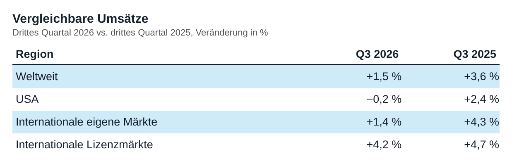
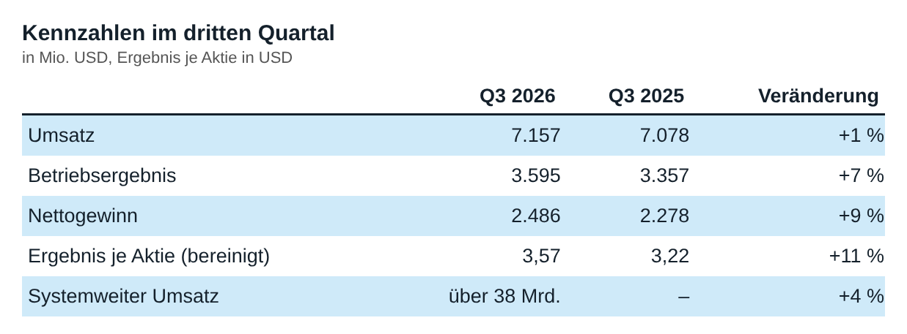

<!-- PRÜFEN: Die Pressemitteilung (PDF) konnte nur als Text gelesen werden, nicht als Seitenbild. Die beiden Tabellen im Artikel (f1, f2) sind eigene Darstellungen mit den Zahlen aus Seite 2 der Mitteilung. Bitte mit dem Original abgleichen. Original-Folien oder Seitenausschnitte bei Bedarf nachreichen. -->
<!-- PRÜFEN: Es liegt kein Kursbild vor (Yahoo-Screenshot nachreichen). Die Story läuft bis dahin ohne Kursbild. -->
<!-- PRÜFEN: Die Marge (rund 50 % im Quartal) ist aus den berichteten Zahlen gerechnet, nicht aus der Mitteilung übernommen. -->
<!-- PRÜFEN: Aufmacherfoto fehlt noch, Fotoanfrage ist angelegt. Das CEO-Foto wurde von Divi geliefert, Bildrechte bitte klären. -->

!!! kurz "Kurz gesagt"
    **Umsatz:** 7,2 Mrd. USD (+1 %)
    **Gewinn:** 2,5 Mrd. USD (+9 %)

    1. **Quartal:** Das Betriebsergebnis steigt um 7 % auf 3,6 Mrd. USD, das bereinigte Ergebnis je Aktie um 11 % auf 3,57 USD. Die Marge im Quartal liegt bei rund 50 %.
    2. **Schwäche in den USA:** Die vergleichbaren Umsätze sinken in den USA um 0,2 %, weltweit wachsen sie nur um 1,5 % (Vorjahr: +3,6 %).
    3. **Dividende:** Die Quartalsdividende steigt um 4 % auf 1,93 USD je Aktie.

## McDonald's im dritten Quartal: mehr Gewinn bei kaum wachsendem Umsatz

McDonald's hat im dritten Quartal 2026 den Umsatz um 1 % auf 7,2 Mrd. USD gesteigert (Vorjahr: 7,1 Mrd. USD). Der Gewinn wächst deutlich schneller als der Umsatz. Das liegt an der Struktur des Konzerns: Rund 95 % der mehr als 45.000 Restaurants gehören unabhängigen Betreibern, McDonald's verdient an Gebühren und Mieten und behält davon einen großen Teil als Ergebnis.

*Vergleichbare Umsätze im dritten Quartal 2026 nach Region. Eigene Darstellung nach Daten aus: McDonald's Corporation, Pressemitteilung vom 4. November 2026, S. 2 · [Original](https://corporate.mcdonalds.com/content/dam/sites/corp/nfl/pdf/MCD%20Q326%20-%20Exhibit%2099.1.pdf).*

### Das Quartal im Detail

Das Betriebsergebnis stieg um 7 % auf 3,6 Mrd. USD (Vorjahr: 3,4 Mrd. USD), ohne Sonderbelastungen um 8 %. Daraus ergibt sich nach unserer Rechnung eine Marge von rund 50 % nach 47 % im Vorjahr. Der Nettogewinn nach US-GAAP legte um 9 % auf 2,5 Mrd. USD zu, bereinigt um Sondereffekte um 10 % auf 2,5 Mrd. USD. Das Ergebnis je Aktie lag bei 3,57 USD bereinigt (+11 %, Vorjahr 3,22 USD) und bei 3,51 USD nach GAAP (+10 %). Es wächst etwas schneller als der Gewinn, weil McDonald's weniger Aktien im Umlauf hat: Die Zahl der verwässerten Aktien sank um 1 % auf 708,3 Mio. Die Sonderbelastungen vor Steuern betrugen 56 Mio. USD (Vorjahr: 39 Mio. USD), vor allem Umbaukosten im Zuge des Programms „Accelerating the Organization".

*Kennzahlen im dritten Quartal 2026 im Vergleich zum Vorjahr. Eigene Darstellung nach Daten aus: McDonald's Corporation, Pressemitteilung vom 4. November 2026, S. 2 und 5 · [Original](https://corporate.mcdonalds.com/content/dam/sites/corp/nfl/pdf/MCD%20Q326%20-%20Exhibit%2099.1.pdf).*

Bei den Erlösen entwickeln sich die Bereiche unterschiedlich. Die Einnahmen aus Franchise-Restaurants stiegen um 3 % auf 4,5 Mrd. USD. Der Umsatz der selbst betriebenen Restaurants sank um 3 % auf 2,5 Mrd. USD. Die sonstigen Erlöse legten um 26 % auf 189 Mio. USD zu. Der Umsatz aller Restaurants zusammen (systemweit) wuchs um 4 % auf über 38 Mrd. USD. Über das Treueprogramm liefen in 70 Märkten Umsätze von mehr als 11 Mrd. USD im Quartal.

### Die Regionen im Vergleich

Die vergleichbaren Umsätze, also Restaurants, die schon im Vorjahr offen waren, stiegen weltweit um 1,5 %, nach 3,6 % im Vorjahresquartal. In den USA sanken sie um 0,2 % (Vorjahr: +2,4 %). In den internationalen eigenen Märkten stiegen sie um 1,4 % (Vorjahr: +4,3 %), in den internationalen Lizenzmärkten um 4,2 % (Vorjahr: +4,7 %). In allen drei Bereichen hat sich das Wachstum also verlangsamt, am stärksten in den USA und in den eigenen Auslandsmärkten.

> „In den USA sehen wir eine Verbesserung im Verlauf des Quartals, nachdem wir bei den Preisen eingegriffen haben“, sagt Chris Kempczinski, Chairman und CEO von McDonald's. *Aus dem Englischen übersetzt, aus der Pressemitteilung.*

Kempczinski spricht von einem weiteren Quartal mit weltweitem Wachstum und solider Entwicklung im internationalen Geschäft. Der Konzern wolle jetzt „darauf aufbauen“ und in das nächste Kapitel des Wachstums investieren.

### Dividende

McDonald's erhöht die Quartalsdividende um 4 % auf 1,93 USD je Aktie. Zu Aktienrückkäufen und zum freien Cashflow nennt die Mitteilung keine Zahlen, sie verweist für Zusatzinformationen auf einen weiteren Anhang (Exhibit 99.2) der Börsenmeldung.

### Neun Monate

In den ersten neun Monaten 2026 stieg der Umsatz um 5 % auf 20,8 Mrd. USD (währungsbereinigt +2 %). Das Betriebsergebnis legte um 7 % auf 9,9 Mrd. USD zu, der Nettogewinn um 7 % auf 6,8 Mrd. USD. Das bereinigte Ergebnis je Aktie liegt bei 9,78 USD nach 9,08 USD im Vorjahreszeitraum (+8 %).

### Einordnung und Ausblick

Die Zahlen zeigen ein stabiles, aber langsamer wachsendes Geschäft. Der Gewinn steigt durch Gebühren, Kostenkontrolle und weniger Aktien, die Kundenzahlen und Umsätze in den Restaurants tun es kaum. Besonders in den USA bleibt das Wachstum schwach, und auch im Ausland hat es nachgelassen. Ob die Preisaktionen die Besserung dauerhaft tragen, lässt sich aus einem Quartal nicht ablesen. Eine Prognose für das Gesamtjahr nennt McDonald's in der Mitteilung nicht, der CEO spricht lediglich davon, aufbauen zu wollen. Die Dividendenerhöhung um 4 % setzt die lange Reihe steigender Ausschüttungen fort, bleibt aber unter dem Gewinnwachstum von 9 %.

*Quelle: McDonald's Corporation, Pressemitteilung vom 4. November 2026. Rechenwege eigene Berechnung. Keine Anlageberatung.*
