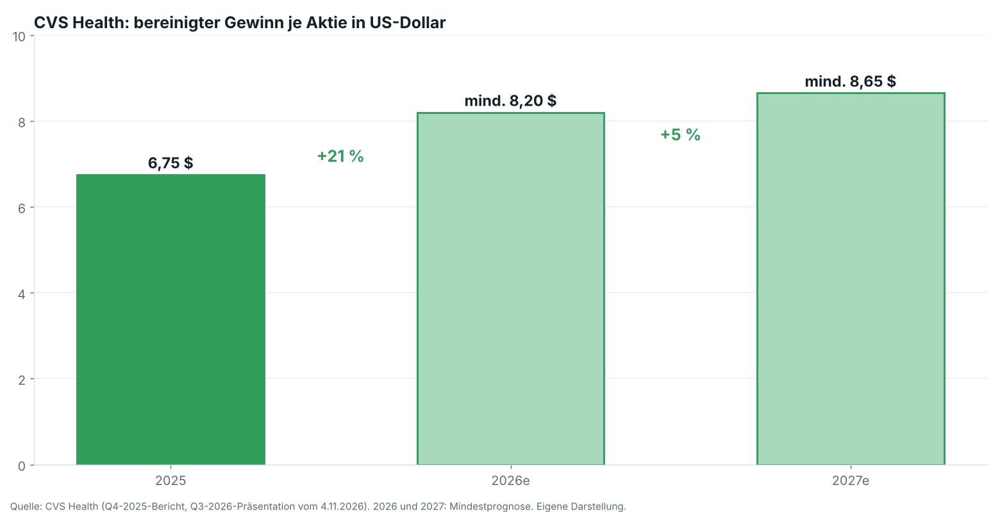
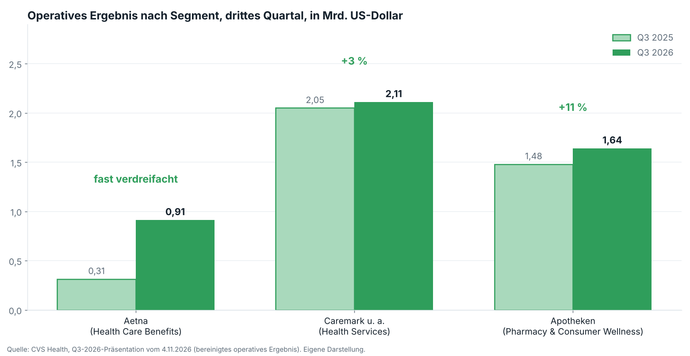
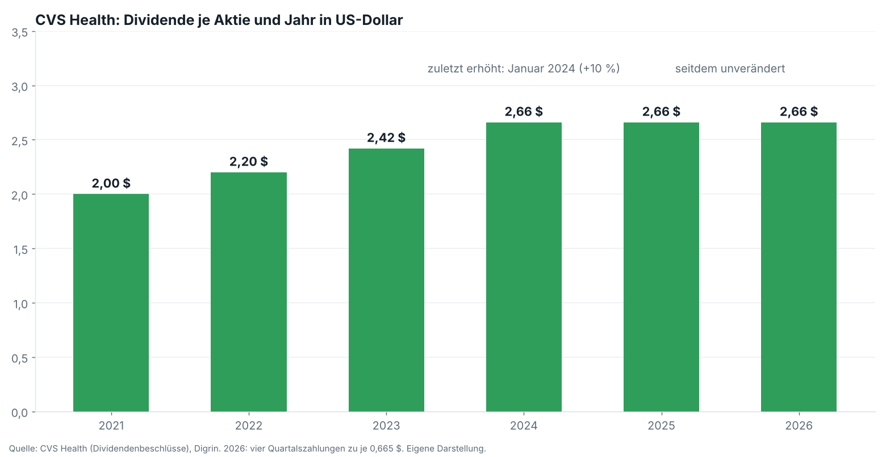
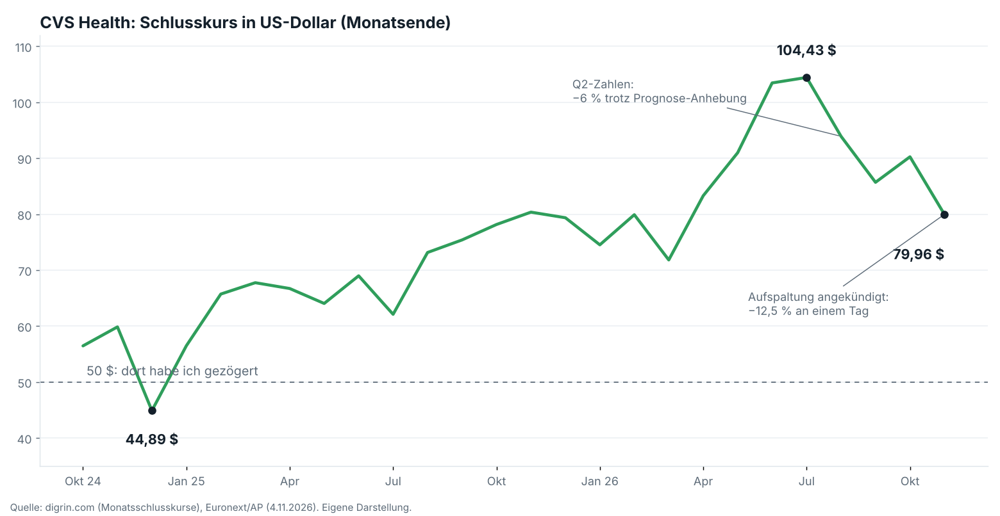

!!! kurz "Kurz gesagt"
    **Gewinn je Aktie (bereinigt):** 2,09 USD (+31 %)
    **Aktienkurs nach der Meldung:** 79,96 USD (−12,5 %)

    CVS meldet starke Zahlen, hebt die Prognose zum dritten Mal an und kündigt am selben Tag die Aufspaltung in zwei Börsenunternehmen bis 2028 an. Die Dividende von 2,66 USD ist gut gedeckt, ihre Zukunft nach der Trennung ist offen.

CVS war in diesem Jahr eine der Erholungsgeschichten am US-Markt: Von knapp 72 Dollar Ende März stieg die Aktie bis Ende Juli auf über 104 Dollar, und die Prognose wurde schon zum dritten Mal angehoben. Jetzt kommen wieder starke Quartalszahlen. Und am selben Tag kündigt der Konzern an, sich bis 2028 in zwei Börsenunternehmen aufzuspalten. Die Aktie verlor an einem Tag mehr als ein Achtel ihres Werts.

Viele Beobachter wirkten ratlos. Auf den ersten Blick läuft das Geschäft gut, ein Zwang zum Umbau ist von außen kaum zu erkennen. Die Erklärung liegt in der Politik, denn die Verbindung von Apotheken und Medikamenten-Einkauf steht in den USA unter Druck. Für Anleger stellt sich die Frage, was bleibt: vom Gewinn, von der Dividende und vom Wert der Aktie.

## Ein starkes Quartal, mit Einschränkung

Der Umsatz stieg im dritten Quartal um 5,4 % auf 108,4 Milliarden Dollar, der bereinigte Gewinn je Aktie um 31 % auf 2,09 Dollar, Analysten hatten 1,65 Dollar erwartet. Die Prognose für 2026 liegt nun bei mindestens 8,20 Dollar je Aktie, zu Jahresbeginn standen 7,00 bis 7,20 Dollar im Plan. Der Vergleich mit dem Vorjahr hinkt jedoch, denn damals belastete eine Abschreibung von 5,7 Milliarden Dollar das Ergebnis.

Getragen wird der Gewinn von der Versicherung Aetna. Ihr operatives Ergebnis stieg von 314 Millionen auf 912 Millionen Dollar, weil die Kosten für Behandlungen im Verhältnis zu den Prämien sanken (Medical Benefit Ratio 91,3 statt 92,8 %). Die Apotheken verdienten 11 % mehr, obwohl ihr Umsatz um 2 % sank, geholfen haben übernommene Rite-Aid-Standorte. Die Pharmacy-Benefit-Sparte um Caremark trat mit einem Plus von 3 % auf der Stelle.

Die Sanierung hat ihren Preis: Aetna setzt auf Marge vor Wachstum, die Zahl der Versicherten sank von 26,7 auf 26,1 Millionen. Für 2027 stellt CVS mindestens 8,65 Dollar je Aktie in Aussicht, nur noch rund 5 % mehr, nach 21 % in diesem Jahr. Caremark soll dann sogar schwächer ausfallen. Der Gewinn hängt damit stark an der Erholung bei Aetna, und die Branche kämpft weiter mit hohen Behandlungskosten.

## Die Aufspaltung

CVS teilt sich in zwei Börsenunternehmen. Bei CVS Health unter David Joyner bleiben Aetna, Caremark, die Spezialapotheken sowie Oak Street Health und Signify Health. Die neue CVS Pharmacy unter Prem Shah erhält rund 9.000 Filialen, die Versandapotheke und die MinuteClinics. Aktionäre sollen Anteile an beiden bekommen, der Abschluss ist für das erste Halbjahr 2028 geplant, steuerfrei nach US-Bundessteuer, sofern Verwaltungsrat, Börsenaufsicht und Steuerbestätigung zustimmen.

Das Management nennt mehr Fokus, eigene Kapitalverteilung und eine einfachere Struktur. Joyner betont, der Schritt sei möglich geworden, weil sich beide Teile verbessert haben, und kein Zeichen von Not. Analysten sehen auch einen politischen Hintergrund. CVS bekämpft vor Gericht Gesetze in Arkansas und Tennessee, die den gleichzeitigen Besitz von Apotheken und Pharmacy-Benefit-Managern verbieten, ähnliche Initiativen gibt es im Kongress. Die Trennung könnte einer Regelung zuvorkommen. Hinzu kommt die Skepsis der Investoren, denn Details fehlen: Wie die Schulden von 60,7 Milliarden Dollar verteilt werden, ist offen, und der Ausblick für 2027 gilt als schwächer als bei Wettbewerbern.

Für die Trennung spricht, dass beide Teile unterschiedlich sind. Eine Versicherung und eine Filialkette brauchen andere Investitionen, und der Markt kann sie getrennt bewerten. Ob zwei Unternehmen zusammen mehr wert sind als eines, zeigt sich erst, wenn CVS Zahlen je Gesellschaft vorlegt.

## Die Dividende

CVS zahlt 0,665 Dollar je Quartal, 2,66 Dollar im Jahr, bei 79,96 Dollar Kurs sind das 3,3 % Rendite. Gekürzt wurde die Dividende seit 29 Jahren nicht, erhöht zuletzt im Januar 2024, seither steht sie still.

Die Deckung ist komfortabel: Sie beansprucht 32 % des bereinigten Gewinns und nach US-GAAP 38 %, vom freien Cashflow der ersten neun Monate frisst sie rund ein Fünftel (eigene Rechnung). Die Bilanz entspannt sich, die Schulden sanken seit Jahresende von 64,6 auf 60,7 Milliarden Dollar, im vierten Quartal sollen wieder Aktien zurückgekauft werden. Eine Dividendenpolitik für die beiden künftigen Unternehmen hat CVS nicht genannt. Wer heute 2,66 Dollar bezieht, hält nach der Trennung Anteile an zwei Firmen, ob beide Ausschüttungen zusammen diese Summe erreichen, ist offen.

## Bewertung und Risiken

Zum Kurs von 79,96 Dollar kostet die Aktie das 9,8-Fache des erwarteten Gewinns 2026 (eigene Rechnung), im August waren es bei 94 Dollar noch 11,5. Seit dem Hoch im Juli hat sie 23 % verloren. Der Abschlag hat Gründe: Der Gewinn lebt von der Margenerholung bei Aetna, ein Teil davon aus Rückstellungsauflösungen, die sich nicht beliebig wiederholen. 2027 gilt als Zwischenjahr. Der Cashflow sprang von 7,2 auf 15,3 Milliarden Dollar in neun Monaten, ohne dass CVS erklärt, ob das von Dauer ist. Und die Trennung bindet bis 2028 Management und Geld.

Entscheidend werden die Registrierungsunterlagen zur Abspaltung, die Zahlen je Gesellschaft, Schuldenaufteilung und Dividendenpolitik enthalten dürften. Dazu kommen die Medical Benefit Ratio im vierten Quartal, die Größe des Rückkaufs und die Frage, ob Gerichte oder Gesetzgeber die Verbindung von Apotheken und Pharmacy-Benefit-Managern vorher einschränken.

Das ist eine Einordnung der Zahlen und keine Kaufempfehlung.

## Quellen

- [CVS Health: Q3-2026-Präsentation und Gewinnmitteilung, 4.11.2026](https://www.cvshealth.com/content/dam/enterprise/cvs-enterprise/pdfs/2026/Q3-2026-EarningsRelease.pdf)
- [Euronext/AP: CVS to break up $117 billion business, shares fall](https://live.euronext.com/en/financial-news/cvs-break-117-billion-business-separating-pharmacies-insurance-shares-fall)
- [Healthcare Dive: CVS to split into two companies](https://www.healthcaredive.com/news/cvs-split-two-companies-strategic-about-face/873660/)
- [Star-Advertiser: CVS shares plunge 13 % after plan to split](https://www.staradvertiser.com/2026/11/04/breaking-news/cvs-shares-plunge-13-after-surprise-plan-to-split-company/)
- [Yahoo Finance: Q3 earnings call focuses on planned pharmacy separation](https://finance.yahoo.com/healthcare/articles/cvs-health-q3-earnings-call-180500873.html)
- [Motley Fool: Q3-2026-Transkript](https://www.fool.com/earnings/call-transcripts/2026/11/04/cvs-health-cvs-q3-2026-earnings-call-transcript/)
- [CVS Health: Q4-/Gesamtjahr 2025](https://www.cvshealth.com/news/company-news/cvs-health-corporation-reports-fourth-quarter-and-full-year-2025-results)
- [TIKR: Aktie und Ausblick nach Q2](https://www.tikr.com/de/blog/is-cvs-health-stock-a-buy-after-its-2027-outlook-rattled-investors)
- [Digrin: Kurs- und Dividendenhistorie](https://www.digrin.com/stocks/detail/CVS/)
- Aktienfinder, Stand 7.11.2026

*Dieser Beitrag fasst Unternehmensangaben und Berichterstattung der genannten Quellen in eigenen Worten zusammen. Eigene Berechnungen sind als solche gekennzeichnet. Alle Angaben ohne Gewähr.*
