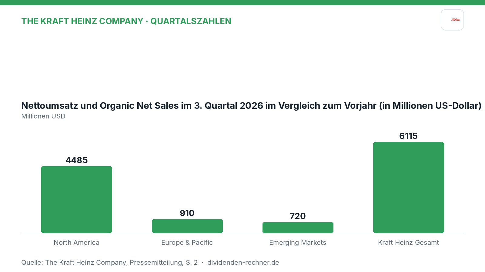
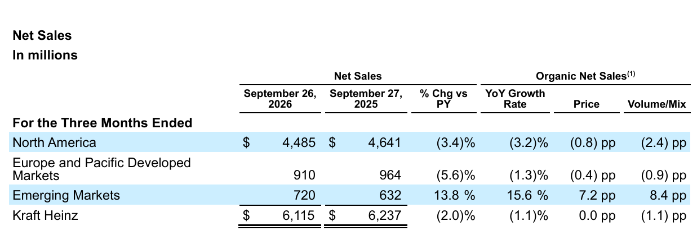
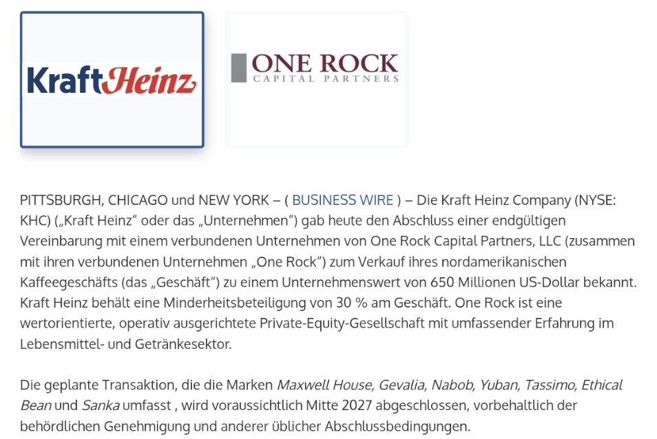

<!-- PRÜFEN: Aufmacherfoto ist automatisch von Unsplash gewaehlt: bitte pruefen, ob es zum Artikel passt (sonst image-Zeilen entfernen, dann entsteht ein Titelbild automatisch). -->
<!-- PRÜFEN: Diese Werte wurden im Berichtstext nicht gefunden: Grafik North America: 4485; Grafik Kraft Heinz Gesamt: 6115 -->
<!-- PRÜFEN: Quelle: https://ir.kraftheinzcompany.com/media/document/4da1f969-7485-48b1-99a1-6732690250a4/assets/EX_99.1_-_ER_Q3_2026_vFinal.pdf?disposition=inline -->
<!-- PRÜFEN: Ausschnitte aus dem Bericht im Text (f1): bitte prüfen, ob Zuschnitt und Platz passen. Unpassende Bildzeilen einfach löschen. -->

!!! kurz "Kurz gesagt"
    **Umsatz:** 6,1 Mrd. USD (−2,0 %)
    **Gewinn:** 536,0 Mio. USD (−12,6 %)

    1. **Treiber und Bremser:** Während das Segment Emerging Markets mit einem organischen Wachstum von 15,6 % stark zulegt, belasten rückläufige Umsätze in Nordamerika (−3,4 %) und in Europa und Pacific Developed Markets (−5,6 %) das Gesamtgeschäft.
    2. **Kaffeegeschäft verkauft:** Kraft Heinz verkauft sein nordamerikanisches Kaffeegeschäft (u. a. Maxwell House) für 650 Mio. USD an One Rock Capital Partners und behält 30 %.
    3. **Ausblick und Risiken:** Der Konzern hebt die untere Spanne seiner Prognose für das organische Nettowachstum an, steht jedoch weiterhin unter Druck durch Inflation bei Beschaffung und Logistik sowie sinkende Volumina.

## Kraft Heinz im dritten Quartal: weniger Umsatz, weniger Gewinn, Ausblick leicht höher

Im dritten Quartal 2026 zeigt sich bei The Kraft Heinz Company ein durchmischtes Bild. Neben der Auswertung des Hauptberichts flossen auch die Einblicke aus der separat veröffentlichten Geschäftspräsentation in diese Analyse ein, die Details zu den geplanten Investitionen und der strategischen Ausrichtung liefert. Der Konzern kämpft in wichtigen Märkten mit rückläufigen Volumina, treibt aber parallel den Umbau und gezielte Investitionen in Marken und Vertrieb voran.

*Eigene Darstellung nach Daten aus: The Kraft Heinz Company, Quartalszahlen vom 2026-11-04 · [Original](https://ir.kraftheinzcompany.com/media/document/4da1f969-7485-48b1-99a1-6732690250a4/assets/EX_99.1_-_ER_Q3_2026_vFinal.pdf?disposition=inline) · [Unterlage 2](https://ir.kraftheinzcompany.com/media/document/a1827369-0616-435c-b026-c748df9916c5/assets/3Q26_KHC_Business_Update_vFinal2.pdf?disposition=inline).*

### Das Quartal im Detail

Im abgelaufenen Quartal bis zum 26. September 2026 sank der Nettoumsatz des Lebensmittelkonzerns um 2,0 % auf 6,1 Mrd. USD (verglichen mit 6,2 Mrd. USD im Vorjahreszeitraum). Auf Basis des organischen Wachstums, das Währungseffekte und Portfoliobereinigungen herausrechnet, betrug der Rückgang 1,1 %. Der operative Gewinn (Operating Income) verschlechterte sich um 14,6 % auf 875,0 Mio. USD (Vorjahr: 1,0 Mrd. USD). Der Nettogewinn nach GAAP-Rechnungslegung lag bei 536,0 Mio. USD nach 613,0 Mio. USD im Vorjahr, was einem Minus von 12,6 % entspricht. Das bereinigte operative Ergebnis (Adjusted Operating Income) sank um 15,2 % auf 939,0 Mio. USD (Vorjahr: 1,1 Mrd. USD).

*Nettoumsatz nach Regionen im 3. Quartal 2026. Quelle: The Kraft Heinz Company, Quartalszahlen vom 2026-11-04, S. 2 · [Original](https://ir.kraftheinzcompany.com/media/document/4da1f969-7485-48b1-99a1-6732690250a4/assets/EX_99.1_-_ER_Q3_2026_vFinal.pdf?disposition=inline) · [Unterlage 2](https://ir.kraftheinzcompany.com/media/document/a1827369-0616-435c-b026-c748df9916c5/assets/3Q26_KHC_Business_Update_vFinal2.pdf?disposition=inline). Ausschnitt nur zugeschnitten, sonst unverändert.*

Die regionalen Trends verlaufen sehr unterschiedlich. Während Nordamerika als größter Markt einen Umsatzrückgang auf 4,5 Mrd. USD (−3,4 %) verzeichnete und Europa sowie Pacific Developed Markets ebenfalls schwächelten (Umsatz von 910,0 Mio. USD, −5,6 %), glänzten die Emerging Markets mit einem kräftigen Umsatzsprung auf 720,0 Mio. USD (+13,8 %, organisch +15,6 %). Konzernchef Steve Cahillane betonte die Fortschritte beim Umbauplan.

!!! zitat "Steve Cahillane, CEO von Kraft Heinz"
    {: .zitatfoto }
    „Unser Betriebsplan 2026, um das US-Geschäft zu drehen und das internationale Wachstum zu beschleunigen, liegt im Zeitplan.“

    Aus dem Englischen übersetzt, aus der Pressemitteilung. Foto: Kraft Heinz

### Verkauf des nordamerikanischen Kaffeegeschäfts

Zusätzlich zu den Quartalszahlen meldet Kraft Heinz den Abschluss einer endgültigen Vereinbarung über den Verkauf seines nordamerikanischen Kaffeegeschäfts an einen verbundenen Fonds von One Rock Capital Partners. Der Unternehmenswert liegt bei 650 Mio. USD. Kraft Heinz behält eine Minderheitsbeteiligung von 30 % am Geschäft. Zu den Marken gehören Maxwell House, Gevalia, Nabob, Yuban, Tassimo, Ethical Bean und Sanka. Der Abschluss wird Mitte 2027 erwartet, vorbehaltlich behördlicher Genehmigungen.

*Pressemitteilung zum Verkauf des Kaffeegeschäfts (Business Wire). Ausschnitt nur zugeschnitten, sonst unverändert.*

Der Nettoerlös nach Steuern soll bei rund 500 Mio. USD liegen und zur Schuldentilgung dienen. Rund 250 Vollzeitbeschäftigte sowie die Kaffeeproduktionsstätten in Jacksonville (Florida) und Vancouver (British Columbia) wechseln mit. Kraft Heinz erwartet eine positive Wirkung auf Wachstum und Gewinnmarge, weil sich der Konzern auf Bereiche konzentrieren will, in denen er schneller wachsen kann. Der Verkauf ist aber auch ein Abschied von traditionsreichen Marken und senkt den Umsatz in Nordamerika, dem ohnehin schwächsten Markt des Konzerns.

CEO Steve Cahillane nennt den Schritt wichtig für die Wertsteigerung des Portfolios und die Beschleunigung der Transformation. Die Marken hätten über Generationen im Leben der Kaffeetrinker eine Rolle gespielt, die Beteiligung zeige das Vertrauen in ihr Potenzial unter One Rock.

### Dividende und Kapitalrückführung

Im bisherigen Jahresverlauf hat Kraft Heinz 1,4 Mrd. USD in Form von Bardividenden an seine Aktionäre ausgeschüttet. Auf Aktienrückkäufe aus dem öffentlich angekündigten Programm verzichtet Kraft Heinz im Berichtszeitraum. Die starke Cashflow-Generierung unterstützt laut Management die Disziplin bei der Kapitalallokation zwischen Dividenden, Schuldenabbau und Investitionen in das operative Geschäft.

### Schulden und Cashflow

Die Bilanzstruktur zum Stichtag zeigt liquide Mittel und kurzfristige Anlagen, denen erhebliche Finanzverbindlichkeiten gegenüberstehen. Der operative Cashflow belief sich in den ersten neun Monaten des Jahres auf 3,0 Mrd. USD (gegenüber 3,1 Mrd. USD im Vorjahreszeitraum). Nach Abzug von Investitionsausgaben (Capex) in Höhe von 599,0 Mio. USD verbleibt ein Free Cash Flow von 2,4 Mrd. USD. Das Unternehmen hält an einer soliden Bilanz fest, um die finanzielle Flexibilität zu wahren.

### Einordnung und Ausblick

Die Zahlen spiegeln die Herausforderungen wider, denen sich etablierte Konsumgüterkonzerne derzeit gegenübersehen: Inflationsbedingter Kostendruck bei Beschaffung und Logistik sowie verändertes Konsumverhalten belasten die Margen und Volumina. Dennoch zeigt die gezielte Investitionsoffensive in den Schwellenländern und im Bereich Away-From-Home erste Erfolge. Für das Gesamtjahr 2026 hat das Management die untere Spanne der Prognose für das organische Nettowachstum leicht angehoben, rechnet aber weiterhin mit einem anspruchsvollen Marktumfeld.

*Quelle: The Kraft Heinz Company, Quartalszahlen vom 2026-11-04. Rechenwege eigene Berechnung. Keine Anlageberatung.*
