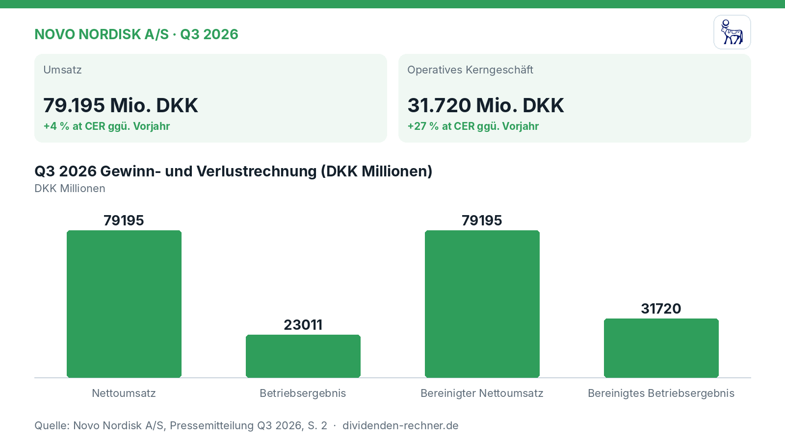
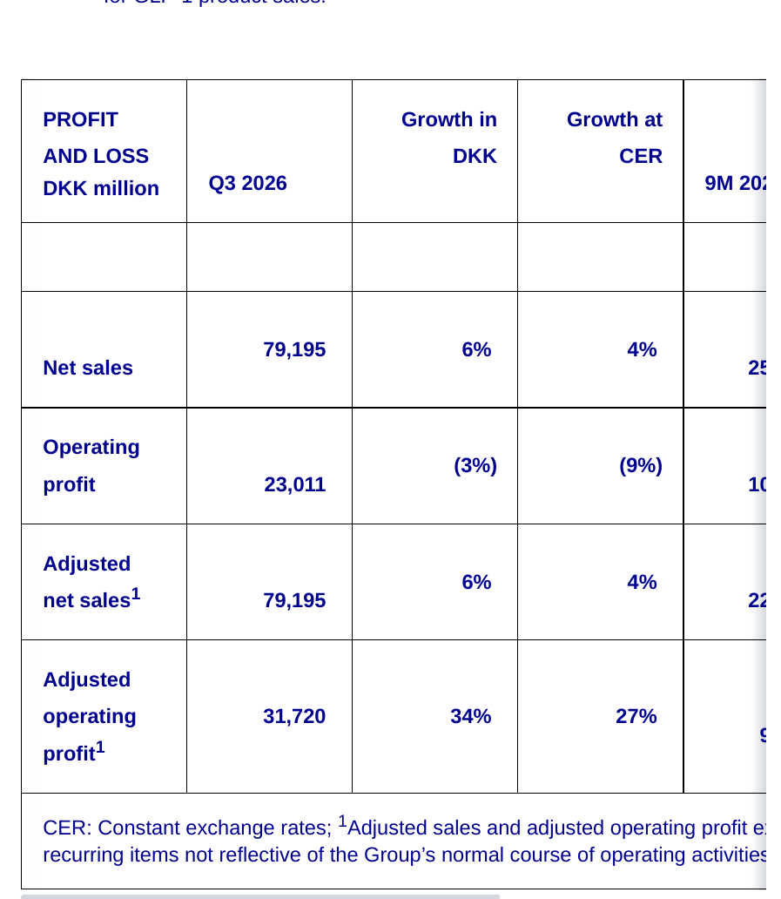

<!-- PRÜFEN: Aufmacherfoto ist automatisch von Unsplash gewaehlt: bitte pruefen, ob es zum Artikel passt (sonst image-Zeilen entfernen, dann entsteht ein Titelbild automatisch). -->
<!-- PRÜFEN: Diese Werte wurden im Berichtstext nicht gefunden: Grafik Nettoumsatz: 79195; Grafik Betriebsergebnis: 23011; Grafik Bereinigter Nettoumsatz: 79195; Grafik Bereinigtes Betriebsergebnis: 31720 -->
<!-- PRÜFEN: Quelle: https://www.novonordisk.com/news-and-media/news-and-ir-materials/news-details.html?id=919765# -->
<!-- PRÜFEN: Ausschnitte aus dem Bericht im Text (f1): bitte prüfen, ob Zuschnitt und Platz passen. Unpassende Bildzeilen einfach löschen. -->

!!! kurz "Kurz gesagt"
    **Umsatz:** 79,2 Mrd. DKK (+4 %)
    **Gewinn:** 31,7 Mrd. DKK (+27 %)

    1. **Treiber:** Vor allem das anhaltende Wachstum bei GLP-1-Medikamenten, insbesondere im Bereich Adipositas, treibt das Geschäft in den USA und international an.
    2. **Ausblick:** Das Unternehmen hebt die Jahresprognose für das bereinigte Umsatz- und operative Ergebniswachstum auf jeweils -2 % bis +2 % zu konstanten Wechselkursen an.
    3. **Risiko:** Berichtetes Betriebsergebnis sinkt durch Sondereffekte und nicht-zahlungswirksame Wertberichtigungen um 9 %.

## Novo Nordisk wächst im dritten Quartal dank starker Nachfrage nach GLP-1-Produkten

Novo Nordisk hat im dritten Quartal 2026 ein solides Umsatzwachstum erzielt. Gestützt auf die anhaltende Nachfrage nach GLP-1-Präparaten steigerte der dänische Pharmakonzern den **Nettoumsatz** auf **79.195 Mio. DKK**, was einem währungsbereinigten Plus von **4 %** entspricht. Wie der Bericht zeigt, trugen sowohl die US-Operationen als auch das internationale Geschäft zu dieser Entwicklung bei.

*Eigene Darstellung nach Daten aus: Novo Nordisk A/S, Quartalszahlen Q3 2026 vom 2026-11-04 · [Original](https://www.novonordisk.com/news-and-media/news-and-ir-materials/news-details.html?id=919765#).*

### Operatives Ergebnis und bereinigte Kennzahlen

Das operative Kerngeschäft entwickelte sich im Berichtszeitraum erfreulich. Das bereinigte operative Ergebnis kletterte auf **31.720 Mio. DKK**, ein Zuwachs von **27 %** zu konstanten Wechselkursen. Dies ist unter anderem auf eine günstige Vergleichsbasis nach Transformationstransaktionen im Vorjahreszeitraum zurückzuführen. Das gemeldete Betriebsergebnis ging dagegen um **9 %** auf **23.011 Mio. DKK** zurück, was durch nicht-zahlungswirksame Wertberichtigungen in Höhe von insgesamt 8,7 Milliarden DKK für Ziltivekimab sowie die Anpassung des Produktionsnetzwerks belastet wurde.

*Gewinn- und Verlustrechnung Q3 2026. Quelle: Novo Nordisk A/S, Quartalszahlen Q3 2026 vom 2026-11-04 · [Original](https://www.novonordisk.com/news-and-media/news-and-ir-materials/news-details.html?id=919765#). Ausschnitt nur zugeschnitten, sonst unverändert.*

### Fortschritte bei Produkten und Pipeline

Im kommerziellen Bereich zeigt sich vor allem die Einführung des Wegovy-Pills in den USA, den Vereinigten Arabischen Emiraten, dem Vereinigten Königreich und Deutschland als starker Wachstumstreiber mit einem Quartalsumsatz von 5.394 Mio. DKK. Auch die Vermarktung des Ozempic-Pills in den USA zeigt laut Unternehmen eine positive Dynamik bei den Neurezepten. In der Forschung und Entwicklung meldet Novo Nordisk Fortschritte bei der Pipeline, darunter positive Studienergebnisse für CagriSema bei Adipositas und Typ-2-Diabetes.

### Einordnung der aktuellen Situation

Das Unternehmen knüpft mit den vorgelegten Quartalszahlen an den bisherigen Kurs an, muss sich jedoch im hart umkämpften Markt für Diabetes- und Adipositastherapien gegen steigenden Wettbewerb behaupten. Die angehobene Jahresprognose für das bereinigte Umsatz- und Ergebniswachstum unterstreicht die Zuversicht des Managements für die kommenden Monate. Dennoch bleiben Investoren gefordert, die Entwicklung der Produktionskapazitäten und die regulatorischen Fortschritte bei neuen Pipeline-Kandidaten wie CagriSema im Auge zu behalten.

## Die wichtigsten Zahlen im Überblick

| Kennzahl | Wert | Veränderung zum Vorjahr | Quelle |
|---|---|---|---|
| Umsatz | 79.195 Mio. DKK | +4 % at CER | S. 2 |
| Operatives Kerngeschäft | 31.720 Mio. DKK | +27 % at CER | S. 2 |

*Quelle: Novo Nordisk A/S, Quartalszahlen Q3 2026 vom 2026-11-04. Rechenwege eigene Berechnung. Keine Anlageberatung.*
