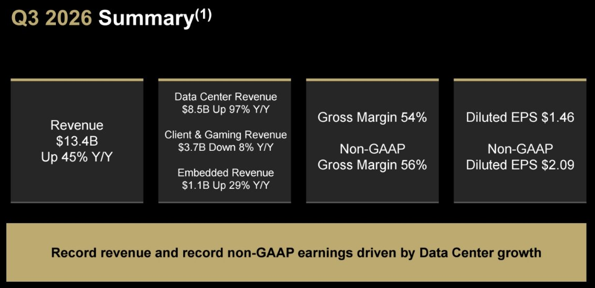
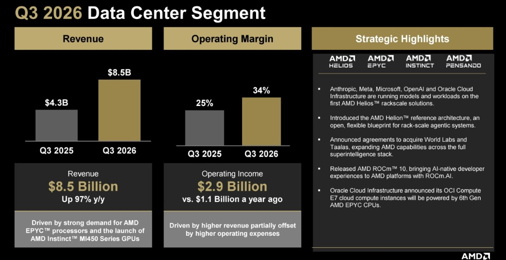
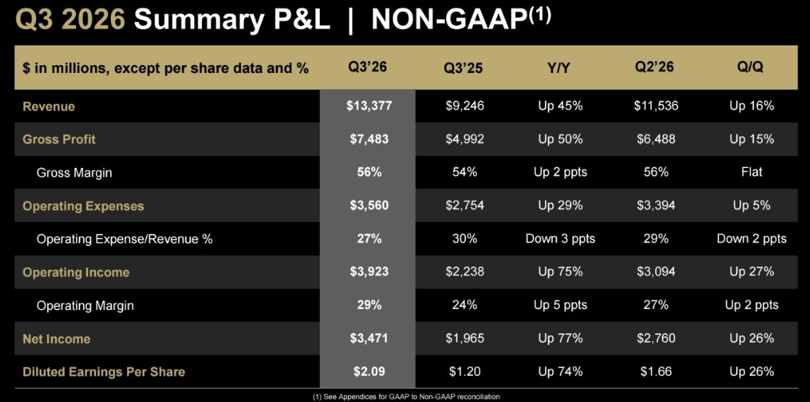
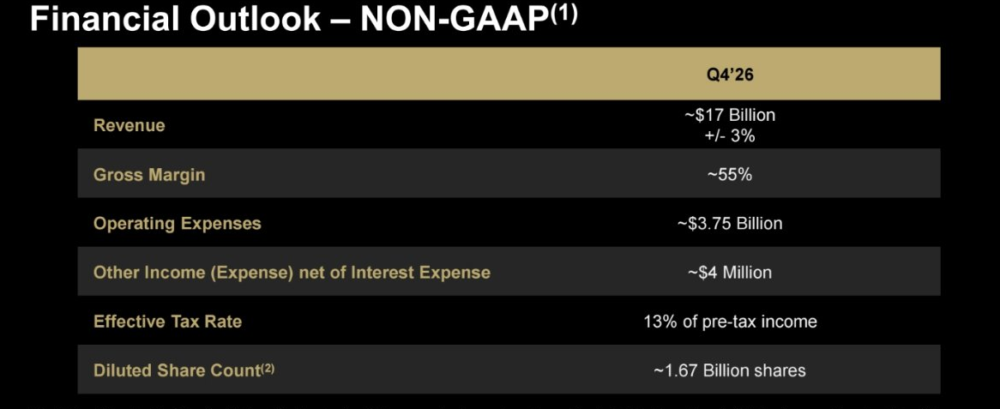

<!-- PRÜFEN: Aufmacherfoto fehlt noch, die Fotoanfrage (Rechenzentrum/Chip) ist angelegt, der Bot ergänzt es. -->
<!-- PRÜFEN: Kursangaben (Schluss 483,90 USD, +3,65 %; nachbörslich 517,82 USD, +7,01 % um 16:20 Uhr EST) stammen aus dem eigenen Yahoo-Finance-Screenshot vom 03.11.2026, 22:20 Uhr. Nachbörsliche Kurse schwanken stark. Nutzungsbedingungen von Yahoo prüfen. -->
<!-- PRÜFEN: Es liegt nur die Präsentation vor, keine Pressemitteilung. Aussagen des Managements und das Zitat von Lisa Su fehlen deshalb, ebenso Dividende (AMD zahlt meines Wissens keine, nicht belegt). Foto von Lisa Su: Nutzungsrecht prüfen. -->
<!-- PRÜFEN: Bereinigte (non-GAAP) und GAAP-Zahlen sind getrennt genannt. Der Unterschied beim Gewinn kommt vor allem aus dem Posten Warrants (1,1 Mrd. USD), siehe Anhang S. 23. -->
<!-- PRÜFEN: Ausschnitte aus der Präsentation (f1 bis f4): bitte prüfen, ob Zuschnitt und Platz passen. Unpassende Bildzeilen einfach löschen. -->

!!! kurz "Kurz gesagt"
    **Umsatz:** 13,4 Mrd. USD (+45 %)
    **Gewinn (bereinigt):** 3,47 Mrd. USD (+77 %)

    1. **Treiber:** Das Rechenzentrumsgeschäft wächst um 97 % auf 8,5 Mrd. USD und liefert mehr als 60 % des Umsatzes. Der Bereich Client & Gaming (PCs, Spielekonsolen) schrumpft dagegen um 8 %.
    2. **Ausblick:** Für das vierte Quartal erwartet AMD rund 17 Mrd. USD Umsatz (±3 %), das wären gut 27 % mehr als im dritten Quartal.
    3. **Börse:** Die Aktie schloss am Dienstag bei 483,90 USD (+3,65 %) und legte nach Veröffentlichung nachbörslich um rund 7 % auf 517,82 USD zu.

## Rechenzentrum treibt das Rekordquartal

AMD setzt im dritten Quartal 2026 **13,4 Mrd. USD** um, nach 9,2 Mrd. USD vor einem Jahr und 11,5 Mrd. USD im Vorquartal. Das ist ein Plus von **45 Prozent** zum Vorjahr und 16 Prozent zum Vorquartal. Die Bruttomarge liegt bei 54 Prozent (bereinigt 56 Prozent, Vorjahr 54 Prozent). Der bereinigte operative Gewinn steigt um 75 Prozent auf 3,9 Mrd. USD, die bereinigte operative Marge auf 29 Prozent.

Der Nettogewinn nach US-Rechnungslegung (GAAP) verdoppelt sich fast: 2,4 Mrd. USD und 1,46 USD je Aktie nach 0,75 USD. **Bereinigt** (ohne Aktienvergütung, Abschreibungen auf Zukäufe und Sondereffekte) sind es 3,5 Mrd. USD und **2,09 USD je Aktie** nach 1,20 USD, also **74 Prozent mehr**. AMD selbst spricht von Rekordumsatz und Rekordgewinn.

*Zusammenfassung des dritten Quartals 2026. Quelle: AMD, Präsentation Q3 2026, S. 18. Ausschnitt nur zugeschnitten, sonst unverändert.*

## Die drei Segmente laufen sehr unterschiedlich

Das **Rechenzentrum** (Prozessoren und KI-Beschleuniger) erlöst **8,5 Mrd. USD** nach 4,3 Mrd. USD, ein Plus von 97 Prozent. Der operative Gewinn steigt von 1,1 Mrd. auf 2,9 Mrd. USD, die Marge von 25 auf 34 Prozent. AMD führt das auf die starke Nachfrage nach EPYC-Prozessoren und den Start der Instinct-Beschleuniger MI450 zurück. Als Kunden auf der Helios-Rack-Lösung nennt die Präsentation Anthropic, Meta, Microsoft, OpenAI und Oracle Cloud.

*Segment Rechenzentrum im dritten Quartal 2026. Quelle: AMD, Präsentation Q3 2026, S. 14. Ausschnitt nur zugeschnitten, sonst unverändert.*

**Client & Gaming** fällt um 8 Prozent auf 3,7 Mrd. USD. Der operative Gewinn sinkt um 34 Prozent auf 573 Mio. USD, die Marge von 21 auf 15 Prozent. Als Gründe nennt AMD weniger Umsatz mit Semi-Custom-Chips und Grafik, teilweise ausgeglichen durch höhere Verkäufe bei PC-Prozessoren. Das Segment **Embedded** (Chips für Luftfahrt, Auto, Kommunikation, Industrie) wächst um 29 Prozent auf 1,1 Mrd. USD, der operative Gewinn steigt um 60 Prozent auf 453 Mio. USD.

Damit hängt AMD stärker am Rechenzentrum: Es steuert gut 60 Prozent des Umsatzes und über 70 Prozent der Segmentgewinne bei. Fällt die KI-Nachfrage, trifft das AMD entsprechend härter, genau wie es jetzt vom Boom profitiert.

*Bereinigte Gewinn- und Verlustrechnung (non-GAAP). Quelle: AMD, Präsentation Q3 2026, S. 11. Ausschnitt nur zugeschnitten, sonst unverändert.*

## Bilanz: mehr Cash, aber auch mehr Schulden

Die liquiden Mittel und kurzfristigen Anlagen steigen auf 15,8 Mrd. USD (Vorquartal 13,1 Mrd.). Die Gesamtschulden mehr als verdoppeln sich auf 7,1 Mrd. USD nach 3,2 Mrd., unter anderem durch Anleihen über 4,75 Mrd. USD im August. Die Vorräte wachsen um 35 Prozent auf 11,5 Mrd. USD, die Forderungen um 26 Prozent auf 9,2 Mrd. USD. Beides passt zu stark wachsendem Geschäft, bindet aber Kapital.

Beim GAAP-Gewinn fällt ein Sonderposten auf: Die Neubewertung von Optionsscheinen (Warrants), die AMD bestimmten Kunden ausgegeben hat, belastet das Ergebnis mit 1,1 Mrd. USD (0,66 USD je Aktie). Der Wert hängt am AMD-Aktienkurs. Dem steht ein Steuereffekt von gut 1 Mrd. USD gegenüber. Beides ist im bereinigten Ergebnis herausgerechnet. Für das vierte Quartal plant AMD außerdem Übernahmen von Taalas und World Labs, der Abschluss wird bis Ende 2026 erwartet und steht unter dem Vorbehalt der Genehmigungen.

## Ausblick und Einordnung

Für das vierte Quartal plant AMD mit rund **17 Mrd. USD Umsatz** (plus/minus 3 Prozent), einer bereinigten Bruttomarge von etwa 55 Prozent und Betriebskosten von rund 3,75 Mrd. USD. Die Steuerquote soll bei 13 Prozent liegen, die Aktienzahl bei rund 1,67 Milliarden.

*Ausblick für das vierte Quartal 2026 (non-GAAP). Quelle: AMD, Präsentation Q3 2026, S. 17. Ausschnitt nur zugeschnitten, sonst unverändert.*

Die Aktie schloss vor der Veröffentlichung bei 483,90 USD und stieg nachbörslich um rund 7 Prozent auf 517,82 USD. Solche Kurse im nachbörslichen Handel sind dünn gehandelt und können sich am nächsten Handelstag deutlich ändern. Offen bleibt, wie nachhaltig das Wachstum im Rechenzentrum ist: Der Ausblick zeigt einen weiteren Sprung, die Segmente Client & Gaming zeigen aber, dass nicht alle Bereiche mitwachsen. Dieser Beitrag ist keine Anlageberatung.
