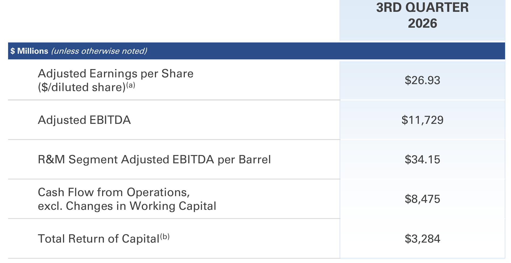
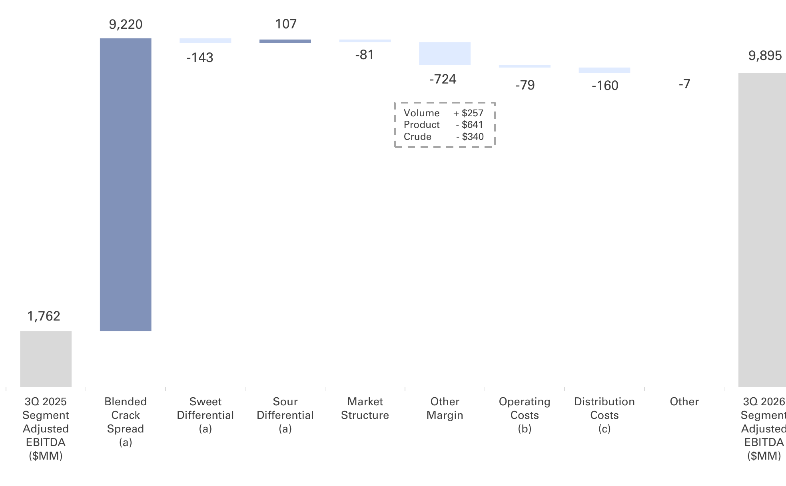

<!-- PRÜFEN: Aufmacher ist ein NASA-Foto (gemeinfrei) der Marathon-Raffinerie Garyville von oben. Bild ist eher nüchtern, bei Bedarf gegen ein dramatischeres Raffineriefoto tauschen. -->
<!-- PRÜFEN: Kursangabe (427,94 USD, -0,57 %, Stand 12:00 Uhr EST am 03.11.2026) stammt aus dem eigenen Yahoo-Finance-Screenshot vom 03.11.2026, 18:00 Uhr. Das Kursbild für die Story ist daraus zugeschnitten. Nutzungsbedingungen von Yahoo prüfen. -->
<!-- PRÜFEN: Nicht in der Präsentation enthalten: Umsatz, Dividende je Aktie (laut Pressemitteilung um 10 % erhöht, Betrag nicht gefunden). Deshalb stehen oben EBITDA und Gewinn je Aktie statt Umsatz und Gewinn. -->
<!-- PRÜFEN: Zahlen zu Diesel- und Crack-Spreads und zum Dieselpreis stammen aus Drittquellen (Hydrocarbon Processing, Axios, EIA über Energy News Beat), nicht aus der Marathon-Präsentation. Der Dieselpreis der EIA (6,35 USD je Gallone, Woche zum 26.10.) ist aus zweiter Hand. -->
<!-- PRÜFEN: Pressemitteilung: R&M-Marge 45,70 USD je Barrel (Vorjahr 17,60 USD), Auslastung 100 % (Vorjahr 95 %), Verkaufspreis Raffinerien 4,2 Mrd. USD (3,45 Mrd. für MPC, 750 Mio. für MPLX), 5 Mrd. USD zusätzliche Rückkaufermächtigung. -->
<!-- PRÜFEN: Zitat der CEO stammt aus der Pressemitteilung vom 03.11.2026 (englisch, hier sinngemäß übersetzt). Foto: Unternehmensporträt, Nutzungsrecht prüfen. -->
<!-- PRÜFEN: Ausschnitte aus der Präsentation (f1, f2): bitte prüfen, ob Zuschnitt und Platz passen. Unpassende Bildzeilen einfach löschen. -->

!!! kurz "Kurz gesagt"
    **Bereinigtes EBITDA:** 11,7 Mrd. USD (+266 %)
    **Gewinn je Aktie:** 26,93 USD (Vorjahr 3,01 USD)

    1. **Treiber:** Das Raffineriegeschäft liefert 9,9 Mrd. USD bereinigtes EBITDA, gut das Fünffache der 1,8 Mrd. im Vorjahr. Fast der gesamte Sprung kommt aus höheren Margen für Kraftstoffe wie Diesel, nicht aus mehr Absatz oder niedrigeren Kosten.
    2. **Kapitalrückgabe:** 3,3 Mrd. USD fließen an die Aktionäre, fast alles über Aktienrückkäufe. Die Dividende steigt um 10 %, dazu kommt eine neue Rückkaufermächtigung über 5 Mrd. USD.
    3. **Einordnung:** Die Margen hängen stark an der Marktlage. Das Unternehmen selbst nennt Preisschwankungen durch den US-Iran-Konflikt und mögliche Sondersteuern als Risiko.

## Raffinerien verdienen am Abstand zwischen Rohöl und Kraftstoff

Marathon Petroleum erzielt im dritten Quartal 2026 einen **Nettogewinn** von **7,4 Mrd. USD**, im Vorjahr waren es 1,4 Mrd. Je verwässerter Aktie sind das 26,59 USD, bereinigt 26,93 USD nach 3,01 USD im Vorjahresquartal. Das **bereinigte EBITDA** steigt auf **11,7 Mrd. USD** nach 3,2 Mrd. USD. Das ist ein Plus von 266 Prozent und mehr als das Dreifache. Der bereinigte Gewinn je Aktie liegt fast beim Neunfachen des Vorjahreswerts.

Fast das gesamte Plus kommt aus dem Raffineriegeschäft (Refining & Marketing). Dessen bereinigtes EBITDA liegt bei **9,9 Mrd. USD** nach 1,8 Mrd. USD, also gut dem Fünffachen. Je Barrel verarbeitetem Rohöl verdient das Segment **34,15 USD**, vor einem Jahr waren es 6,37 USD. In allen drei Regionen hat sich der Wert vervielfacht: an der Golfküste 32,77 USD (Vorjahr 4,50 USD), im Mittleren Westen 36,00 USD (8,93 USD) und an der Westküste 33,30 USD (5,08 USD).

*Kennzahlen zum dritten Quartal 2026. Quelle: Marathon Petroleum, Präsentation Q3 2026, S. 4. Ausschnitt nur zugeschnitten, sonst unverändert.*

### Diesel und Crack-Spread: der Motor hinter dem Quartal

Entscheidend ist der sogenannte Crack-Spread, also der Abstand zwischen dem Preis der Raffinerieprodukte und dem Preis des Rohöls. Die Brückenfolie des Unternehmens zeigt: Der Crack-Spread allein steuert **9,2 Mrd. USD** zum Anstieg bei. Die übrigen Posten ziehen netto rund 1,1 Mrd. USD ab: die sonstige Marge mit 724 Mio. USD, die Preisunterschiede zwischen leichten und schweren Rohölsorten netto mit 36 Mio. USD, höhere Betriebskosten mit 79 Mio. USD und höhere Vertriebskosten mit 160 Mio. USD. Die Raffinerien liefen laut Pressemitteilung zu 100 Prozent der Kapazität nach 95 Prozent im Vorjahr, mit rund 3,2 Millionen Barrel am Tag.

Warum der Spread so hoch ist, steht nicht in der Präsentation. Fachmedien nennen mehrere Gründe: den Iran-Krieg seit Ende Februar, der Lieferungen aus dem Nahen Osten gestört hat, einen zeitweisen russischen Exportstopp für Diesel, Rekordexporte aus den USA und knappe Lagerbestände. Im Juli lag der Diesel-Crack-Spread laut Hydrocarbon Processing auf Rekordniveau über 91 USD je Barrel. An der Zapfsäule spürt man das: Diesel kostete laut US-Energiebehörde EIA in der Woche zum 26. Oktober im Schnitt rund 6,35 USD je Gallone.

Das Unternehmen bildet davon nicht den ganzen Spread ab: In seiner ausgewiesenen Marge kommen 93 Prozent der Margenanzeige an. Die Präsentation nennt als Bremse die Nebenprodukte.

*Veränderung des bereinigten EBITDA im Raffineriesegment, drittes Quartal 2025 zum dritten Quartal 2026. Quelle: Marathon Petroleum, Präsentation Q3 2026, S. 19. Ausschnitt nur zugeschnitten, sonst unverändert.*

### Midstream und Erneuerbarer Diesel

Das Pipeline- und Logistikgeschäft (Midstream) wächst stetig: bereinigtes EBITDA von 1,9 Mrd. USD nach 1,7 Mrd. USD. Treiber sind höhere Tarife und Durchsatzmengen, mehr Ergebnis aus Beteiligungen und Zukäufe. Der Teilkonzern MPLX soll jährlich rund 3,1 Mrd. USD an Ausschüttungen zahlen. Das deckt nach Unternehmensangaben den eigenen Kapitalbedarf von Marathon Petroleum und die Dividende mehr als ab.

Das Geschäft mit erneuerbarem Diesel dreht von minus 56 Mio. USD auf plus 254 Mio. USD, bei einer Auslastung von 89 Prozent. Das Unternehmen nennt ein stärkeres Margenumfeld und höhere Werte für Regulierungszertifikate. Verglichen mit dem Raffineriegeschäft bleibt das ein kleiner Beitrag.

!!! zitat "Maryann T. Mannen, Chairman, President und CEO von Marathon Petroleum"
    {: .zitatfoto }
    „Unsere Fähigkeiten entlang der Wertschöpfungskette bleiben ein entscheidender Vorteil für uns."

    Aus dem Englischen übersetzt, aus der Pressemitteilung. Foto: Marathon Petroleum

## Kapitalrückgabe: Rückkäufe vor Dividende

Marathon Petroleum gibt im Quartal **3,3 Mrd. USD** an die Aktionäre zurück. Davon entfallen 3,0 Mrd. USD auf Aktienrückkäufe und 279 Mio. USD auf Dividenden. Die Dividende wurde laut Pressemitteilung um 10 Prozent angehoben, die Höhe je Aktie nennt die Präsentation nicht. Zusätzlich hat der Verwaltungsrat eine weitere Rückkaufermächtigung über 5 Mrd. USD beschlossen. Rund 3,1 Mrd. USD standen aus früheren Programmen noch offen.

Für Dividendeninvestoren heißt das: Der Hauptteil der Rückgabe läuft über Rückkäufe, die Ausschüttung selbst ist vergleichsweise klein. Der operative Cashflow vor Veränderungen des Betriebskapitals liegt bei 8,5 Mrd. USD, die Kasse bei 13,6 Mrd. USD. Die Nettoverschuldung im Verhältnis zum Kapital beträgt konzernweit 39 Prozent. Ohne den Teilkonzern MPLX liegt sie unter null.

### Verkauf von zwei Raffinerien

Marathon Petroleum verkauft die Raffinerien St. Paul Park und Mandan samt zugehöriger Logistikanlagen für insgesamt **4,2 Mrd. USD**. Davon gehen 3,45 Mrd. USD an Marathon Petroleum und 750 Mio. USD an MPLX. Der Abschluss wird Ende 2026 erwartet. Das Geld will das Unternehmen in die renditestärksten Projekte stecken, vor allem an der Golfküste.

## Ausblick und Einordnung

Für das vierte Quartal plant Marathon Petroleum mit einem Raffinerie-Durchsatz von 3,08 Millionen Barrel am Tag bei einer Auslastung von 95 Prozent. Die Wartungskosten steigen auf 230 Mio. USD, der Betriebsaufwand liegt bei 5,60 USD je Barrel. Eine Prognose für die Margen gibt die Präsentation nicht.

Die Zahlen zeigen, wie stark das Raffineriegeschäft vom Preisabstand zwischen Rohöl und Diesel abhängt. Das ist Chance und Risiko zugleich. Bei Marktstörungen können Margen wie in diesem Quartal entstehen, bei Entspannung schmelzen sie schnell wieder ab. Das Unternehmen führt in seinen Risikohinweisen selbst Preisschwankungen durch den US-Iran-Konflikt auf, außerdem mögliche Sondersteuern oder Margenobergrenzen für Raffinerien, etwa in Kalifornien.

Die Aktie notierte am Dienstag um 12:00 Uhr Ostküstenzeit bei 427,94 USD, ein Minus von 0,57 Prozent. Warum die Aktie trotz der starken Zahlen leicht nachgibt, geht aus den Daten nicht hervor. Ein Tageskurs mitten im Handel sagt dazu wenig.

## Die wichtigsten Zahlen im Überblick

| Kennzahl | Wert | Vorjahr | Quelle |
|---|---|---|---|
| Bereinigtes EBITDA | 11,7 Mrd. USD | 3,2 Mrd. USD | S. 4, 5 |
| Gewinn je Aktie (bereinigt) | 26,93 USD | 3,01 USD | S. 4, Pressemitteilung |
| Raffineriesegment, EBITDA je Barrel | 34,15 USD | 6,37 USD | S. 17 |
| Kapitalrückgabe | 3,3 Mrd. USD | n. a. | S. 4 |

*Quelle: Marathon Petroleum, Präsentation und Pressemitteilung zum dritten Quartal 2026 vom 2026-11-03. Rechenwege eigene Berechnung. Keine Anlageberatung.*
