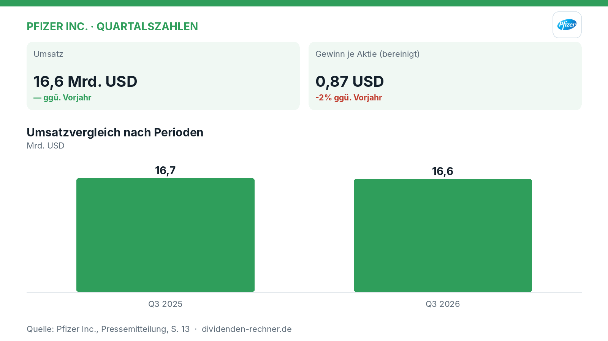
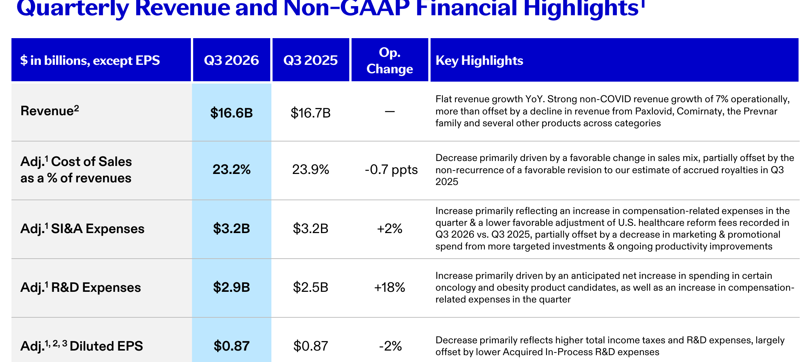
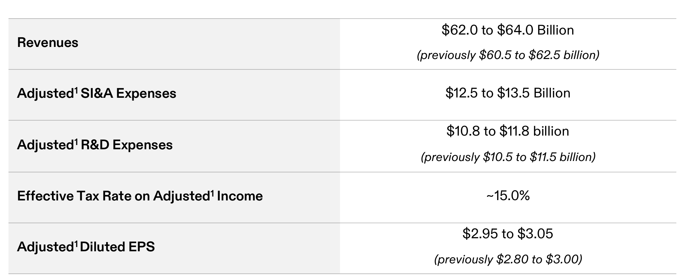

<!-- PRÜFEN: Aufmacherfoto ist automatisch von Unsplash gewaehlt: bitte pruefen, ob es zum Artikel passt (sonst image-Zeilen entfernen, dann entsteht ein Titelbild automatisch). -->
<!-- PRÜFEN: Ausschnitte aus dem Bericht im Text (f1, f2): bitte prüfen, ob Zuschnitt und Platz passen. Unpassende Bildzeilen einfach löschen. -->

!!! kurz "Kurz gesagt"
    **Umsatz:** 16,6 Mrd. USD (—)
    **Gewinn:** 0,87 USD (-2%)

    1. **Treiber:** Das non-COVID-Geschäft wächst operativ um 7 %, was den Rückgang bei Produkten wie Paxlovid und Comirnaty fast vollständig ausgleicht.
    2. **Kapitalverwendung:** Der Konzern investiert massiv in interne und externe R&D und treibt die Pipeline voran, während die Dividende gehalten wird.
    3. **Ausblick:** Pfizer hebt die Umsatz- und EPS-Prognose für das Gesamtjahr 2026 an, muss jedoch weiterhin den Druck durch anstehende Patentabläufe abfedern.

## Pfizer wächst in Kernbereichen, spürt aber höhere Forschungskosten und Patentverluste

Im dritten Quartal 2026 verzeichnet Pfizer einen **Umsatz** von **16,6 Mrd. USD**, was im Vergleich zum Vorjahreszeitraum mit **16,7 Mrd. USD** nahezu unverändert blieb. Während das non-COVID-Geschäft operativ um **7 %** zulegte, dämpften sinkende Erlöse bei bekannten Produkten wie Paxlovid und Comirnaty die Bilanz. Der bereinigte Gewinn je Aktie (Adjusted Diluted EPS) sank leicht um **2 %** auf **0,87 USD** nach **0,87 USD** im Vorquartal beziehungsweise Vorjahreszeitraum, was vor allem höheren Investitionen in Forschung und Entwicklung sowie steigenden Steuern geschuldet ist.

*Eigene Darstellung nach Daten aus: Pfizer Inc., Quartalszahlen vom 2026-11-03.*

### Operative Entwicklung und Produktpipeline

Der Konzern setzt im operativen Geschäft auf neue Kassenschlager und angekaufte Produkte. So wuchs der Umsatz mit übernommenen Seagen-Produkten in den USA um **39 %**, während Biohavens Nurtec ein operatives Umsatzwachstum von **33 %** erzielte. Insgesamt legten die Umsätze mit kürzlich eingeführten und übernommenen Produkten im Jahresvergleich operativ um **32 %** auf **3,8 Mrd. USD** zu. 

CEO Albert Bourla betonte die Fortschritte bei den strategischen Prioritäten:

> „Wir treiben unsere Pipeline konsequent voran und maximieren den Wert unserer Schlüsseltransaktionen.“
>
> — Albert Bourla, Chairman und Chief Executive Officer (aus dem Englischen übersetzt)

*Quartalsumsatz und Finanzkennzahlen Q3 2026. Quelle: Pfizer Inc., Quartalszahlen vom 2026-11-03, S. 12. Ausschnitt nur zugeschnitten, sonst unverändert.*

### Dividende und Kapitalallokation

Pfizer verfolgt eine Politik der verlässlichen Rückgabe von Mitteln an die Aktionäre, während gleichzeitig massiv in die Zukunftsfähigkeit investiert wird. Im bisherigen Jahresverlauf bis zum dritten Quartal 2026 wurden **7,3 Mrd. USD** an die Aktionäre ausgeschüttet. Gleichzeitig flossen **9,2 Mrd. USD** in interne und externe F&E-Projekte, wobei der interne Bereich mit **8,3 Mrd. USD** den Löwenanteil ausmachte. Auf Aktienrückkäufe wurde im bisherigen Jahresverlauf verzichtet, um die Mittel primär auf den Schuldenabbau und die klinische Forschung zu konzentrieren.

### Verschuldung und Bilanzstruktur

Die Bilanzstruktur bleibt auf Kurs, die Bruttoverschuldung im Rahmen der strategischen Ziele zu halten. Der Verschuldungsgrad (gross leverage) bewegt sich weiterhin bei rund **2,7x**. Das Management plant, die Kennzahl während der anspruchsvollen Übergangsphase mit auslaufenden Patenten auf diesem Niveau zu stabilisieren.

*Finanzprognose für das Gesamtjahr 2026. Quelle: Pfizer Inc., Quartalszahlen vom 2026-11-03, S. 14. Ausschnitt nur zugeschnitten, sonst unverändert.*

### Ausblick und Bewertung

Gestützt auf die starke Performance in den ersten neun Monaten hat das Management die Jahresprognose für 2026 nach oben angepasst. Erwartet wird nun ein Gesamtumsatz zwischen **62,0 und 64,0 Mrd. USD** (zuvor **60,5 bis 62,5 Mrd. USD**) sowie ein bereinigtes verwässertes Ergebnis je Aktie von **2,95 bis 3,05 USD** (zuvor **2,80 bis 3,00 USD**). 

Dennoch bleibt die anstehende Welle von Patentabläufen (LOEs) ein zentrales Risiko, das das Unternehmen durch den beschleunigten Markteintritt neuer Produkte wie Atirmociclib und Tivunatamig auszugleichen versucht. Die anstehenden Monate werden zeigen, ob die neuen Therapien den erwarteten Ersatz für die wegfallenden Umsätze im Altportfolio schnell genug liefern.

## Die wichtigsten Zahlen im Überblick

| Kennzahl | Wert | Veränderung zum Vorjahr | Quelle |
|---|---|---|---|
| Umsatz | 16,6 Mrd. USD | — | S. 12 |
| Gewinn je Aktie (bereinigt) | 0,87 USD | -2% | S. 12 |

*Quelle: Pfizer Inc., Quartalszahlen vom 2026-11-03. Rechenwege eigene Berechnung. Keine Anlageberatung.*
