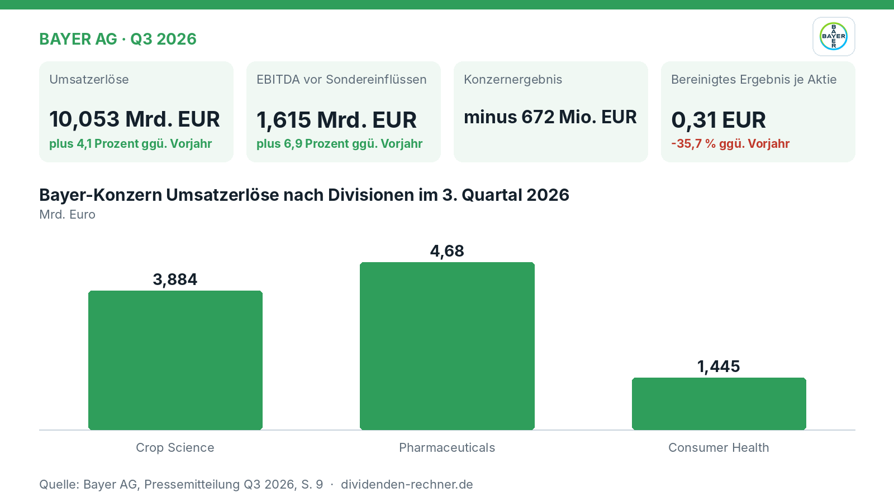
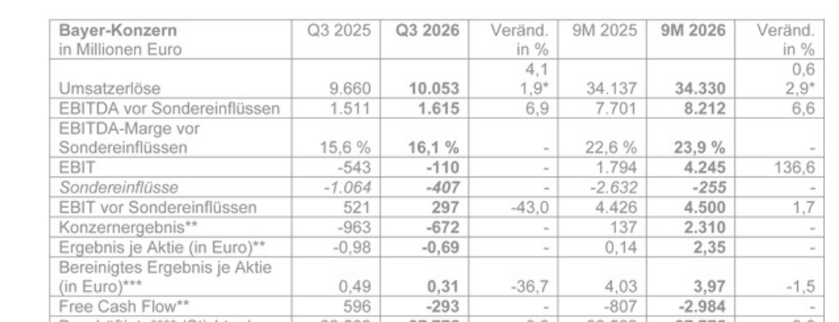
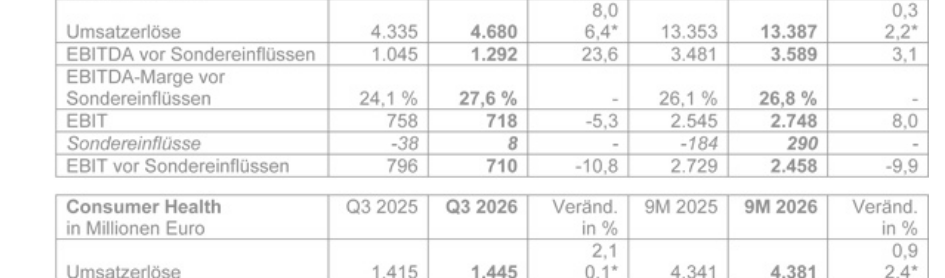

<!-- PRÜFEN: Aufmacherfoto ist automatisch von Unsplash gewaehlt: bitte pruefen, ob es zum Artikel passt (sonst image-Zeilen entfernen, dann entsteht ein Titelbild automatisch). -->
<!-- PRÜFEN: Diese Werte wurden im Berichtstext nicht gefunden: Bereinigtes Ergebnis je Aktie (change: -35,7 %) -->
<!-- PRÜFEN: Quelle: https://www.bayer.com/media/bayer-steigert-umsatz-und-ebitda-vor-sondereinfluessen-im-3-quartal--jahresausblick-verbessert/ -->
<!-- PRÜFEN: Ausschnitte aus dem Bericht im Text (f1, f3): bitte prüfen, ob Zuschnitt und Platz passen. Unpassende Bildzeilen einfach löschen. -->

!!! kurz "Kurz gesagt"
    **Umsatz:** 10,05 Mrd. EUR (+4,1 %)
    **Gewinn:** -672 Mio. EUR

    1. **Treiber:** Pharmaceuticals wächst stark durch die neuen Medikamente Nubeqa und Kerendia, während das Agrargeschäft leidet.
    2. **Finanzen:** Der Free Cashflow sinkt auf -293 Mio. Euro und die Nettofinanzverschuldung sinkt auf 31,08 Mrd. Euro.
    3. **Ausblick:** Bayer hebt den Jahresausblick für das operative Ergebnis sowie den Free Cashflow an, kämpft aber mit Rechtsstreitigkeiten.

## Pharmaceuticals treibt das Geschäft, während Sonderbelastungen das Konzernergebnis drücken

Bayer hat im dritten Quartal 2026 ein durchmischtes Ergebnis vorgelegt. Während der Konzernumsatz zulegte und das Pharmageschäft dank neuer Medikamente stark wuchs, führten außerplanmäßige Wertminderungen zu einem tiefen Fehlbetrag. Der Vorstand blickt dennoch optimistischer auf das Jahresende und hebt Teile der Jahresprognose an.

*Eigene Darstellung nach Daten aus: Bayer AG, Quartalszahlen Q3 2026 vom 2026-11-03 · [Original](https://www.bayer.com/media/bayer-steigert-umsatz-und-ebitda-vor-sondereinfluessen-im-3-quartal--jahresausblick-verbessert/).*

### Das Quartal und seine Treiber

Im dritten Quartal 2026 kletterten die **Umsatzerlöse** des Bayer-Konzerns um **4,1 Prozent** auf **10,05 Mrd. Euro** (währungs- und portfoliobereinigt ein Plus von 1,9 Prozent). Das **EBITDA vor Sondereinflüssen** verbesserte sich um **6,9 Prozent** auf **1,62 Mrd. Euro**. Unterm Strich stand jedoch ein **Konzernergebnis** von **minus 672 Mio. Euro** (nach minus 963 Mio. Euro im Vorjahr). Belastet wurde das Ergebnis vor allem durch außerplanmäßige Wertminderungen in den Divisionen Pharmaceuticals und Consumer Health sowie durch Aufwendungen für Rechtsstreitigkeiten. Das bereinigte Ergebnis je Aktie sank von 0,49 Euro auf **0,31 Euro** (-35,7 %). 
*Bayer-Konzern Kennzahlen 3. Quartal 2026. Quelle: Bayer AG, Quartalszahlen Q3 2026 vom 2026-11-03 · [Original](https://www.bayer.com/media/bayer-steigert-umsatz-und-ebitda-vor-sondereinfluessen-im-3-quartal--jahresausblick-verbessert/). Ausschnitt nur zugeschnitten, sonst unverändert.*

> „Wir haben bei der Wachstumsentwicklung von Pharmaceuticals inzwischen einen Wendepunkt erreicht, und wir sehen, dass es aufwärts geht.“
>

— Bill Anderson, Vorstandsvorsitzender (aus dem Englischen übersetzt)

### Pharmaceuticals wächst, Agrargeschäft schwächelt

Die wichtigste Stütze im Quartal war die Pharmasparte. Der Umsatz mit rezeptpflichtigen Medikamenten stieg um 8,0 Prozent (währungsbereinigt 6,4 Prozent) auf **4,68 Mrd. Euro**. Getrieben wurde dies vor allem durch das Krebsmedikament Nubeqa (plus 58,3 %) und Kerendia (plus 64,9 %) für Nierenerkrankungen. Das EBITDA vor Sondereinflüssen stieg in diesem Segment um 23,6 Prozent auf **1,29 Mrd. Euro**. Das Agrargeschäft (Crop Science) verzeichnete dagegen einen währungsbereinigten Umsatzrückgang von 2,4 Prozent auf **3,88 Mrd. Euro**, ausgelöst durch negative regulatorische Effekte und Wetterbedingungen. Das EBITDA vor Sondereinflüssen sank dort um 41,3 Prozent auf **101 Mio. Euro**. Bei Consumer Health blieb der Umsatz mit **1,45 Mrd. Euro** stabil, während das Segmentergebnis leicht nachgab. 
*Pharmaceuticals Quartalszahlen 2026. Quelle: Bayer AG, Quartalszahlen Q3 2026 vom 2026-11-03 · [Original](https://www.bayer.com/media/bayer-steigert-umsatz-und-ebitda-vor-sondereinfluessen-im-3-quartal--jahresausblick-verbessert/). Ausschnitt nur zugeschnitten, sonst unverändert.*

### Schulden und Cashflow

Der **Free Cash Flow** verschlechterte sich im Quartal auf **minus 293 Mio. Euro** (nach plus 596 Mio. Euro im Vorjahr), was unter anderem auf erwartete Auszahlungen zur Beilegung von Rechtsverfahren zurückzuführen ist. Die **Nettofinanzverschuldung** verbesserte sich zum 30. September 2026 jedoch gegenüber dem Vorquartal um 2,56 Mrd. Euro auf **31,08 Mrd. Euro**. Wesentlicher Grund hierfür war eine erhaltene Zahlung von 3,0 Mrd. Euro von Apollo Global Management für den Erwerb einer Minderheitsbeteiligung.

### Ausblick und offene Punkte

Gestützt auf die gute Entwicklung bei Pharmaceuticals hebt Bayer den Ausblick für das Gesamtjahr 2026 an. Das Unternehmen rechnet nun mit einer EBITDA-Marge vor Sondereinflüssen für Pharmaceuticals von 25 bis 27 Prozent (bisher 23 bis 25 Prozent). Für den gesamten Konzern wird ein währungsbereinigtes EBITDA vor Sondereinflüssen von 9,8 bis 10,3 Mrd. Euro erwartet. Der Free Cashflow soll zwischen minus 1,5 und minus 0,5 Mrd. Euro liegen. Kritisch bleiben die anhaltenden Rechtsstreitigkeiten um Glyphosat, auch wenn jüngste Gerichtsentscheidungen dem Unternehmen Rückenwind geben.

## Die wichtigsten Zahlen im Überblick

| Kennzahl | Wert | Veränderung zum Vorjahr | Quelle |
|---|---|---|---|
| Umsatzerlöse | 10,053 Mrd. EUR | plus 4,1 Prozent | S. 3 |
| EBITDA vor Sondereinflüssen | 1,615 Mrd. EUR | plus 6,9 Prozent | S. 3 |
| Konzernergebnis | minus 672 Mio. EUR | – | S. 3 |
| Bereinigtes Ergebnis je Aktie | 0,31 EUR | -35,7 % | S. 9 |
| Free Cash Flow | minus 293 Mio. EUR | – | S. 4 |

*Quelle: Bayer AG, Quartalszahlen Q3 2026 vom 2026-11-03. Rechenwege eigene Berechnung. Keine Anlageberatung.*
