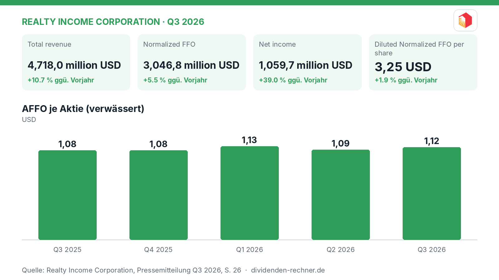
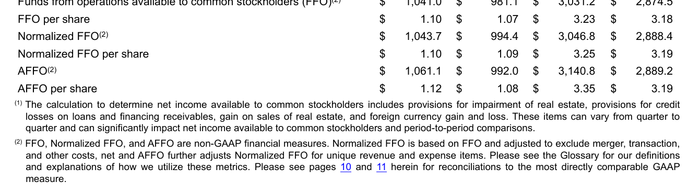

<!-- PRÜFEN: Aufmacherfoto ist automatisch von Wikimedia Commons gewaehlt: bitte pruefen, ob es zum Artikel passt (sonst image-Zeilen entfernen, dann entsteht ein Titelbild automatisch). -->
<!-- PRÜFEN: Ausschnitte aus dem Bericht im Text (f1): bitte prüfen, ob Zuschnitt und Platz passen. Unpassende Bildzeilen einfach löschen. -->

!!! kurz "Kurz gesagt"
    **Umsatz:** 4,7 Mrd. USD (+10,7 %)
    **Gewinn:** 1,1 Mrd. USD (+39,0 %)

    1. **Treiber:** Der Zuwachs beim Umsatz auf 1,6 Mrd. USD allein im dritten Quartal stützt sich auf stabile Mieteinnahmen und Zuwächse bei den Beteiligungen.
    2. **Kapitalverwendung:** Realty Income zahlt eine unverändert zuverlässige Dividende, treibt den Ausbau des Portfolios voran und hält die Verschuldung stabil.
    3. **Knackpunkt:** Das Zinsumfeld bleibt anspruchsvoll, doch das Management steuert mit einer soliden Bilanz und gezielten Investitionen dagegen.

## Realty Income wächst im dritten Quartal und hebt die AFFO-Prognose an

Realty Income blickt auf ein erfolgreiches drittes Quartal 2026 zurück und treibt das Wachstum des Immobilienportfolios weiter voran. Im Berichtszeitraum stieg der Gesamtumsatz in den ersten neun Monaten des Jahres auf **4,7 Mrd. USD**, was einem Zuwachs von **10,7 %** im Vergleich zum Vorjahreszeitraum entspricht. Das Nettoergebnis verbesserte sich deutlich auf **1,1 Mrd. USD** (plus **39,0 %**). Das Unternehmen profitiert dabei von einer hohen Vermietungsquote und neuen Investitionen in Europa und den USA.

*Eigene Darstellung nach Daten aus: Realty Income Corporation, Quartalszahlen Q3 2026 vom 2026-11-02.*

### Operative Entwicklung und Investitionen

Im dritten Quartal investierte Realty Income rund **2,6 Mrd. USD** (Pro-Rata-Anteil: **2,2 Mrd. USD**) in neue Immobilien und Projekte. Die Vermietungsquote im gesamten Portfolio verbleibt auf dem hohen Niveau von **98,8 %**. Zudem expandierte das Unternehmen mit einer strategischen Partnerschaft mit KKR im Bereich der privaten Plattformen in Europa. Das Management hob im Zuge der starken Entwicklung die Prognose für den bereinigten FFO je Aktie für das Gesamtjahr 2026 auf **4,45 bis 4,46 USD** an.

> „Wir haben ein weiteres Quartal mit starker operativer Leistung abgeliefert, was die Widerstandsfähigkeit unseres Geschäftsmodells widerspiegelt.“
>
> — Sumit Roy, Präsident und Chief Executive Officer (aus dem Englischen übersetzt)

*Ausgewählte Finanzergebnisse. Quelle: Realty Income Corporation, Quartalszahlen Q3 2026 vom 2026-11-02, S. 3. Ausschnitt nur zugeschnitten, sonst unverändert.*

### Dividende und Ausschüttung

Die monatlichen Dividendenzahlungen an die Aktionäre wurden im dritten Quartal 2026 auf **0,813 USD** je Aktie erhöht, was einer Steigerung von **0,7 %** im Vergleich zum Vorjahreszeitraum entspricht. Die annualisierte Dividende als Stand zum September 2026 beläuft sich auf **3,258 USD** je Aktie. Die Ausschüttung deckt sich stabil mit dem operativen Cashflow und dem bereinigten FFO je Aktie von **1,12 USD** im dritten Quartal.

### Schulden und Cashflow

Der operative Cashflow lag in den ersten neun Monaten 2026 bei **2,9 Mrd. USD** (ein Anstieg von **5,5 %** gegenüber den ersten neun Monaten 2025). Die Verschuldung, gemessen als Nettoverschuldung im Verhältnis zum annualisierten Pro-Forma-EBITDAre, bewegt sich mit **5,4x** auf einem bewährten Niveau. Das Unternehmen sicherte sich durch frisches Kapital über den Verkauf von Stammaktien und Anleihen zusätzlichen finanziellen Spielraum.

### Einordnung und Ausblick

Realty Income beweist in einem herausfordernden Zinsumfeld seine Stärke als verlässlicher Zahler von monatlichen Dividenden und treibt die geografische Diversifikation voran. Die hohe Belegungsrate und die selektiven Zukäufe in Europa und den USA stützen das Geschäftsmodell. Dennoch bleiben die Refinanzierungskosten ein genauer zu beobachtender Faktor, den das Management durch eine langfristige und breit diversifizierte Kapitalstruktur abfedert.

## Die wichtigsten Zahlen im Überblick

| Kennzahl | Wert | Veränderung zum Vorjahr | Quelle |
|---|---|---|---|
| Total revenue | 4,718,0 million USD | +10.7 % | S. 3 |
| Normalized FFO | 3,046,8 million USD | +5.5 % | S. 3 |
| Net income | 1,059,7 million USD | +39.0 % | S. 3 |
| Diluted Normalized FFO per share | 3,25 USD | +1.9 % | S. 3 |
| Net cash provided by operating activities | 2,945,6 million USD | +5.5 % | S. 15 |
| Cash dividends paid per common share | 2,4345 USD | +1.1 % | S. 10 |

*Quelle: Realty Income Corporation, Quartalszahlen Q3 2026 vom 2026-11-02. Rechenwege eigene Berechnung. Keine Anlageberatung.*
