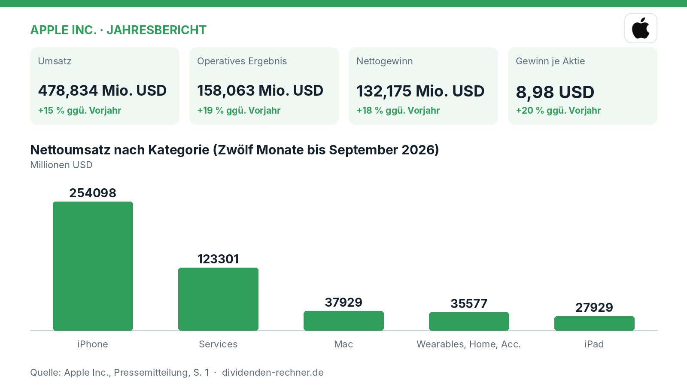
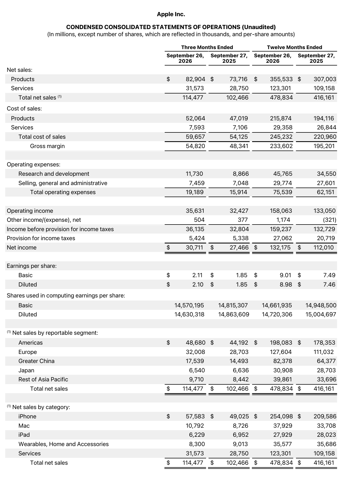
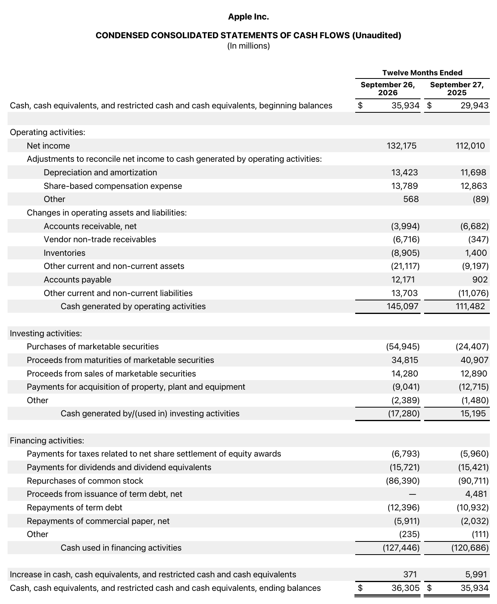

<!-- PRÜFEN: Aufmacherfoto ist automatisch von Wikimedia Commons gewaehlt: bitte pruefen, ob es zum Artikel passt (sonst image-Zeilen entfernen, dann entsteht ein Titelbild automatisch). -->
<!-- PRÜFEN: Diese Werte wurden im Berichtstext nicht gefunden: Grafik iPhone: 254098; Grafik Services: 123301; Grafik Mac: 37929; Grafik Wearables, Home, Acc.: 35577; Grafik iPad: 27929 -->
<!-- PRÜFEN: Ausschnitte aus dem Bericht im Text (f1, f3): bitte prüfen, ob Zuschnitt und Platz passen. Unpassende Bildzeilen einfach löschen. -->

!!! kurz "Kurz gesagt"
    **Umsatz:** 478,8 Mrd. USD (+15 %)
    **Gewinn:** 132,2 Mrd. USD (+18 %)

    1. **Treiber:** Das iPhone liefert 254,1 Mrd. USD Umsatz, während das wachsende Servicegeschäft auf 123,3 Mrd. USD klettert.
    2. **Kapitalverwendung:** Apple schüttet 15,6 Mrd. USD über Dividenden aus und investiert massiv in Aktienrückkäufe.
    3. **Ausblick:** Das starke Fundament aus Services und Hardware-Nachfrage stützt das Geschäft, während hohe Investitionen und Schulden im Blick bleiben.

## Apple wächst zweistellig: iPhone und Services treiben Rekordgewinn

Apple blickt auf ein starkes Geschäftsjahr zurück. Der Technologiekonzern steigerte seinen Umsatz im Jahresverlauf bis zum 26. September 2026 auf **478,8 Mrd. USD**, was einem Zuwachs von 15 % gegenüber dem Vorjahr entspricht. Noch deutlicher fiel der Zuwachs beim Gewinn aus: Der Nettogewinn kletterte um **18 %** auf **132,2 Mrd. USD**. Getragen wird dieser Erfolg vor allem von einer anhaltend hohen Nachfrage nach dem iPhone sowie dem weiter expandierenden Servicebereich, wie die Zahlen zum Jahresende belegen.

*Eigene Darstellung nach Daten aus: Apple Inc., Jahresbericht vom 2026-10-30.*

### Das Geschäftsjahr im Detail: iPhone und Services als Wachstumsmotoren

*Gewinn- und Verlustrechnung. Quelle: Apple Inc., Jahresbericht vom 2026-10-30, S. 1. Ausschnitt nur zugeschnitten, sonst unverändert.*

Das abgelaufene Geschäftsjahr zeigte in allen Segmenten eine solide Dynamik. Der Nettoumsatz beim Hauptprodukt iPhone erreichte **254,1 Mrd. USD** nach 209,6 Mrd. USD im Vorjahr. Das Servicegeschäft, zu dem App Store, iCloud und andere digitale Angebote gehören, legte auf **123,3 Mrd. USD** zu. Der Bereich Mac steuerte **37,9 Mrd. USD** bei, Wearables, Home und Accessories erreichten **35,6 Mrd. USD**, während das iPad-Geschäft mit **27,9 Mrd. USD** leicht unter dem Vorjahreswert von 28,0 Mrd. USD lag. Der operative Gewinn kletterte um 19 % auf **158,1 Mrd. USD**, gestützt von einer starken Bruttomarge und effizienten Kostenstrukturen.

### Die Dividende im Kontext des Free Cashflow

Die aktuelle Jahresdividende ist auf **1,08 USD** je Aktie hochgerechnet (auf Basis von vier Quartalszahlungen zu je 0,27 USD). Damit errechnet sich beim aktuellen Aktienkurs von 338,32 USD eine Dividendenrendite von 0,3 %. Im vergangenen Geschäftsjahr flossen insgesamt 15,6 Mrd. USD in Dividendenzahlungen. Bezogen auf den erwirtschafteten Free Cashflow der letzten vier Quartale von 136,7 Mrd. USD entspricht dies einer Quote von 11 %. Die Ausschüttungsquote bezogen auf den Gewinn je Aktie von 8,98 USD liegt rechnerisch bei 12 %. Das Dividendenwachstum bewegte sich in den Jahren von 2020 bis 2025 rückläufig.

### Schuldenabbau und starker Cashflow

*Kapitalflussrechnung. Quelle: Apple Inc., Jahresbericht vom 2026-10-30, S. 3. Ausschnitt nur zugeschnitten, sonst unverändert.*

Der operative Cashflow erreichte im abgelaufenen Geschäftsjahr **145,1 Mrd. USD**, ein Anstieg um 30 % im Vergleich zum Vorjahr. Die Nettoverschuldung des Konzerns hat sich in den vergangenen Jahren kontinuierlich verringert: Von 101,6 Mrd. USD im Jahr 2021 sank sie bis zum Ende des Geschäftsjahres 2025 auf **76,4 Mrd. USD**. Das Verhältnis der Nettoverschuldung zum EBITDA verbesserte sich dadurch auf einen Faktor von 0,5, was die finanzielle Stabilität des Unternehmens untermauert. Die Investitionen (Capex) beliefen sich im Geschäftsjahr 2025 auf 12,7 Mrd. USD.

### Bewertung und Markteinordnung

Mit einem Kurs-Gewinn-Verhältnis ([KGV](/grundlagen/kgv/)) von 38,8 auf Basis der letzten vier Quartale ist Apple an der Börse ambitioniert bewertet. Das [Payout Ratio](/grundlagen/ausschuettungsquote/) zeigt, dass der Konzern nur einen Bruchteil seines Gewinns an die Aktionäre ausschüttet, während der Großteil des Kapitals in Aktienrückkäufe und das operative Geschäft fließt. Im Vergleich zu vielen klassischen Industrie- oder Finanzwerten setzt Apple auf ein massives Volumen an eigenen Aktienrückkäufen, um den Gewinn je Aktie weiter zu steigern.

### Ausblick und offene Punkte

Apple geht mit einer soliden Bilanz und margenstarken Dienstleistungen in die kommenden Quartale. Dennoch bleibt zu beobachten, wie sich das weltwirtschaftliche Umfeld, regulatorische Eingriffe in das App-Store-Geschäft und der intensive Wettbewerb im Smartphone-Markt auf die Wachstumsraten auswirken. Die hohen Investitionen in Zukunftstechnologien erfordern zudem weiterhin hohe operative Cashflows, um die Flexibilität des Konzerns zu wahren.

## Die wichtigsten Zahlen im Überblick

| Kennzahl | Wert | Veränderung zum Vorjahr | Quelle |
|---|---|---|---|
| Umsatz | 478,834 Mio. USD | +15 % | S. 1 |
| Operatives Ergebnis | 158,063 Mio. USD | +19 % | S. 1 |
| Nettogewinn | 132,175 Mio. USD | +18 % | S. 1 |
| Gewinn je Aktie | 8,98 USD | +20 % | S. 1 |
| Operativer Cashflow | 145,097 Mio. USD | +30 % | S. 3 |

## Dividendenkennzahlen im Überblick (eigene Berechnung)

| Kennzahl | Wert | Rechenweg |
|---|---|---|
| Dividendenrendite | 0,3 % | 1,08 USD ÷ Kurs 338,32 USD |
| Ausschüttungsquote (Ergebnis je Aktie) | 12 % | 1,08 USD ÷ 8,72 USD (4 Quartale) |
| KGV | 38,8 | Kurs ÷ 8,72 USD |
| Dividenden / Free Cashflow (12 Monate) | 11 % | 15.640 ÷ 136.683 Mio. USD |
| Free Cashflow, Geschäftsjahre (Mrd. USD) | 2021: 93,0; 2022: 111,4; 2023: 99,6; 2024: 108,8; 2025: 98,8 | Kapitalflussrechnung laut FMP |
| Nettoverschuldung / EBITDA, Jahresende | 2021: 0,8; 2022: 0,8; 2023: 0,7; 2024: 0,7; 2025: 0,5 | Bilanz und Gewinn- und Verlustrechnung laut FMP |
| Dividendenerhöhungen in Folge | 4 Jahre | Kalenderjahressummen bis 2025 |
| Dividendenwachstum 2020–2025 | -17,0 % p. a. | Kalenderjahressummen |

*Quelle: Apple Inc., Jahresbericht vom 2026-10-30; Kurs- und Dividendendaten: Financial Modeling Prep. Rechenwege eigene Berechnung. Keine Anlageberatung.*
