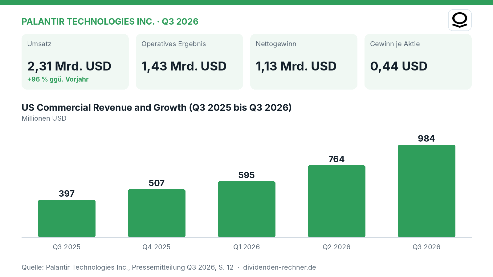
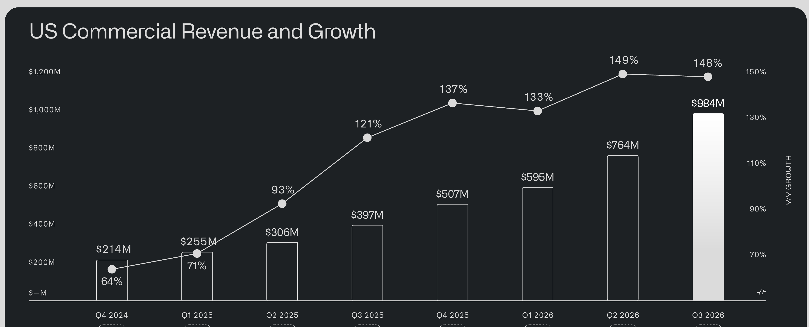

<!-- PRÜFEN: Aufmacherfoto ist automatisch von Unsplash gewaehlt: bitte pruefen, ob es zum Artikel passt (sonst image-Zeilen entfernen, dann entsteht ein Titelbild automatisch). -->
<!-- PRÜFEN: Ausschnitte aus dem Bericht im Text (f1): bitte prüfen, ob Zuschnitt und Platz passen. Unpassende Bildzeilen einfach löschen. -->

!!! kurz "Kurz gesagt"
    **Umsatz:** 2,31 Mrd. USD (+96 %)
    **Gewinn:** 1,13 Mrd. USD

    1. **Treiber:** Das US-Kommerzgeschäft wächst rasant und klettert auf 984 Mio. USD, was einem Plus von 148 Prozent entspricht.
    2. **Mittelverwendung:** Der bereinigte freie Cashflow erreicht 1,22 Mrd. USD bei einer Marge von 53 Prozent, während Schulden keine Rolle spielen.
    3. **Ausblick:** Für das vierte Quartal 2026 rechnet das Unternehmen mit einem Umsatz zwischen 2,649 und 2,653 Mrd. USD.

## Palantir wächst im Eiltempo dank US-Geschäft und Künstlicher Intelligenz

Palantir legt im dritten Quartal 2026 ein beeindruckendes Wachstum hin. Der Gesamtumsatz klettert im Vergleich zum Vorjahreszeitraum um **96 %** auf **2,31 Mrd. USD**. Maßgeblich dafür verantwortlich ist das US-Geschäft, das von der anhaltend starken Nachfrage nach Künstlicher Intelligenz profitiert. Das bereinigte operative Ergebnis erreicht im selben Zeitraum **1,43 Mrd. USD**, was einer Marge von 62 Prozent entspricht.

*Eigene Darstellung nach Daten aus: Palantir Technologies Inc., Quartalszahlen Q3 2026 vom 2026-11-03.*

### Starkes US-Kommerzgeschäft als zentraler Motor

Die Dynamik im US-Markt bleibt der wichtigste Treiber für das Unternehmen. Der US-Umsatz insgesamt wächst um **119 %** auf **1,94 Mrd. USD**. Besonders das US-Kommerzgeschäft sticht hervor: Die Erlöse springen von 397 Mio. USD im Vorjahresquartal auf **984 Mio. USD** in Q3 2026, was einem Zuwachs von **148 %** entspricht. Erstmals übertrifft damit das US-Kommerzgeschäft das US-Regierungsgeschäft, welches ebenfalls um 96 Prozent auf **953 Mio. USD** zulegt.

*US Commercial Revenue and Growth. Quelle: Palantir Technologies Inc., Quartalszahlen Q3 2026 vom 2026-11-03, S. 12. Ausschnitt nur zugeschnitten, sonst unverändert.*

### Operative Marge und Cashflow auf Rekordniveau

Neben dem Umsatzwachstum glänzt das Unternehmen mit hoher Profitabilität. Der GAAP-Nettogewinn beläuft sich auf **1,13 Mrd. USD**, der GAAP-Gewinn je Aktie liegt bei **0,44 USD**. Der bereinigte freie Cashflow klettert auf **1,22 Mrd. USD** und erzielt eine Marge von **53 %**. Das bereinigte operative Ergebnis steigt auf **1,43 Mrd. USD** (**62 %** Marge).

### Ausblick und Marktlage

Für das vierte Quartal 2026 stellt das Management einen Umsatz zwischen 2,649 und 2,653 Mrd. USD in Aussicht. Für das gesamte Geschäftsjahr 2026 wird ein Umsatz zwischen 8,530 und 8,534 Mrd. USD erwartet. Kritisch zu beobachten bleibt, ob das enorme Wachstumstempo angesichts hoher Bewertungen und eines zunehmend wettcifermäßigen KI-Umfelds gehalten werden kann.

## Die wichtigsten Zahlen im Überblick

| Kennzahl | Wert | Veränderung zum Vorjahr | Quelle |
|---|---|---|---|
| Umsatz | 2,31 Mrd. USD | +96 % | S. 4 |
| Operatives Ergebnis | 1,43 Mrd. USD | – | S. 4 |
| Nettogewinn | 1,13 Mrd. USD | – | S. 13 |
| Gewinn je Aktie | 0,44 USD | – | S. 4 |
| Free Cashflow | 1,22 Mrd. USD | – | S. 4 |

*Quelle: Palantir Technologies Inc., Quartalszahlen Q3 2026 vom 2026-11-03. Rechenwege eigene Berechnung. Keine Anlageberatung.*
