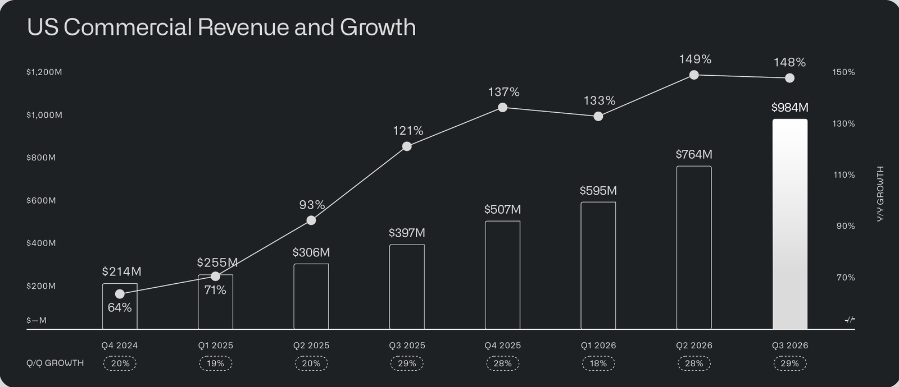

<!-- PRÜFEN: Alle Zahlen stammen aus der Unternehmenspräsentation „Q3 2026 Business Update“. Eigene Rechnungen (kenntlich gemacht): Quartalsumsatz im vierten Quartal gegenüber dem dritten (+15 %), Anteil Aktienvergütung. Nicht geprüft: Kursreaktion, Analystenerwartungen und ob die Prognose gegenüber dem Vorquartal angehoben wurde, deshalb stehen sie nicht im Text. Palantir zahlt keine Dividende. -->

Palantir Technologies hat im dritten Quartal 2026 einen Umsatz von 2,31 Milliarden US-Dollar erzielt, 96 Prozent mehr als vor einem Jahr und 20 Prozent mehr als im zweiten Quartal. Im US-Geschäft überholten die Unternehmenskunden erstmals die Behörden. Zugleich zeigt der Anhang, dass die Kosten für Aktienvergütung fast so schnell wachsen wie der Umsatz.

!!! kurz "Kurz gesagt (drittes Quartal 2026)"
    **Kern:** Das Wachstum beschleunigt sich weiter, die Gewinne steigen mit, aber ein Teil der Marge steckt in Aktienvergütung.

    1. **Umsatz:** 2,31 Mrd. US-Dollar (+96 %), davon USA 1,94 Mrd. (+119 %)
    2. **Gewinn:** Nettogewinn 1,13 Mrd. US-Dollar, 0,44 US-Dollar je Aktie
    3. **Cashflow:** bereinigter freier Cashflow 1,22 Mrd. US-Dollar (53 % vom Umsatz)
    4. **Prognose 2026:** Umsatz rund 8,5 Mrd. US-Dollar

## USA treiben das Wachstum

Der Umsatz in den USA stieg auf 1,94 Milliarden US-Dollar (+119 %). Das Geschäft mit US-Unternehmen wuchs um 148 Prozent auf 984 Millionen, das mit US-Behörden um 96 Prozent auf 953 Millionen. Damit lag der kommerzielle Teil zum ersten Mal über dem staatlichen. Weltweit kamen Unternehmenskunden auf 1,17 Milliarden US-Dollar (+113 %), Behörden auf 1,15 Milliarden (+81 %).

Die Kundenbasis wächst deutlich langsamer als der Umsatz. Palantir zählt 1.090 Kunden (+20 %), darunter 904 Unternehmenskunden (+22 %). Der Umsatz pro Kunde steigt also stark: Die Nettoumsatzbindung, also der Umsatz mit bestehenden Kunden im Vergleich zum Vorjahr, lag bei 165 Prozent, 8 Punkte mehr als im Vorquartal. Palantir schloss 212 Verträge ab einer Million US-Dollar, davon 64 ab zehn Millionen.

*Folie: Palantir Technologies, „Q3 2026 Business Update“. Umsatz mit US-Unternehmen je Quartal und Wachstum zum Vorjahr.*

## Gewinn und Cashflow

Der Betriebsgewinn nach US-Rechnungslegung (GAAP) lag bei 1,08 Milliarden US-Dollar, das ist eine Marge von 47 Prozent. Bereinigt um Aktienvergütung und darauf anfallende Lohnsteuern waren es 1,43 Milliarden oder 62 Prozent. Der Nettogewinn betrug 1,13 Milliarden US-Dollar oder 0,44 US-Dollar je Aktie. Der bereinigte freie Cashflow stieg auf 1,22 Milliarden US-Dollar nach 540 Millionen im Vorjahr. Palantir hat 10,4 Milliarden US-Dollar an Zahlungsmitteln und US-Staatsanleihen und keine Schulden.

## Die Kehrseite: Aktienvergütung und Auftragsbestand

Die Aktienvergütung stieg auf 319 Millionen US-Dollar nach 172 Millionen vor einem Jahr (+85 %). Das sind rund 14 Prozent des Umsatzes (eigene Rechnung). Sie ist der Hauptgrund für den Abstand zwischen der bereinigten Marge von 62 und der GAAP-Marge von 47 Prozent. Für Aktionäre bedeutet sie Verwässerung, auch wenn sie nicht als Barausgabe anfällt.

Beim Auftragsbestand zeigt sich das Wachstum weniger deutlich. Die vertraglich fest zugesagten, noch nicht abgerechneten Umsätze (RPO) liegen bei 4,88 Milliarden US-Dollar, fast doppelt so hoch wie vor einem Jahr (2,60 Milliarden), aber etwas unter dem zweiten Quartal (4,90 Milliarden). Die abgerechneten Beträge stiegen dagegen auf 2,45 Milliarden US-Dollar nach 2,07 Milliarden im Vorquartal.

## Prognose

Für das vierte Quartal erwartet Palantir einen Umsatz von 2.649 bis 2.653 Millionen US-Dollar und ein bereinigtes Betriebsergebnis von 1.640 bis 1.644 Millionen. Für 2026 insgesamt stehen 8.530 bis 8.534 Millionen US-Dollar Umsatz, 5.245 bis 5.249 Millionen bereinigter Betriebsgewinn und 4,8 bis 5,0 Milliarden bereinigter freier Cashflow im Plan. Im US-Geschäft mit Unternehmen sollen es mehr als 3.559 Millionen US-Dollar werden, ein Plus von mindestens 143 Prozent. Der Umsatz im vierten Quartal läge damit rund 15 Prozent über dem dritten (eigene Rechnung) und damit unter dem Plus von 20 Prozent im dritten Quartal.

## Einordnung

Die Zahlen zeigen ein Unternehmen, das schneller wächst und mehr verdient als fast jeder andere große Börsenwert. Die Aktie ist daran gemessen allerdings entsprechend hoch bewertet, so dass schon kleine Enttäuschungen stark ins Gewicht fallen können. Offene Fragen sind, wie lange das Wachstum so hoch bleibt, wie stark die Aktienvergütung weiter steigt und ob der Auftragsbestand das Tempo trägt. Im Anhang zeigt Palantir außerdem die eigene "Rule of 40" (Wachstum plus Marge) von 158 Prozent im Vergleich zu anderen Konzernen. Es ist eine Kennzahl, die das Unternehmen selbst und mit eigener Definition der Marge berechnet. Eine Dividende zahlt Palantir nicht.

*Quelle: Palantir Technologies, „Q3 2026 Business Update“ (November 2026).*
