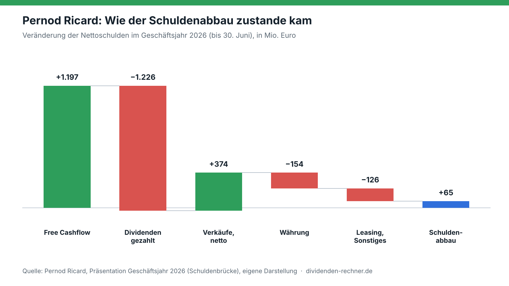

<!-- PRÜFEN: Zahlen zu Geschäftsjahr 2026, Schuldenbrücke, Investitionen, Cash-Umwandlung, Dividende, Hauptversammlung am 20. November und Q1-Regionen mit Pernod-Pressemitteilung, Präsentation und Q1-Meldung abgeglichen. Schuldenbrücke offiziell: Free Cashflow 1.197, Dividenden -1.226, Verkäufe/Beteiligungen netto +374, Treasury/Sonstiges -10, Währung -154, Leasing -116, Ergebnis +65 (Grafik fasst Leasing und Sonstiges zu -126 zusammen). -->
<!-- PRÜFEN: Nicht belegt: Aktienkurse 59,22 Euro (6. Oktober) und 68,92 Euro sowie die daraus errechneten rund 16 Prozent und 6,8 Prozent Rendite stammen aus dem Redaktionstext, bitte mit aktuellem Kurs gegenlesen. Die erwartete Umsatzzahl der Analysten (im Entwurf -1,7 Prozent) steht nicht in der Pernod-Meldung und wurde deshalb nicht übernommen. -->
<!-- PRÜFEN: Entwurf nannte Verkäufe 389 und Währung/Sonstiges -296 Mio. Euro, die Präsentation nennt 374, -154 und Leasing -116 (plus Sonstiges -10). Im Text und in der Grafik gilt die Präsentation. Ebenso: Investitionen 2024 rund 1,4 Mrd. und 2025 1,2 Mrd. Euro, die Einzelwerte 656/383 und 557/233 gehören zum Vorjahresvergleich 2025 zu 2026. -->

Die Aktie von Pernod Ricard hat sich in vier Wochen um rund 16 Prozent erholt, von 59,22 Euro am 6. Oktober auf 68,92 Euro. Bei diesem Kurs liegt die Dividendenrendite bei rund 6,8 Prozent. Das wirft die Frage auf, ob der Konzern hinter Absolut, Jameson, Lillet und Martell sich seine Ausschüttung überhaupt leisten kann. Die Antwort aus den Zahlen: knapp ja, aber ohne Spielraum.

!!! kurz "Kurz gesagt (Geschäftsjahr 2026, bis 30. Juni)"
    **Kern:** Der Free Cashflow deckt die Dividende gerade so, Schulden sinken nur durch Verkäufe.

    1. **Umsatz:** 9,4 Mrd. Euro (−14,2 %, organisch −3,9 %)
    2. **Operativer Gewinn:** 2,4 Mrd. Euro (−17,9 %, organisch −5,2 %)
    3. **Free Cashflow:** 1,2 Mrd. Euro (+6 %), gezahlte Dividenden 1,2 Mrd. Euro
    4. **Nettoschulden:** 10,7 Mrd. Euro (−65 Mio. Euro), 3,7-faches EBITDA

## Weniger investiert, mehr Geld übrig

Dass der Free Cashflow trotz sinkender Gewinne gestiegen ist, liegt vor allem an einer Entscheidung: Pernod hat die Investitionen stark zurückgefahren. Die sogenannten strategischen Investitionen, also Sachanlagen und der Aufbau von Lagerbeständen für gereifte Spirituosen wie Whisky und Cognac, lagen im Geschäftsjahr 2024 noch bei rund 1,4 Mrd. Euro und im Jahr darauf bei 1,2 Mrd. Euro. Im Geschäftsjahr 2026 waren es nur noch 616 Mio. Euro. Allein gegenüber dem Vorjahr sanken die Sachinvestitionen von 656 auf 383 Mio. Euro, der Aufbau von Reifebeständen von 557 auf 233 Mio. Euro.

Der Effekt zeigt sich in der Cash-Umwandlung, also dem Anteil des Gewinns, der als Geld in der Kasse ankommt: 65 Prozent im Geschäftsjahr 2024, 74 Prozent im Jahr darauf, jetzt 91 Prozent. Der Free Cashflow stieg so von 1.133 auf 1.197 Mio. Euro.

Das ist allerdings eher ein Bremsmanöver als eine operative Stärke. Pernod investiert weniger, weil die Nachfrage fehlt. Für das laufende Geschäftsjahr plant der Konzern wieder rund 700 Mio. Euro Investitionen ein, also etwas mehr als zuletzt.

## Die Rechnung geht nur mit Verkäufen auf

Der eigentliche Knackpunkt steht in der Schuldenbrücke der Präsentation. Den 1,2 Mrd. Euro Free Cashflow standen Dividendenzahlungen von ebenfalls 1,2 Mrd. Euro gegenüber (genau: 1.197 Mio. zu 1.226 Mio. Euro). Aus dem laufenden Geschäft allein hätte Pernod die Dividende also nicht ganz bezahlen können.

Dass die Nettoschulden trotzdem leicht gesunken sind, um 65 Mio. Euro auf 10,7 Mrd. Euro, verdankt der Konzern dem Verkauf von Geschäften. Diese brachten unterm Strich 374 Mio. Euro ein. Währungseffekte kosteten 154 Mio. Euro, Leasingverbindlichkeiten und Sonstiges weitere 126 Mio. Euro.

Gleichzeitig ist die Verschuldung im Verhältnis zum Gewinn gestiegen. Die Nettoschulden betragen das 3,7-Fache des operativen Ergebnisses vor Abschreibungen (EBITDA), nach 3,3 im Vorjahr. Grund ist nicht mehr Schulden, sondern weniger Gewinn. Pernods Ziel ist ein Wert unter 3 bis zum Geschäftsjahr 2029. Die Zinskosten sind dabei noch beherrschbar: Der Finanzaufwand sank von 455 auf 421 Mio. Euro, die durchschnittlichen Kosten der Schulden stiegen leicht von 3,2 auf 3,4 Prozent.

## Was die Dividende stützt – und was sie gefährdet

Die Dividende liegt seit dem Geschäftsjahr 2023 unverändert bei 4,70 Euro je Aktie. Gemessen am bereinigten Gewinn je Aktie von 5,85 Euro schüttet Pernod damit rund 80 Prozent aus. Die eigene Richtlinie sieht etwa 50 Prozent vor.

Zwei Dinge sprechen dafür, dass Pernod die Dividende vorerst halten kann:

- **Aktien statt Geld:** Die Schlussdividende von 2,35 Euro können Aktionäre wahlweise in Aktien beziehen. Jeder, der das tut, spart dem Konzern Bargeld.
- **Kostenprogramm:** Pernod will bis zum Geschäftsjahr 2028 rund 1 Mrd. Euro an Kosten einsparen. Etwa die Hälfte ist bereits erreicht.

Dagegen spricht vor allem der Ausblick. Für das laufende Geschäftsjahr erwartet Pernod nur einen stabilen Umsatz. Im ersten Quartal lag er organisch bei −0,9 Prozent und damit besser, als Analysten erwartet hatten. Der Rückgang in den USA (−10 Prozent) und China (−25 Prozent) wurde aber nur durch Indien (+19 Prozent) ausgeglichen. Dort halfen allerdings auch Sondereffekte: ein schwacher Vergleichswert wegen geänderter Verbrauchsteuerregeln im Bundesstaat Maharashtra im Vorjahr und Lieferungen an den Handel im Vorfeld eines möglichen Börsengangs, über den der Verwaltungsrat noch nicht entschieden hat. Aktienrückkäufe sind kein Thema. Die kommen bei Pernod erst, wenn alle anderen Prioritäten erfüllt sind.

## Umschuldung statt Schuldenabbau

Ende Oktober hat Pernod seine Anleihen neu sortiert. Der Konzern hat eine Hybridanleihe über 1,5 Mrd. Euro ausgegeben (zwei Teile mit Kupons von 5,625 und 6,125 Prozent) und damit Anleihen mit Fälligkeiten zwischen September 2027 und November 2032 im Wert von rund 1,2 Mrd. Euro zurückgekauft. Hybridanleihen haben keine feste Laufzeit und werden von Ratingagenturen teilweise wie Eigenkapital gewertet. Das verschafft Luft bei den Fälligkeiten und entlastet die Kennzahlen, kostet aber höhere Zinsen als normale Anleihen. Ein Schuldenabbau ist es nicht.

## Einordnung

Pernod steht mit seinen Problemen nicht allein. Die ganze Spirituosenbranche leidet unter schwacher Nachfrage in den USA, dem Handelsstreit mit China und Lagerabbau im Handel. Konkurrent Diageo hat seine Zwischendividende im Februar bereits halbiert. Pernod hat die Dividende bisher gehalten, und der Free Cashflow deckt sie gerade so. Für Schuldenabbau aus eigener Kraft bleibt aber nichts übrig.

Die hohe Dividendenrendite ist deshalb vor allem ein Zeichen dafür, dass der Markt der Ausschüttung nicht ganz traut. Wer auf die Dividende setzt, wettet darauf, dass der Umsatz ab 2027 wie angekündigt wieder um 3 bis 6 Prozent pro Jahr wächst. Pernod selbst erwartet eher das untere Ende dieser Spanne. Bleibt das Wachstum aus, wird eine Kürzung wahrscheinlicher. Über die Dividende für das Geschäftsjahr 2026 stimmt die Hauptversammlung am 20. November ab.

*Quellen: Pernod Ricard, Pressemitteilung und Präsentation zum Geschäftsjahr 2026 (27. August 2026), Umsatzmeldung erstes Quartal 2027 (15. Oktober 2026), Mitteilungen zur Hybridanleihe und zum Anleihenrückkauf (Oktober 2026); Diageo, Halbjahreszahlen (25. Februar 2026).*
