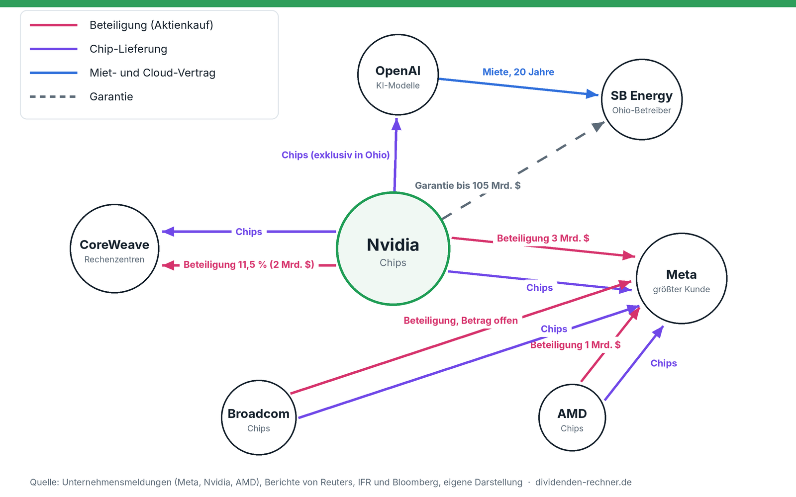
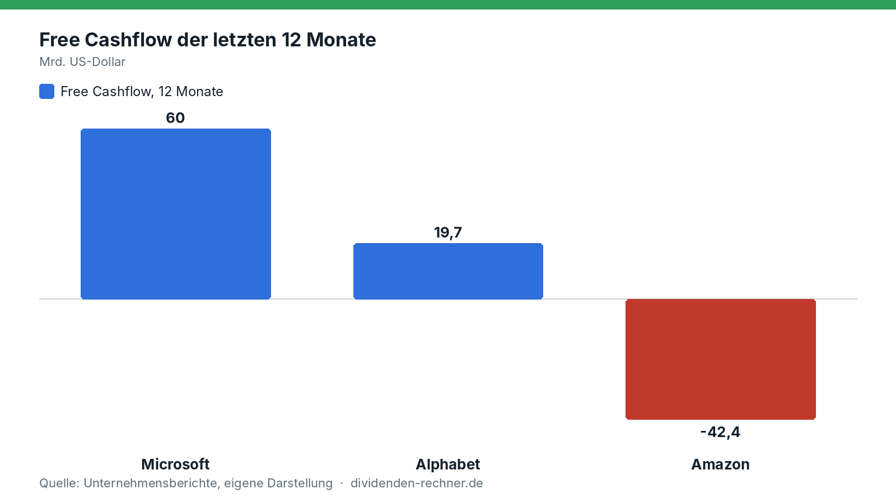
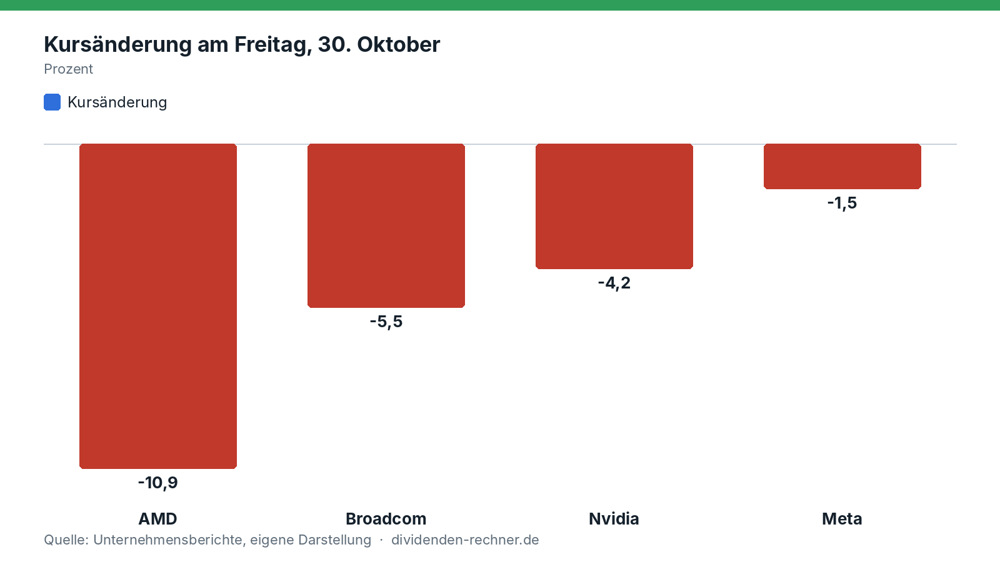

<!-- ÜBERARBEITET 01.11.2026 nach Leserkritik (zu einseitig und reißerisch): Gegenargumente ergänzt (knappe Rechenleistung, starke Bilanzen, Absicherung ist klein und üblich), Dotcom-Vergleich relativiert, Auslöser des Freitags eingeordnet. Zahlen zu Amazon-Nettogewinn und Cloud-Wachstum stammen aus unserem Marktüberblick vom 30.10. -->
<!-- PRÜFEN: Thema und Reihenfolge nach einem Kommentar des Wall Street Journal (J. Mackintosh, 1.11.2026) und einer Netzwerk-Grafik von Dritten. Von dort wurden keine Zahlen übernommen. Die Grafik mit Marktwerten und weiteren Beträgen (z. B. Nvidia/OpenAI „bis zu 100 Mrd.“, Alphabet/Anthropic, Amazon/OpenAI) ist nicht belegt und wurde bewusst nicht verwendet. -->
<!-- PRÜFEN: Meta-Kapitalerhöhung (25 Mrd. Dollar Stammaktien zu 625 Dollar, 12,5 Mrd. Wandel-Vorzugsaktien zu 6,50 %, Interesse der drei Chipfirmen bis 5 Mrd., Nvidia 3 Mrd., AMD 1 Mrd.) stammt aus Meta-Mitteilungen laut fourweekmba.com und aa.com.tr. Bitte gegen die Meta-Pressemitteilung (SEC) prüfen. Brodcom-Betrag ist nicht genannt. -->
<!-- PRÜFEN: CoreWeave: 2 Mrd. Dollar zu 87,20 Dollar je Aktie, Anteil danach 11,5 % (IFR, Januar/Februar 2026). Anleiherenditen 14,8 bis 14,9 % und Kursminus 16 % am 14.10. (investinglive.com), Rating B+ (S&P). Zusage, ungenutzte Kapazität bis 2032 zu mieten, stammt aus dem WSJ-Kommentar, nicht aus einer Primärquelle. -->
<!-- PRÜFEN: Ohio: Garantie bis 105 Mrd. Dollar, 20 Jahre Miete, 1,5 Mrd. Beteiligung an SB Energy, Mitteilung vom 17.8.2026 (Reuters über investing.com). -->
<!-- PRÜFEN: Amazon-Free-Cashflow (−42,4 Mrd., 12 Monate) stammt aus unserem Entwurf zu Amazon Q3 (noch nicht veröffentlicht). Erst veröffentlichen, wenn der Amazon-Artikel geprüft ist; sonst Amazon aus Grafik und Text streichen. -->
<!-- PRÜFEN: Kursänderungen vom Freitag (AMD −10,9 %, Broadcom −5,5 %, Nvidia −4,2 %, Meta −1,5 %) aus der Marktdatenzeile des WSJ-Kommentars. Bitte gegen Kursdaten prüfen. -->
<!-- PRÜFEN: Absicherung (Rekord bei CoreWeave-Puts, Verfall 2028 mit Ausübungspreis 35 Dollar bei Kurs um 55 Dollar laut Cboe; Ausfallversicherungen auf Amazon, Alphabet, Microsoft, Meta, Oracle auf höchstem Stand seit 2021 laut Solve; Oracle-Spread um mehr als 1 Prozentpunkt; Jump Trading Handelstisch für Rechenleistung; Mietpreis Nvidia B300 7,56 Dollar je Stunde, +56 % in diesem Jahr laut Silicon Data) stammt aus einem WSJ-Bericht (G. Banerji, 31.10.2026) und ist nicht gegen Primärdaten geprüft. Einziges wörtliches Zitat: Dave Olsen, Jump Trading, in eigener Übersetzung. -->

!!! kurz "Kurz gesagt"
    **Kern:** Die Chiphersteller finanzieren ihre eigenen Kunden. Das stützt die Nachfrage, verbindet die Unternehmen aber enger miteinander. Ob das ein Risiko oder ein Geschäftsmodell ist, hängt davon ab, ob die Nachfrage nach Rechenleistung anhält.

    1. **Das Netz:** Nvidia hält 11,5 % an CoreWeave, haftet mit bis zu 105 Mrd. Dollar für ein OpenAI-Rechenzentrum und will mit AMD und Broadcom bis zu 5 Mrd. Dollar Meta-Aktien kaufen.
    2. **Dafür spricht:** Rechenleistung ist knapp, die Mieten steigen, und die großen Konzerne verdienen Milliarden. Amazon erzielte im Quartal über 20 Mrd. Dollar Gewinn.
    3. **Dagegen spricht:** Die Investitionen übersteigen bei Amazon und Alphabet den Free Cashflow. Die Anleihen von CoreWeave rentieren bei rund 15 %, und Absicherungen sind gefragt, bleiben aber klein.

Die am stärksten nachgefragte Versicherung der Wall Street lautet derzeit auf CoreWeave. Der Anbieter von KI-Rechenzentren hat in diesem Monat Rekordumsätze bei Verkaufsoptionen auf seine Aktie verzeichnet, vor allem auf Kontrakte mit Verfall 2028. Sie zahlen aus, wenn der Kurs auf 35 Dollar fällt. Zuletzt lag er bei etwa 55 Dollar. Das berichtet das Wall Street Journal unter Berufung auf Daten der Börse Cboe.

Der Anlass liegt in der Art, wie der Boom bezahlt wird. Die Chiphersteller verkaufen nicht nur Chips. Sie beteiligen sich an ihren Kunden, garantieren deren Mieten und kaufen deren Aktien. Das stützt die Nachfrage, solange sie hoch bleibt. Fällt sie, trifft es Lieferant und Kunde zugleich.

Eine Absicherung ist allerdings keine Vorhersage. Wer große Positionen hält, kauft Versicherungen, auch wenn er nicht mit dem Schlimmsten rechnet. Dieser Beitrag zeigt beide Seiten: wie das Netz aufgebaut ist, was für dieses Modell spricht und wo die Risiken liegen.

## Was diese Woche passiert ist

Am 26. Oktober kündigte Meta eine Kapitalerhöhung an. Aus den ersten 35 Mrd. Dollar wurden nach der Nachfrage rund 37,5 Mrd.: 25 Mrd. Dollar Stammaktien zu 625 Dollar je Aktie und 12,5 Mrd. Dollar Wandel-Vorzugsaktien mit 6,5 % Zins. Später sollen weitere 60 Mrd. Dollar folgen. Für 2026 plant Meta Investitionen von 135 bis 145 Mrd. Dollar, vor allem für Rechenzentren.

Am selben Tag meldeten Nvidia, AMD und Broadcom Interesse an Aktien im Wert von bis zu 5 Mrd. Dollar, zu den gleichen Bedingungen wie alle anderen Käufer. Nvidia nannte danach 3 Mrd. Dollar, AMD 1 Mrd. Dollar. Das entspricht rund einem Achtel der gesamten Kapitalerhöhung.

Meta ist einer der größten Kunden der drei Konzerne. Die Lieferanten werden damit zu Teilhabern ihres Kunden.

## Das Netz in einem Bild

Das Muster ist überall gleich: Ein Chiphersteller verkauft an einen Kunden und sorgt dafür, dass der Kunde das Geld hat. Das gelingt über Beteiligungen, über Verträge, die dem Kunden Einnahmen sichern, und über Garantien, die dessen Kredit billiger machen.

*Eigene Darstellung nach Unternehmensmeldungen und Agenturberichten. Gezeigt sind nur Beziehungen mit belegtem Betrag oder Vertrag.*

Aus dem Autohandel kennt man das Prinzip: Der Hersteller leiht dem Käufer das Geld für den Wagen, bekommt den Verkauf und die Zinsen und ist auf die Zahlungsfähigkeit des Käufers angewiesen. Hier ist der Hersteller Nvidia und der Käufer ein Rechenzentrum.

| Wer | Was | Betrag | Stand |
|---|---|---|---|
| Nvidia, CoreWeave | Beteiligung | 2 Mrd. Dollar, danach 11,5 % der Aktien | Januar 2026 |
| Nvidia, SB Energy | Garantie für Miete und Strom (OpenAI-Rechenzentrum in Ohio) | bis zu 105 Mrd. Dollar, dazu 1,5 Mrd. Dollar Beteiligung | 17. August 2026 |
| Nvidia, Meta | Beteiligung an der Kapitalerhöhung | 3 Mrd. Dollar | 27. Oktober 2026 |
| AMD, Meta | Beteiligung an der Kapitalerhöhung | 1 Mrd. Dollar | 27. Oktober 2026 |
| Broadcom, Meta | Interesse an Meta-Aktien | Betrag nicht genannt | 26. Oktober 2026 |

Am größten ist die Garantie für Ohio. OpenAI mietet das Rechenzentrum 20 Jahre lang von SB Energy, einer Tochter von SoftBank. Zahlt OpenAI nicht, deckt Nvidia die Lücke zwischen dem garantierten Mindestwert und dem, was der Eigentümer durch Neuvermietung oder Verkauf erlöst. Nvidia ist dort exklusiver Chiplieferant und rechnet nach Medienberichten mit bis zu 200 Mrd. Dollar Umsatz aus dem Standort.

Ein Teil der Nachfrage nach Nvidia-Chips ist damit nicht unabhängig, sondern vom Lieferanten mitfinanziert.

## Was für das Modell spricht

Die Konzerne investieren nicht ins Blaue, sondern in eine Nachfrage, die sie bisher nicht bedienen können. Der Preis für die Miete eines Nvidia-B300-Chips stieg nach dem Index von Silicon Data in diesem Jahr um rund 56 %. Das spricht für knappe Kapazität und nicht für ein Überangebot. Auch die Kapitalerhöhung von Meta war so gefragt, dass aus 35 Mrd. Dollar rund 37,5 Mrd. wurden.

Die Käufer sind keine Unternehmen ohne Einnahmen. [Amazon](../tech-ausverkauf-intel-nasdaq-marktueberblick/) erzielte im dritten Quartal einen Nettogewinn von über 20 Mrd. Dollar, und das Cloud-Geschäft wuchs so stark wie seit Jahren nicht. Microsoft erwirtschaftet 60 Mrd. Dollar Free Cashflow. Wer wie Nvidia einem solchen Kunden hilft, finanziert die Nachfrage von Unternehmen mit eigenen Gewinnen.

Auch die Absicherung ist weniger bedrohlich, als sie klingt. Sie ist im Vergleich zum eigentlichen KI-Handel noch klein. Wer Versicherungen anbietet, verdient an den Prämien. Ein solcher Markt kann auch entstehen, weil der Handel mit Risiken ein weiteres Geschäft ist.

## Wer die Rechnung bezahlt

Die großen Cloud-Anbieter zahlen ihre Investitionen immer weniger aus der Kasse. Die [Free Cashflows](../../grundlagen/free-cashflow/) der letzten zwölf Monate zeigen ein uneinheitliches Bild:

*Eigene Darstellung nach den Quartalsberichten. Amazon: Mittelabfluss laut Zwölfmonatszahlen bis September 2026.*

Microsoft erwirtschaftet 60 Mrd. Dollar. Die Investitionen stiegen aber von 23,9 Mrd. Dollar im Geschäftsjahr 2022 auf 115,9 Mrd. Dollar im Geschäftsjahr 2026 (+385 %), der Free Cashflow im selben Zeitraum nur von 65,1 auf 67,0 Mrd. Dollar (+3 %). Mehr dazu in unserer [Analyse der Microsoft-Zahlen](../microsoft-q1-2027-zahlen/).

[Alphabet](../alphabet-q3-2026-quartalszahlen/) investierte im dritten Quartal 51,4 Mrd. Dollar, 114 % mehr als ein Jahr zuvor, und kam im Quartal auf einen Free Cashflow von −9,1 Mrd. Dollar. Amazon steht bei einem operativen Cashflow von 168 Mrd. Dollar mit einem Mittelabfluss von 42 Mrd. Dollar da. Meta will in diesem Jahr bis zu 145 Mrd. Dollar investieren und holt sich dafür zusätzlich Kapital an der Börse.

Der Rest kommt von den Anleihemärkten. Alphabet, Amazon, Meta und Oracle haben nach Angaben der Datenfirma LSEG bis Mitte Oktober mehr als 228 Mrd. Dollar an Anleihen ausgegeben, mehr als doppelt so viel wie im gesamten Vorjahr.

Der Chip-Boom wird damit zunehmend mit geliehenem Geld und neuen Aktien bezahlt. Das funktioniert, solange die Kapitalmärkte mitspielen und die Gewinne der Kunden wachsen.

## Wo es schon knirscht: CoreWeave

CoreWeave betreibt Rechenzentren und ist ein Großkunde von Nvidia, das zugleich zu seinen größten Aktionären zählt. Das Unternehmen hat sich stark verschuldet. Am 14. Oktober fiel die Aktie um rund 16 %, und die Anleihen mit Laufzeit bis 2031 und 2032 rentierten bei knapp 15 %. Das ist der Zins, den Anleger für ein sehr riskantes Unternehmen verlangen. Die Ratingagentur S&P stuft CoreWeave mit B+ ein, also unterhalb der Anlagequalität.

CoreWeave hält die Reaktion für übertrieben und verweist auf Aufträge, die seine Schulden mehr als abdecken. Auch andere Werte aus dem Umfeld gaben nach: Oracle fiel am selben Tag um fast 9 %, Nebius um rund 10 %.

Der Markt behandelt CoreWeave damit bereits wie einen Kredit, der ausfallen könnte. Nvidia hat dort Aktien und Mietzusagen und wäre bei einem Ausfall doppelt betroffen.

## Der Freitag: ein Tag mit mehreren Auslösern

Am Freitag verloren die drei Chipkonzerne, die zuvor ihren Einstieg bei Meta angekündigt hatten, besonders stark:

*Eigene Darstellung nach Börsendaten vom 30. Oktober 2026, Schlusskurse laut Wall Street Journal.*

AMD verlor knapp 11 %, Broadcom rund 5,5 %, Nvidia rund 4 %. Der Freitag hatte allerdings mehrere Auslöser: die Zahlen von [Alphabet](../alphabet-q3-2026-quartalszahlen/) und Amazon, der Einbruch bei [Intel](../intel-q3-2026-zahlen/) um rund 30 %, ein Ölpreis um 112 Dollar und Signale der US-Notenbank für eine Zinserhöhung im Dezember. Der Nasdaq beendete den Tag mit einem Minus von 2,9 % und den schwächsten Monat seit März 2025. Dass die Aktien des Netzes gemeinsam fielen, belegt die Verflechtung, aber nicht, dass der KI-Handel zu Ende ist. Einzelheiten stehen in unserem [Marktüberblick](../tech-ausverkauf-intel-nasdaq-marktueberblick/).

Wer mehrere dieser Aktien besitzt, ist weniger breit gestreut, als es aussieht. Die Unternehmen hängen über Beteiligungen, Verträge und Garantien aneinander und bewegen sich deshalb stärker im Gleichschritt.

## Wer sich absichert

Neben den Put-Optionen auf CoreWeave zeigt sich die Vorsicht an den Märkten für Kreditversicherungen. Die Kosten, einen Zahlungsausfall von Amazon, Alphabet, Microsoft, Meta oder Oracle abzusichern, sind im vergangenen Monat auf den höchsten Stand seit 2021 gestiegen. Bei Oracle weiteten sich die Aufschläge um mehr als einen Prozentpunkt aus. Der Anleihedatenanbieter Solve sieht darin eine breite Sorge um den ganzen Sektor, keine Probleme einzelner Unternehmen.

Auch Privatkunden von Vermögensverwaltern wollen ihre Aktienpositionen absichern. Das Wall Street Journal berichtet von früheren Mitarbeitern der Technologiekonzerne, die ihre Aktien nicht mehr einfach halten wollen.

Am weitesten geht der Handelskonzern Jump Trading. Er hat einen Handelstisch für Rechenleistung eingerichtet. Ein Betreiber von Rechenzentren kann sich dort gegen fallende Mieten für seine Chips absichern. Der Preis für die Miete eines Nvidia-B300-Chips ist nach einem Index von Silicon Data in diesem Jahr um rund 56 % auf 7,56 Dollar je Stunde gestiegen. Jump könnte zum Beispiel zusagen, die Rechenzeit zu kaufen, wenn der Preis auf 4 Dollar fällt. Auch das Handelshaus Susquehanna berichtet von Anfragen nach solchen Absicherungen, auch von Rechenzentren, die damit ihre Kreditgeber beruhigen wollen.

Jump-Präsident Dave Olsen sagt: „Man muss kein Bär sein, um eine Versicherung zu wollen.“ Die Absicherung ist im Vergleich zum eigentlichen KI-Handel noch klein, und viele Anleger bleiben optimistisch. Sie zeigt Vorsicht, aber keine Erwartung eines Absturzes.

## Gedankenspiel: Was bei einem Rückschlag passiert

Fällt die Nachfrage nach KI-Rechenleistung deutlich, trifft das mehrere Stellen in der gleichen Reihenfolge.

1. Kunden mit schwacher Bilanz wie CoreWeave bekommen Probleme, ihre Kredite zu bedienen.
2. Die Chiphersteller verlieren Aufträge und müssen auf Beteiligungen und Garantien abschreiben.
3. Gebrauchte Chips und Rechenzeit kommen billig auf den Markt und drücken die Preise für neue Chips.

Der Vergleich mit der Dotcom-Zeit vor 25 Jahren liegt nahe, trägt aber nur begrenzt. Damals hatten Netzausrüster Kredite an Kunden gegeben, die noch kein Geschäftsmodell hatten, und mussten Milliarden abschreiben. Heute verdienen Nvidia, Microsoft, Alphabet, Amazon und Meta bereits Milliarden mit dem, was sie tun, und haben starke Bilanzen. Sie können Verluste tragen. Offen ist, wie viele Garantien und Beteiligungen am Ende gleichzeitig zu tragen wären.

Hält die Nachfrage dagegen an, passiert das Gegenteil: Beteiligungen und Garantien kosten nichts, die Kunden zahlen ihre Mieten, und die Chiphersteller verdienen an beiden Seiten.

## Was Anleger daraus ablesen

Das Netz erklärt, warum KI-Aktien zuletzt so gleichmäßig steigen und fallen: Gute Nachrichten für einen Konzern gelten für die anderen mit, schlechte ebenso. Wer mehrere dieser Aktien hält, sollte wissen, dass sie weniger unabhängig sind, als es aussieht. Wer in Dividendenwerte aus dem Netz investiert, etwa [Microsoft](../microsoft-q1-2027-zahlen/), bekommt regelmäßige Ausschüttungen aus hohen Gewinnen. Der Free Cashflow wächst durch die hohen Investitionen aber kaum. Ob sich diese Investitionen lohnen, hängt von der Nachfrage nach Rechenleistung ab, und dafür sprechen derzeit steigende Mieten für Rechenleistung. Das ist keine Empfehlung und keine Prognose, sondern die Beschreibung der Lage.

## Quellen

- Meta, Mitteilungen zur Kapitalerhöhung vom 26. und 27.10.2026, nach Berichten von [Anadolu](https://www.aa.com.tr/en/science-technology/meta-unveils-95b-financing-plan-to-fund-ai-expansion/4101382) und [FourWeekMBA](https://fourweekmba.com/ai-nvidia-amd-and-broadcom-eye-up-to-5b-of-metas-stock-sale/)
- [IFR: Nvidia investiert 2 Mrd. Dollar in CoreWeave](https://www.ifre.com/equities/2377167/nvidia-throws-us2bn-lifeline-to-under-fire-coreweave)
- [Investinglive: CoreWeave-Anleihen rentieren wie Risikoanleihen](https://investinglive.com/stocks/coreweave-bonds-trade-like-distressed-debt-as-ai-spending-outpaces-balance-sheets/), 15.10.2026
- [Reuters über Investing.com: Nvidia garantiert bis zu 105 Mrd. Dollar für OpenAIs Rechenzentrum in Ohio](https://www.investing.com/news/stock-market-news/nvidia-to-invest-15-billion-in-sb-energy-under-openai-data-center-deal-4863156), 17.08.2026
- Wall Street Journal, G. Banerji, „KI-Investoren wetteifern darum, sich gegen die größte Marktwette der Geschichte abzusichern", 31.10.2026 (Absicherung, Optionen, Kreditversicherungen, Rechenleistungs-Handel)
- Wall Street Journal, J. Mackintosh, „Straßenkenntnis", 01.11.2026 (Themenhinweis und Kursdaten)
- Quartalsberichte von Microsoft, Alphabet und Amazon (siehe verlinkte Analysen)

*Dieser Beitrag fasst Berichte in eigenen Worten zusammen. Alle Angaben ohne Gewähr. Keine Anlageberatung.*
