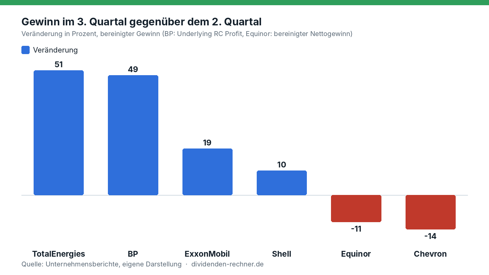
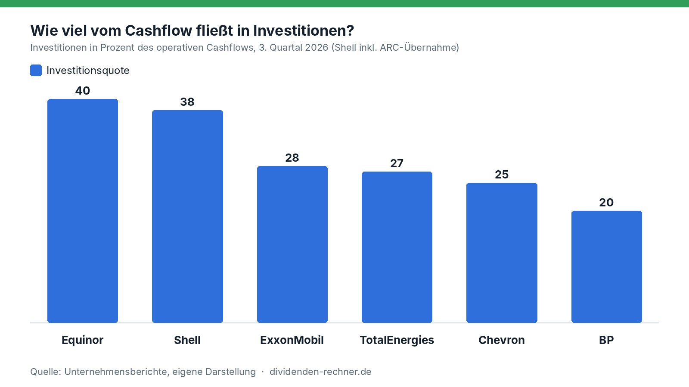
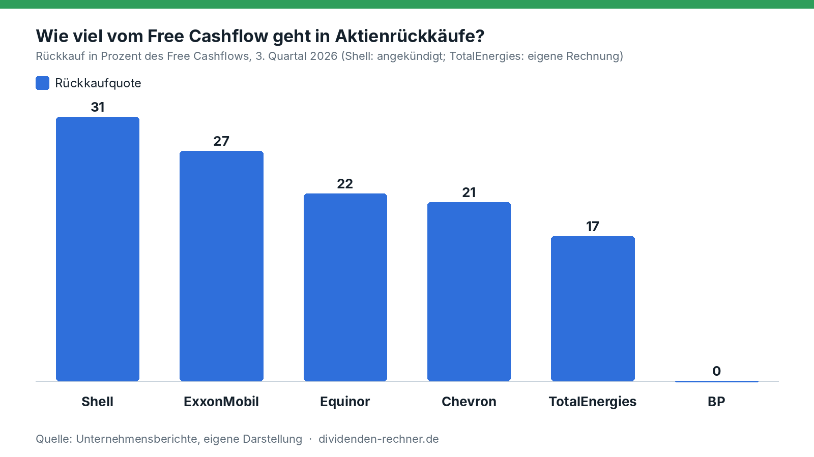

<!-- PRÜFEN: Zahlen stammen aus den Quartalsberichten (Shell, BP, TotalEnergies, Equinor als PDF, Exxon und Chevron aus den SEC-Meldungen). Mit * markierte Werte sind eigene Rechnungen. -->
<!-- PRÜFEN: Vorquartalswerte für ExxonMobil, Chevron und Shell stammen aus den Q2-Meldungen (Exxon: SEC 8-K, Zahlen per Auszug gelesen; Chevron: SEC 8-K; Shell: Pressemitteilung Q2). Exxon meldet für Q2 und Q3 identische Ausschüttungen (9,4 Mrd., davon 5,1 Rückkäufe): bitte im Original gegenlesen. -->
<!-- PRÜFEN: Brent rund 117 und WTI rund 107 Dollar sind Redaktionsangaben ohne Quelle. Andere Werte vom Samstag: Brent rund 113, WTI rund 103 (interne Abfrage, nicht veröffentlichen), WSJ im Marktüberblick 112 bis 113. Stichtag und Quelle klären. -->
<!-- PRÜFEN: Aussage zu iranischem Öl, das per Schiff in die Märkte kommt und direkt in die Raffinerien geht, ist Redaktionsaussage, nicht aus den Berichten belegt. Russland: Benzinimporte aus Indien und Verlängerung des Benzinexportstopps laut Berliner Zeitung (nur die Meldungstitel gesehen). -->
<!-- PRÜFEN: Chevron und Shell: gezahlte Dividendensumme im Q3 steht nicht im ausgewerteten Material. Equinor: Rückkaufprogramm 2026 (bis zu 3 Mrd. USD) und Zahl der Tranchen noch einmal im Bericht gegenlesen. -->

!!! kurz "Kurz gesagt"
    **Lage:** Der Iran-Krieg treibt den Ölpreis, der Ukraine-Konflikt den Dieselpreis. Brent liegt zuletzt bei rund 117, WTI bei rund 107 Dollar.
    **Ergebnis:** Gegenüber dem Vorjahr verdienen die Konzerne deutlich mehr. Gegenüber dem Vorquartal ist das Bild gemischt: TotalEnergies +51 %, BP +49 %, Chevron −14 %, Equinor −11 %.

    1. **Rückkäufe:** Nur Shell erhöht kräftig, von 3,0 auf 5,0 Mrd. USD (+67 %). ExxonMobil und Equinor bleiben unverändert, Chevron kürzt um 20 %, BP kauft nichts zurück.
    2. **Schulden:** Sie sinken überall, am stärksten bei BP (−38 %), TotalEnergies (−30 %) und Chevron (−27 %).
    3. **Dividenden:** ExxonMobil hebt um 3,9 % auf 1,07 USD, TotalEnergies um 5,9 % auf 0,90 Euro. Chevron und Equinor zahlen unverändert.

## Geopolitik treibt Öl und Diesel

Der Iran-Krieg treibt den Ölpreis, der Ukraine-Konflikt den Dieselpreis. Brent kostet zuletzt rund 117 Dollar je Barrel, WTI rund 107 Dollar. Noch stärker als Rohöl verteuern sich Raffinerieprodukte wie Diesel und Heizöl.

Beide Konflikte verstärken sich. In Russland haben ukrainische Angriffe Raffinerien zerstört. Das Land, sonst ein großer Exporteur von Raffinerieprodukten, muss Berichten zufolge Benzin aus Indien einführen und hat seinen Benzinexportstopp bis Ende Januar 2027 verlängert. Gleichzeitig kommt aus dem Iran wieder mehr Öl per Schiff auf den Markt, auch in den USA kommt es an. Weil die Lager weltweit auf einem Tiefstand sind, füllt dieses Öl keine Tanks auf. Es geht sofort in die Raffinerien, die daraus Diesel und Heizöl machen. Das hält die Preise der Raffinerieprodukte hoch und mit ihnen die Margen der Konzerne.

Die Konzerne rechnen nicht mit schneller Entspannung. TotalEnergies sieht den Ölpreis auch zu Beginn des vierten Quartals über 100 Dollar, bei Raffinerieprodukten spricht der Konzern von einem „sehr volatilen“ Markt. Für LNG erwartet TotalEnergies im vierten Quartal im Schnitt über 14 Dollar je Mbtu. BP plant das vierte Quartal mit 110 Dollar je Barrel und rechnet weiter mit Störungen im Nahen Osten. Konzernchef Patrick Pouyanné spricht von historischen Raffineriemargen und einem „Bullenmarkt“ bei Gas (aus dem Englischen übersetzt).

## Verdienen die Konzerne wirklich mehr?

Gegenüber dem Vorjahr ja, und zwar kräftig. [Chevron](../chevron-q3-2026-ergebnisse/) hat den Nettogewinn von 3,54 auf 9,92 Mrd. Dollar fast verdreifacht (+180 %). BP verdient bereinigt 8,5 statt 2,2 Mrd. Dollar. Gegenüber dem zweiten Quartal ist das Bild gemischt:

*Eigene Darstellung nach den Quartalsberichten von Q2 und Q3 2026. Bereinigte Gewinne, bei BP der „Underlying Replacement Cost Profit“, bei Equinor der bereinigte Nettogewinn.*

Der Grund liegt im Mix aus Förderung und Raffinerie. Der Brent-Preis fiel im Schnitt von 104 auf 97 Dollar je Barrel (−7 %), das drückt die Förderung. Dafür sprangen die Raffineriemargen: Shell nennt 42 statt 24 Dollar je Barrel, BP 46,7 Dollar. Wer viel verarbeitet und handelt, gewinnt. TotalEnergies meldet im Downstream mit 4,1 Mrd. Dollar einen Rekord, bei Shell steigt der Gewinn in Chemie und Produkten von 2,9 auf 3,9 Mrd. Dollar.

[ExxonMobil](../exxonmobil-q3-2026-quartalszahlen/) legt bereinigt um 19 % zu (14,7 auf 17,5 Mrd. Dollar) und kommt an der US-Küste auf eine Auslastung von 100 %. Bei Chevron sinkt der bereinigte Gewinn von 12,0 auf 10,4 Mrd. Dollar, dazu kommen Rückstellungen von 160 Mio. Dollar und negative Timing-Effekte. Equinor steigert das bereinigte operative Ergebnis um 8 %, nach Steuern bleibt aber weniger übrig als im zweiten Quartal.

## Wohin fließt das Geld?

Es gibt drei Wege: investieren, Schulden zurückzahlen, Geld an die Aktionäre geben. Gemessen am operativen Cashflow investiert Equinor mit 40 % am meisten, gefolgt von Shell mit 38 %. BP investiert nur 20 %.

*Eigene Darstellung nach den Quartalsberichten. Shell inklusive der Kosten der ARC-Übernahme, Equinor organische Investitionen.*

| Konzern | Operativer Cashflow | Investitionen | Free Cashflow | Veränderung zum Vorquartal |
|---|---|---|---|---|
| ExxonMobil | 25,7 Mrd. USD | 7,2 Mrd. USD | 19,1 Mrd. USD | +11 % |
| Shell | 21,0 Mrd. USD | 7,9 Mrd. USD | 16,3 Mrd. USD | −7 % |
| Chevron | 16,0 Mrd. USD | 4,0 Mrd. USD | 12,0 Mrd. USD | −34 % |
| BP | 14,8 Mrd. USD | 3,0 Mrd. USD | 11,8 Mrd. USD* | +51 %* |
| TotalEnergies | 12,3 Mrd. USD | 3,3 Mrd. USD | 9,0 Mrd. USD* | +25 % (Cashflow) |
| Equinor | 8,1 Mrd. USD | 3,3 Mrd. USD | 5,2 Mrd. USD | −5 % |

*Quellen: Quartalsberichte der Konzerne. Der Free Cashflow ist bei ExxonMobil, Chevron und Shell die Angabe der Konzerne und enthält auch weitere Zahlungsströme wie Verkaufserlöse. Bei BP und TotalEnergies eigene Rechnung (Cashflow minus Investitionen). Bei TotalEnergies zählt der Cashflow ohne Betriebskapital, bei Equinor der Cashflow vor Kapitalausschüttung.*

## Aktienrückkäufe: nur Shell legt zu

Die Rückkäufe folgen nicht dem Gewinn. Shell erhöht kräftig, von 3,0 auf 5,0 Mrd. Dollar für die nächsten drei Monate (+67 %). ExxonMobil bleibt bei 5,1 Mrd. Dollar, Equinor bei 1,125 Mrd. Dollar je Tranche. Chevron kürzt von 3,1 auf 2,5 Mrd. Dollar (−20 %). TotalEnergies kauft im dritten Quartal für 1,5 Mrd. Dollar zurück, rund ein Drittel mehr als im Schnitt der ersten beiden Quartale (1,1 Mrd.). Für das vierte und das erste Quartal sind zusammen 2,5 Mrd. Dollar geplant, das sind 1,25 Mrd. je Quartal. BP kauft laut Präsentation nichts zurück.

*Eigene Darstellung nach den Quartalsberichten. Shell: angekündigter Rückkauf für je drei Monate. TotalEnergies: Vorquartal als Schnitt der Quartale eins und zwei.*

Gemessen am Free Cashflow ist Shell am großzügigsten und gibt 31 % für Rückkäufe aus. Es folgen ExxonMobil mit 27 %, Equinor mit 22 % und Chevron mit 21 %. TotalEnergies liegt bei 17 %, BP bei null.

*Eigene Darstellung nach den Quartalsberichten. Shell: angekündigter Rückkauf im Verhältnis zum Free Cashflow des Quartals. TotalEnergies: eigene Rechnung.*

ExxonMobil schüttet insgesamt 9,4 Mrd. Dollar aus, davon 4,3 Mrd. als Dividende. Das sind rund 37 %* des operativen Cashflows und rund 49 %* des Free Cashflows.

## Dividenden: kleine Schritte

Die Dividenden steigen langsamer als die Gewinne. ExxonMobil hebt von 1,03 auf 1,07 Dollar je Aktie (+3,9 %), das ist das 44. Jahr in Folge mit einer Erhöhung. TotalEnergies zahlt eine dritte Zwischendividende von 0,90 Euro, 5,9 % mehr als im Vorjahr. BP zahlt 8,66 US-Cent je Aktie, wie im Vorquartal und rund 4 %* mehr als vor einem Jahr. Chevron (1,78 Dollar) und Equinor (0,39 Dollar) zahlen unverändert. Shell zahlt 0,3906 Dollar und verspricht eine Dividende, die jedes Jahr um etwa 4 % steigt.

## Schulden: BP und TotalEnergies räumen auf

Die Nettoverschuldung sinkt überall. BP drückt sie in einem Quartal von 22,3 auf 13,9 Mrd. Dollar (−38 %), TotalEnergies von 19,7 auf 13,8 Mrd. (−30 %), Chevron von 28,5 auf 20,7 Mrd. (−27 %). Bei Shell sind es 41,8 auf 39,7 Mrd. (−5 %), dort sind aber Leasingverbindlichkeiten eingerechnet, bei den anderen nicht. ExxonMobil hat die Nettoverschuldung seit Jahresbeginn um fast 11 Mrd. auf 22,1 Mrd. Dollar gesenkt*. Equinor meldet das Verhältnis von Nettoschulden zu eingesetztem Kapital: 3,8 % nach 10,4 % im Vorquartal.

*Eigene Darstellung nach den Quartalsberichten. Shell inklusive Leasing. ExxonMobil und Equinor ohne vergleichbare Vorquartalswerte.*

Bei BP ist die Lage damit noch nicht erledigt. Zusammen mit Hybridanleihen, Leasing und dem Vergleich zur Ölpest im Golf von Amerika kommt der Konzern auf Finanzverpflichtungen von 44,3 Mrd. Dollar nach 53,6 Mrd. im Vorquartal. BP selbst nennt sie weiter zu hoch. Die Nettoverschuldung von 13,9 Mrd. Dollar liegt aber schon unter dem Zielkorridor von 14 bis 18 Mrd. Dollar, den der Konzern für Ende 2027 genannt hat.

## Wer setzt worauf?

| Konzern | Schwerpunkt | Das steckt dahinter |
|---|---|---|
| ExxonMobil | Aktionäre und Raffinerie | Ausschüttung 9,4 Mrd. USD im Quartal, Rückkäufe unverändert, Struktureinsparungen von 16,9 Mrd. USD seit 2019 |
| Chevron | Schuldenabbau und Förderung | Nettoschulden −27 %, Rückkäufe gekürzt, geplante Investitionen in Venezuela |
| Shell | Rückkäufe, Kanada und LNG | Rückkauf +67 %, Übernahme von ARC Resources, Investitionsentscheidung für LNG Canada Phase 2, Investitionen 2026 von 23 bis 25 Mrd. USD |
| BP | Bilanz | Nettoschulden −38 %, kein Rückkauf, Verkauf von Castrol (rund 6 Mrd. USD erwartet), Investitionen 13,5 bis 14,0 Mrd. USD |
| TotalEnergies | Gas und LNG, dazu Schulden | Vier Investitionsentscheidungen (Zypern, Nigeria, Abu Dhabi, Aserbaidschan), kauft 4 GW Onshore-Erneuerbare von Shell, Investitionen rund 15 Mrd. USD |
| Equinor | Förderwachstum | Förderziel 2026 von 3 auf rund 4 % Wachstum angehoben, Gaskraftwerk in den USA, Bay du Nord in Kanada, organisch rund 13 Mrd. USD |

*Quellen: Quartalsberichte und Präsentationen der Konzerne. Keine Anlageberatung.*

## Was sich aus den Zahlen ablesen lässt

Einen einfachen Zusammenhang zwischen Gewinn und Ausschüttung gibt es nicht. BP (+49 %) und TotalEnergies (+51 %) haben die größten Gewinnsprünge und erhöhen die Rückkäufe nicht oder kaum. Sie zahlen Schulden zurück (−38 % und −30 %). Chevron, dessen Gewinn fällt, kürzt die Rückkäufe um 20 %. Nur Shell erhöht sie deutlich, obwohl die Nettoverschuldung mit 39,7 Mrd. Dollar die höchste der sechs ist (mit Leasing gerechnet).

Auch die Investitionsquote erklärt wenig: Equinor und Shell investieren 40 und 38 % ihres Cashflows, kaufen aber 22 und 31 % des Free Cashflows zurück, BP investiert 20 % und kauft nichts zurück. Erklärungsstärker ist die Bilanz. Wo noch Altlasten drücken (BP), fließt das Geld in den Schuldenabbau. Wo die Bilanz aufgeräumt ist (Chevron, TotalEnergies, Equinor), laufen die Rückkäufe moderat weiter. Bei sechs Konzernen ist das ein Muster, keine Statistik.

Für das vierte Quartal sind die Voraussetzungen besser als im Durchschnitt des dritten. Brent liegt mit rund 117 Dollar deutlich über den 97 Dollar des Quartalsdurchschnitts und über den 110 Dollar, mit denen BP plant. Ob die Konzerne ihr Geld dann anders verteilen, zeigen erst die nächsten Berichte. Das ist keine Kaufempfehlung und keine Prognose, sondern der Vergleich der berichteten Zahlen.

## Quellen

- ExxonMobil, Quartalsberichte Q2 und Q3 2026 (SEC-Meldungen, [Q2](https://www.sec.gov/Archives/edgar/data/0002115436/000211543626000006/livef8k2q26991.htm))
- Chevron, Quartalsberichte Q2 und Q3 2026 (SEC-Meldungen, [Q2](https://www.sec.gov/Archives/edgar/data/0000093410/000009341026000162/a06302026ex9918-k.htm))
- Shell plc, Präsentation zum dritten Quartal 2026 (29.10.2026) und [Pressemitteilung zum zweiten Quartal](https://www.investegate.co.uk/announcement/gnw/shell--shel/shell-plc-publishes-second-quarter-2026-press-/9694970)
- BP, Präsentation zum dritten Quartal 2026
- TotalEnergies, Pressemitteilung zum dritten Quartal 2026 (29.10.2026)
- Equinor, Quartalsbericht Q3 2026
- Berliner Zeitung, Berichte zu Kraftstoffengpässen in Russland: [Benzinimporte aus Indien](https://www.berliner-zeitung.de/article/kraftstoffengpaesse-in-russland-moskau-greift-auf-benzin-importe-aus-indien-zurueck-bericht-10155342), [Exportstopp bis Ende Januar 2027](https://www.berliner-zeitung.de/article/russland-verlaengert-benzinexportstopp-bis-ende-januar-2027-10249784)
