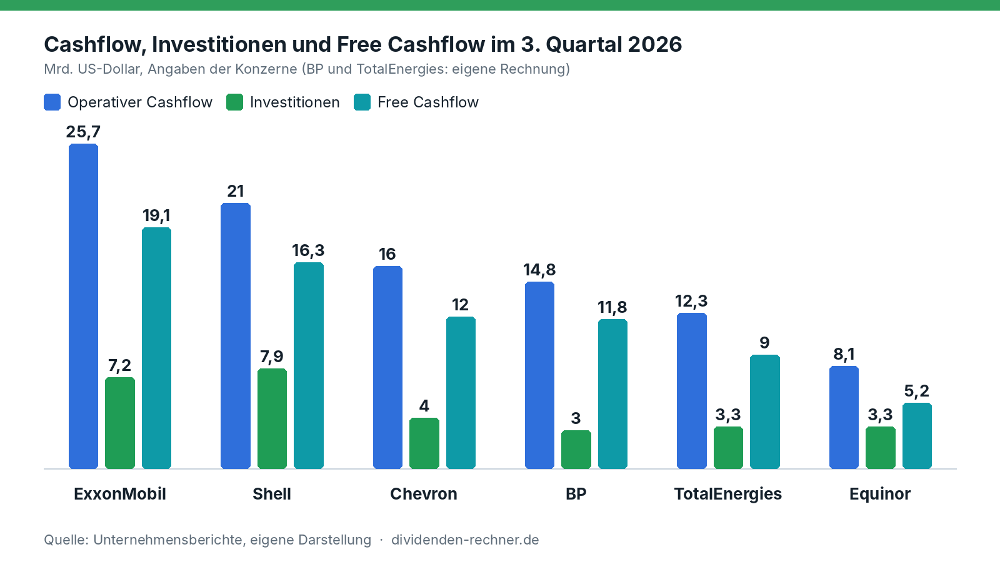
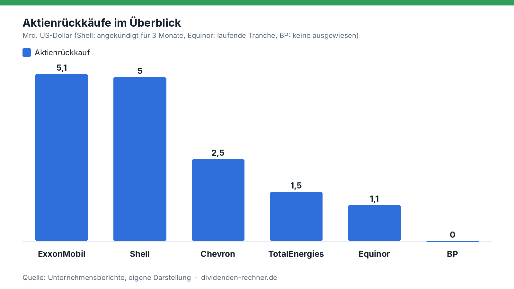
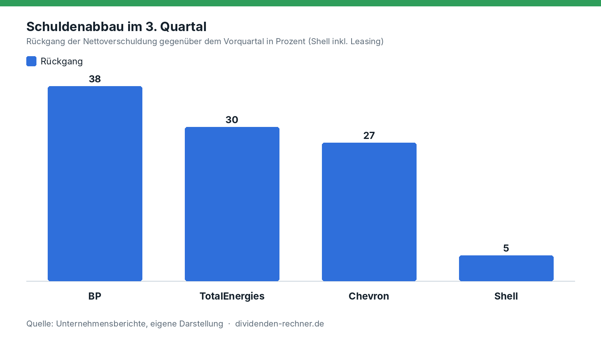

<!-- PRÜFEN: Entwurf. Zahlen stammen aus den Quartalsberichten (Shell, BP, TotalEnergies, Equinor als PDF, Exxon und Chevron aus den eigenen Artikeln und SEC-Meldungen). Mit * markierte Werte sind eigene Rechnungen. Aufmacherfoto fehlt, ohne image-Zeilen entsteht ein Titelbild automatisch. -->
<!-- PRÜFEN: Chevron und Shell: gezahlte Dividendensumme steht nicht im ausgewerteten Material, deshalb nur Dividende je Aktie. Equinor: Gesamtsumme des Rückkaufprogramms 2026 und Zahl der Tranchen vor der Veröffentlichung noch einmal im Bericht gegenlesen. -->

!!! kurz "Kurz gesagt"
    **Thema:** Sechs Ölkonzerne, ein Quartal mit hohen Raffineriemargen: Was machen sie mit dem Geld?
    **Brent im Q3:** rund 97 US-Dollar je Barrel

    1. **Rückkäufe:** ExxonMobil gibt 5,1 Mrd. USD für Aktienrückkäufe aus, Shell kündigt neue 5,0 Mrd. USD an, Chevron verwendet 2,5 Mrd. USD. TotalEnergies hat 1,5 Mrd. USD eingesetzt, Equinor startet eine Tranche über bis zu 1,125 Mrd. USD.
    2. **Schulden:** BP senkt die Nettoverschuldung in einem Quartal von 22,3 auf 13,9 Mrd. USD und kauft laut Präsentation keine Aktien zurück.
    3. **Dividenden:** TotalEnergies hebt die Zwischendividende um 5,9 % auf 0,90 Euro, BP und Equinor zahlen die Dividende des Vorquartals unverändert weiter.

## Ein Quartal mit Rückenwind aus dem Raffineriegeschäft

Im dritten Quartal 2026 lag der Brent-Preis nach Angaben von Shell und Chevron bei durchschnittlich 97 US-Dollar je Barrel, nach 104 Dollar im zweiten Quartal bei Shell. Was die Ergebnisse trug, waren vor allem die Margen im Raffineriegeschäft. Shell nennt für seine indikative Raffineriemarge 42 Dollar je Barrel nach 24 Dollar im Vorquartal, TotalEnergies spricht von historisch hohen Raffineriemargen in Europa und weltweit. [ExxonMobil](../exxonmobil-q3-2026-quartalszahlen/) meldet eine Auslastung von 100 % an den Raffinerien an der US-Küste, [Chevron](../chevron-q3-2026-ergebnisse/) spricht von Rekorden in den US-Raffinerien.

## Ölpreis, Gas und der Konflikt im Nahen Osten

Der Hintergrund der Zahlen ist der Konflikt im Nahen Osten, der die Straße von Hormus betrifft. TotalEnergies beziffert die Folgen für die eigene Förderung im dritten Quartal auf rund 5 %, vor allem wegen begrenzter LNG-Exporte durch die Meerenge. Ohne diesen Effekt wäre die Produktion gegenüber dem Vorjahr um mehr als 4 % gewachsen. Auch BP rechnet im vierten Quartal weiter mit Störungen im Nahen Osten und nennt die „erhöhte Volatilität“ der Öl- und Gaspreise als Risiko für ihre Förderverträge.

Die Preise sind seit dem Quartalsende nicht gefallen. TotalEnergies schreibt, der Ölpreis liege zu Beginn des vierten Quartals weiter über 100 US-Dollar je Barrel, der Markt für Raffinerieprodukte sei „sehr volatil“, die weltweiten Lagerbestände seien auf einem Tiefstand. Für Gas erwartet der Konzern im vierten Quartal einen durchschnittlichen LNG-Verkaufspreis von über 14 US-Dollar je Mbtu. BP legt seinen Annahmen für das vierte Quartal einen Brent-Preis von 110 US-Dollar je Barrel zugrunde. Unser [Marktüberblick vom Freitag](../tech-ausverkauf-intel-nasdaq-marktueberblick/) nennt unter Berufung auf das Wall Street Journal für Brent zuletzt rund 112 bis 113 Dollar.

Das heißt für die Quartalszahlen: Der Durchschnittspreis von 97 Dollar im dritten Quartal liegt unter dem aktuellen Niveau. Die Raffineriemargen sind der zweite Treiber: BP nennt 46,7 Dollar je Barrel nach der eigenen Raffineriemarge, Shell 42 Dollar. TotalEnergies-Chef Patrick Pouyanné spricht von einem Umfeld mit historischen Raffineriemargen und einem „Bullenmarkt“ bei Gas (aus dem Englischen übersetzt).

<!-- PRÜFEN: WTI und die Preisentwicklung der letzten Wochen fehlen noch, sie stehen nicht in den Berichten. Quelle nachtragen, wenn gewünscht. -->

Dieser Artikel stellt die sechs Konzerne nebeneinander. Er beantwortet eine Frage: Wie viel verdienen sie, und wohin fließt das Geld? Es ist keine Kaufempfehlung.

## Cashflow und Investitionen

*Eigene Darstellung nach den Quartalsberichten von ExxonMobil, Chevron, Shell, BP, TotalEnergies und Equinor. Definitionen weichen ab.*

| Konzern | Bereinigter Gewinn | Operativer Cashflow | Investitionen | Free Cashflow |
|---|---|---|---|---|
| ExxonMobil | 17,5 Mrd. USD | 25,7 Mrd. USD | 7,2 Mrd. USD | 19,1 Mrd. USD |
| Shell | 10,8 Mrd. USD | 21,0 Mrd. USD | 7,9 Mrd. USD | 16,3 Mrd. USD |
| Chevron | 10,4 Mrd. USD | 16,0 Mrd. USD | 4,0 Mrd. USD | 12,0 Mrd. USD |
| BP | 8,5 Mrd. USD | 14,8 Mrd. USD | 3,0 Mrd. USD | 11,8 Mrd. USD* |
| TotalEnergies | 9,1 Mrd. USD | 12,3 Mrd. USD | 3,3 Mrd. USD | 9,0 Mrd. USD* |
| Equinor | 2,9 Mrd. USD | 8,1 Mrd. USD | 3,3 Mrd. USD | 5,2 Mrd. USD |

*Quellen: Quartalsberichte der Konzerne vom 29. und 30.10.2026. Bei BP und TotalEnergies eigene Rechnung (Cashflow minus Investitionen).*

Die Zahlen sind nicht eins zu eins vergleichbar. Bei BP ist der Gewinn der „Underlying Replacement Cost Profit“, bei TotalEnergies zählt der Cashflow ohne Veränderung des Betriebskapitals, bei Equinor der Cashflow nach gezahlten Steuern. Der Free Cashflow stammt bei ExxonMobil, Chevron und Shell von den Konzernen selbst und berücksichtigt auch weitere Zahlungsströme, etwa Verkaufserlöse, deshalb ergibt er nicht immer genau den Cashflow minus Investitionen. Bei Shell sind in den Investitionen die Kosten der Übernahme von ARC Resources enthalten. Bei Equinor entspricht die letzte Spalte dem „Netto-Cashflow vor Kapitalausschüttung“, die Investitionen sind mit 3,3 Mrd. USD die organischen, insgesamt waren es 3,8 Mrd. USD.

Auffällig ist Equinor: Dem bereinigten operativen Ergebnis von 12,35 Mrd. USD steht ein bereinigter Nettogewinn von nur 2,86 Mrd. USD gegenüber.

## Wer zahlt wie viel aus?

| Konzern | Dividende je Aktie | Aktienrückkauf | Vorgabe des Konzerns |
|---|---|---|---|
| ExxonMobil | 1,07 USD | 5,1 Mrd. USD im Q3 (Dividenden 4,3 Mrd. USD) | keine Quote genannt |
| Shell | 0,3906 USD | 5,0 Mrd. USD für die nächsten drei Monate | 40–50 % des operativen Cashflows im Zyklus |
| Chevron | 1,78 USD | 2,5 Mrd. USD im Q3 | keine Quote genannt |
| BP | 8,66 US-Cent | laut Präsentation keiner | Schuldenabbau hat Vorrang |
| TotalEnergies | 0,90 Euro (Zwischendividende) | 1,5 Mrd. USD im Q3, danach 2,5 Mrd. USD für Q4 und Q1 2027 | 40 % des Cashflows |
| Equinor | 0,39 USD | Tranche über bis zu 1,125 Mrd. USD, Programm 2026 bis zu 3 Mrd. USD | – |

*Quellen: Quartalsberichte und Präsentationen der Konzerne. Keine Anlageberatung.*

ExxonMobil schüttet insgesamt 9,4 Mrd. USD aus. Das sind rund 37 %* des operativen Cashflows von 25,7 Mrd. USD und rund 49 %* des Free Cashflows von 19,1 Mrd. USD. Der Konzern blickt auf 44 aufeinanderfolgende Jahre mit Dividendenerhöhung zurück.

Bei Chevron entsprechen die 2,5 Mrd. USD Rückkäufe rund 21 %* des Free Cashflows von 12,0 Mrd. USD. Wie viel Dividende Chevron im Quartal tatsächlich gezahlt hat, steht im ausgewerteten Material nicht.

Shell hat die Ausschüttungsquote am klarsten benannt, 40 bis 50 % des operativen Cashflows. Der angekündigte Rückkauf liegt mit 5,0 Mrd. USD höher als zuvor. Shell nennt außerdem eine Dividende, die jedes Jahr um etwa 4 % steigt.

TotalEnergies verlangsamt den Rückkauf rechnerisch: 2,5 Mrd. USD für zwei Quartale sind 1,25 Mrd. USD* je Quartal, im dritten Quartal waren es 1,5 Mrd. USD. Die Zwischendividende von 0,90 Euro liegt 5,9 % über dem Vorjahr.

Bei BP steht die Dividende bei 8,66 US-Cent je Aktie, im Vorquartal waren es ebenfalls 8,66 Cent, vor einem Jahr 8,32 Cent, also rund 4,1 %* mehr. Gezahlt hat BP im dritten Quartal 1,3 Mrd. USD Dividenden.

Equinor zahlt unverändert 0,39 US-Dollar je Aktie und kauft weiter Aktien zurück.

*Eigene Darstellung nach den Quartalsberichten. Shell: angekündigter Rückkauf für drei Monate, Equinor: laufende Tranche.*

## Wer tilgt Schulden?

| Konzern | Nettoverschuldung | Kennzahl |
|---|---|---|
| ExxonMobil | 22,1 Mrd. USD* | 34,3 Mrd. USD Bruttoschulden minus 12,2 Mrd. USD Barmittel |
| Shell | 39,7 Mrd. USD (Vorquartal 41,8) | Gearing 16,6 % (ohne Leasing 2,7 %) |
| Chevron | 20,7 Mrd. USD (Jahresende 2025: 34,5) | Net-Debt-Ratio 9,6 % |
| BP | 13,9 Mrd. USD (Vorquartal 22,3) | zusätzlich 12,1 Mrd. USD Hybridanleihen und 13,3 Mrd. USD Leasing |
| TotalEnergies | 13,8 Mrd. USD (Vorquartal 19,7) | Gearing 9,1 % (Vorquartal 13,1 %) |
| Equinor | – | Nettoschulden zu eingesetztem Kapital 3,8 % (Vorquartal 10,4 %) |

*Quellen: Quartalsberichte der Konzerne. Die Definitionen von „Nettoverschuldung“ unterscheiden sich: Bei Shell ist Leasing eingerechnet, bei BP und TotalEnergies nicht.*

BP ist der Sonderfall. Die Nettoverschuldung ist in einem Quartal um 8,4 Mrd. USD gesunken, die sogenannten Finanzverpflichtungen (Nettoschulden, Hybridanleihen, Leasing und der Gulf-of-America-Vergleich) von 53,6 auf 44,3 Mrd. USD. Die Konzernleitung nennt sie weiterhin „zu hoch“. Mit 13,9 Mrd. USD liegt die Nettoverschuldung bereits unter dem Zielkorridor von 14 bis 18 Mrd. USD, den BP für Ende 2027 nennt. Die Präsentation nennt die Stärkung der Bilanz als erste Priorität und weist keinen Aktienrückkauf aus.

TotalEnergies senkte das Gearing in einem Quartal um vier Prozentpunkte auf 9,1 %, Equinor von 10,4 auf 3,8 %.

*Eigene Darstellung nach den Quartalsberichten. Shell inklusive Leasing, die übrigen ohne. Für Equinor liegt nur eine Quote vor.*

## Wer stellt sich wie auf?

| Konzern | Investitionen 2026 | Wohin das Geld strategisch geht | Besonderheit im Quartal |
|---|---|---|---|
| ExxonMobil | – | Raffinerien und Förderung, Struktureinsparungen 16,9 Mrd. USD seit 2019 | höchster Free Cashflow der Gruppe |
| Chevron | 4,0 Mrd. USD im Q3 | Ausbau der Förderung, geplante Investitionen in Venezuela | Schulden in neun Monaten von 40,8 auf 33,5 Mrd. USD gesenkt |
| Shell | 23–25 Mrd. USD (mit ARC), 2027/28: 20–22 Mrd. USD je Jahr | Kanada: ARC-Übernahme, Investitionsentscheidung für LNG Canada Phase 2 | Verkäufe von Randgeschäften (z. B. Jiffy Lube) |
| BP | 13,5–14,0 Mrd. USD | Schulden und Hybridkapital abbauen, Portfolio verschlanken | Verkauf von Castrol (rund 6 Mrd. USD erwartet), Verkäufe insgesamt rund 8 Mrd. USD |
| TotalEnergies | rund 15 Mrd. USD | Gas und LNG, vier Investitionsentscheidungen (Zypern, Nigeria, Abu Dhabi, Aserbaidschan) | übernimmt 4 GW Onshore-Erneuerbare von Shell, verkauft 50 % eines 1,2-GW-Portfolios an KKR |
| Equinor | rund 13 Mrd. USD (organisch) | Förderung auf Rekordniveau, Gaskraftwerk in den USA, Bay du Nord (Kanada) | Förderziel für 2026 von 3 auf rund 4 % Wachstum angehoben |

*Quellen: Quartalsberichte und Präsentationen der Konzerne. Bei ExxonMobil und Chevron stammen die Angaben aus den Meldungen vom 30.10.2026 und unseren Quartalsartikeln. Keine Anlageberatung.*

## Was daraus folgt

Die Konzerne wählen unterschiedliche Wege: Die Amerikaner und Shell bevorzugen große Rückkäufe, TotalEnergies und Equinor halten die Rückkäufe moderat und senken die Schulden, BP stellt die Bilanz vor die Aktionärsrendite. Für Dividendenanleger sind das unterschiedliche Signale. Eine hohe Rückkaufsumme hängt vom Cashflow und damit von den Margen im Raffineriegeschäft ab. Die Dividende selbst ist bei TotalEnergies gestiegen und bei BP und Equinor gleich geblieben. 
Die Positionierung lässt sich in drei Sätzen zusammenfassen. ExxonMobil und Chevron schütten viel aus und bauen zugleich Schulden ab. Shell setzt auf Kanada und LNG und trennt sich von Randgeschäften, TotalEnergies setzt auf Gas und LNG und kauft nebenbei Erneuerbaren-Portfolios. BP stellt Bilanz und Portfolio an die erste Stelle. Equinor wächst in der Förderung und investiert zusätzlich in ein Gaskraftwerk in den USA.

Eines fehlt in dieser Übersicht noch: die Aussicht auf den Ölpreis selbst. Alle Zahlen beschreiben das dritte Quartal. Ob die Raffineriemargen und der Ölpreis auf diesem Niveau bleiben, lässt sich aus den Berichten nicht ablesen. Das ist keine Empfehlung und keine Prognose, sondern der Vergleich der berichteten Zahlen.

## Quellen

- ExxonMobil, Quartalsbericht Q3 2026 (SEC-Meldung vom 30.10.2026)
- Chevron, Quartalsbericht Q3 2026 (SEC-Meldung vom 30.10.2026)
- Shell plc, Präsentation zum dritten Quartal 2026, 29.10.2026
- BP, Präsentation zum dritten Quartal 2026
- TotalEnergies, Pressemitteilung zum dritten Quartal 2026, 29.10.2026
- Equinor, Quartalsbericht Q3 2026
