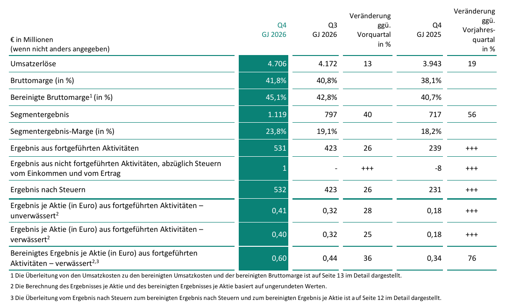

!!! kurz "Kurz gesagt"
    **Umsatz Geschäftsjahr 2026:** 16,4 Mrd. Euro (+12 %)
    **Gewinn nach Steuern:** 1,5 Mrd. Euro (+49 %)
    **Schlussquartal:** Umsatz 4,7 Mrd. Euro (+19 %), Segmentergebnis 1,1 Mrd. Euro (+56 %), Marge 23,8 %
    **Rechenzentren:** 2,2 Mrd. Euro Umsatz, fast doppelt so viel wie im Vorjahr
    **Ausblick 2027:** rund 20 Mrd. Euro Umsatz, mehr als 20 % Wachstum
    **Dividende:** 0,38 Euro je Aktie (+8,6 %), das entspricht aktuell etwa 0,85 % Rendite

Infineon-Chef Jochen Hanebeck kann sich über einen guten Lauf freuen: Die Aktie kostet am Freitagvormittag bei Lang & Schwarz 44,72 Euro und liegt damit 4,8 % im Plus. Das Unternehmen hat vor gut zwei Wochen sein Geschäftsjahr mit einem Rekordquartal abgeschlossen. Hinter dem Schwung steht vor allem ein Geschäft, das vor zwei Jahren kaum jemand auf dem Zettel hatte: die Stromversorgung für KI-Rechenzentren.

## Rechenzentren machen den Unterschied

Im Schlussquartal stieg der Umsatz um 19 % auf 4,7 Mrd. Euro. Das Segmentergebnis legte mit +56 % auf 1,1 Mrd. Euro deutlich stärker zu, die Marge kletterte von 18,2 % auf 23,8 %. Das bereinigte Ergebnis je Aktie lag bei 0,60 Euro nach 0,34 Euro im Vorjahr.

Den Takt gibt das Segment Power Systems vor. Sein Umsatz wuchs im Quartal um 48 % auf 1,7 Mrd. Euro, die Marge verdoppelte sich von 15,3 % auf 30,1 %. Über das ganze Geschäftsjahr kamen die Rechenzentren auf 2,2 Mrd. Euro Umsatz, fast doppelt so viel wie 2025. Davon entfallen 1,7 Mrd. Euro auf KI-Rechenzentren, 0,5 Mrd. Euro auf klassische Rechenzentren. Für jedes Kilowatt, das ein KI-Server zieht, liefert Infineon nach eigenen Angaben im Schnitt Chips für etwa 175 Dollar.

!!! zitat "Jochen Hanebeck, Vorstandsvorsitzender der Infineon Technologies AG"
    {: .zitatfoto }

    „Infineon hat das Geschäftsjahr 2026 mit einem weiteren Rekordquartal abgeschlossen. Wir gehen mit Rückenwind in das Geschäftsjahr 2027.“

    Jochen Hanebeck, Infineon, Mitteilung vom 10. November 2026

Automotive bleibt mit 2,1 Mrd. Euro (+10 %) das größte Segment und erreicht eine Marge von 22,0 %. Über das Jahr gerechnet wuchs der Bereich nur um 5 %. Edge Systems stagniert: Der Umsatz lag im Quartal mit 838 Mio. Euro auf Vorjahresniveau, im Gesamtjahr stieg er um 2 %, das Segmentergebnis fiel um 8 % auf 395 Mio. Euro. Für das erste Quartal erwartet Infineon dort einen moderaten Rückgang.

## Der Ausblick: ein Fünftel mehr Umsatz

Für 2027 plant Infineon mit rund 20 Mrd. Euro Umsatz, gut 22 % mehr als im abgelaufenen Jahr. Rechenzentren sollen davon fast 4 Mrd. Euro beitragen, also noch einmal fast das Doppelte. Die Marge des Segmentergebnisses soll im mittleren Zwanzigerbereich liegen, nach 19,7 % in diesem Jahr. Für das erste Quartal rechnet der Konzern mit rund 4,6 Mrd. Euro Umsatz und einer Marge von etwa 23 %. Die Prognose setzt einen Wechselkurs von 1,15 Dollar je Euro voraus.

Das Wachstum kostet Geld. Die Investitionen steigen 2027 auf 3,0 bis 3,5 Mrd. Euro, nach rund 2,6 Mrd. Euro im Jahr 2026. Sie fließen vor allem in das vierte Fertigungsgebäude in Dresden, in die Siliziumkarbid-Fertigung in Kulim in Malaysia und in die Galliumnitrid-Produktion in Villach. Die Nettoschulden betrugen zum Jahresende 4,7 Mrd. Euro, nach 5,2 Mrd. Euro im Vorquartal.

## Infineon im Vergleich mit anderen Halbleiterkonzernen

Die Aktie ist kein Schnäppchen mehr. Die Kennzahlen aus dem Hub zeigen, dass der Markt Infineon ähnlich hoch bewertet wie andere Konzerne der Branche. Die Rendite liegt, wie bei Chipwerten üblich, im unteren Bereich.

| Halbleiterkonzern | Börsenwert | KGV | Rendite |
|---|---|---|---|
|  Infineon | 56 Mrd € | 54,7 | 0,8 % |
|  STMicro | 33 Mrd € | 119,7 | 0,9 % |
|  NXP | 57 Mrd € | 19,4 | 1,7 % |
|  Analog Devices | 150 Mrd € | 39,9 | 1,2 % |
|  Texas Instruments | 224 Mrd € | 34,9 | 2,1 % |

Die Hub-Werte beruhen auf dem Xetra-Schlusskurs vom 26. November und auf dem jeweils letzten berichteten Geschäftsjahr. Bei Infineon ist das noch 2025 mit einer Dividende von 0,35 Euro. Mit dem neuen Gewinn von 1,5 Mrd. Euro fällt das KGV deutlich niedriger aus.

## Dividende

Der Vorstand will der Hauptversammlung am 25. Februar 2027 eine Dividende von 0,38 Euro je Aktie vorschlagen, 3 Cent oder 8,6 % mehr als zuletzt. Beim aktuellen Kurs von 44,72 Euro entspricht das einer Rendite von etwa 0,85 %. Bei Infineon steht das Wachstum im Vordergrund, die Dividende ist ein Zusatz.

## Fazit

Die Zahlen sind stark, und die Prognose für 2027 legt nach. Dagegen stehen die hohen Investitionen, Nettoschulden von 4,7 Mrd. Euro, ein Edge-Geschäft ohne Wachstum und die Abhängigkeit vom KI-Zyklus. Entscheidend wird, ob Power Systems die Marge von gut 30 % halten kann, wenn die neuen Fabriken hochlaufen.

## Quellen

- Infineon Technologies AG, Presseinformation „Infineon schließt GJ 2026 mit Rekordquartal ab …" (10.11.2026)
- Infineon Technologies AG, Investorenpräsentation zum vierten Quartal und Geschäftsjahr 2026 (10.11.2026)
- Logistik Heute, „Bilanz: Infineon steigert Gewinn um 49 Prozent auf 1,1 Milliarden Euro" (Zitat Hanebeck)
- Kennzahlen aus dem Hub von Dividenden-Rechner.de, Stand 26.11.2026
- Kurs: Lang & Schwarz, 27.11.2026, 10:06 Uhr (TraderFox)

*Dieser Artikel dient der Information und ist keine Anlageberatung. Alle Angaben ohne Gewähr.*
