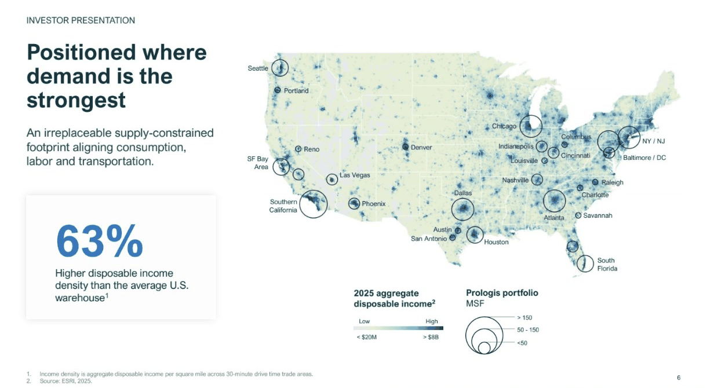
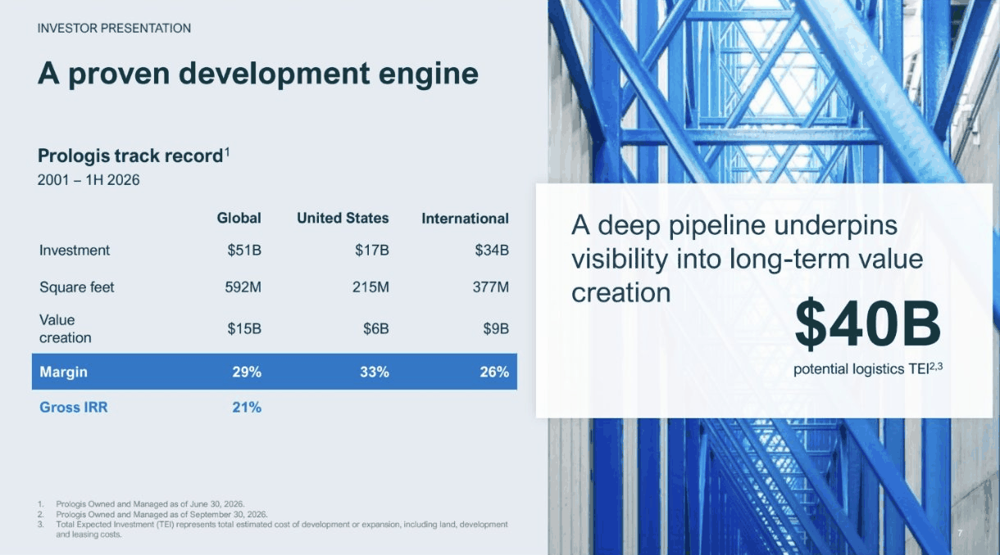
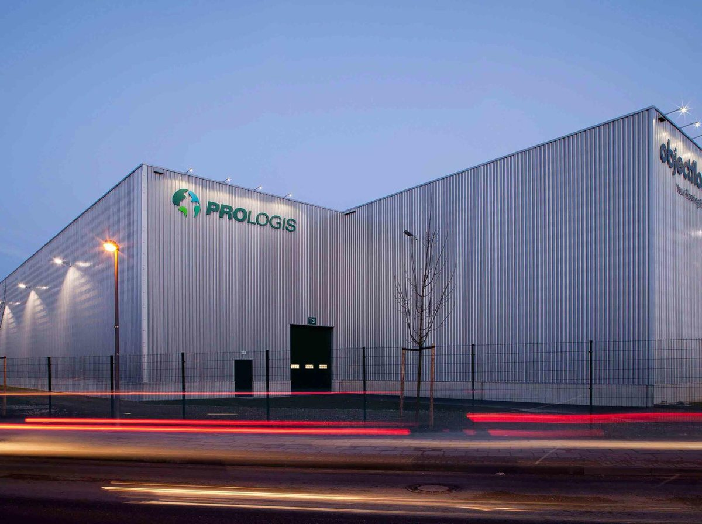

<!-- PRÜFEN: Hub-Daten für PLD sind fehlerhaft: Dividende 0,03 $, Rendite 0,02 %, Dividendenwachstum 1 Jahr 200 %. Im Artikel deshalb Dividende aus dem Quartalsbericht (1,07 $ je Quartal, 1,01 $ im Vorjahresquartal) und Rendite eigene Rechnung: 4,28 $ durch 128,13 $ (Hub-Kurs 26.11.) = 3,3 %. Hub-Daten bitte korrigieren. -->
<!-- PRÜFEN: Eigene Rechnungen: Ausschüttung 68 % des Core FFO (4,28 durch Mitte der Prognose 6,27 $); 87 % des AFFO im dritten Quartal (1.045 Mio. $ Dividenden durch 1.207 Mio. $ AFFO). -->
<!-- PRÜFEN: Fotos sind Pressebilder von Prologis (von Divi geschickt), als markierte Ausnahme. Das zweite Foto zeigt eine Prologis-Halle (Ort unbekannt), Bildtext bleibt allgemein. -->
<!-- PRÜFEN: Folien stammen aus dem Quartr-Screenshot der Investorenpräsentation (Oberflächenrahmen abgeschnitten). -->
<!-- PRÜFEN: Peers aus dem Hub (STAG, Segro, WDP). Für Segro und WDP fehlen im Hub einige Werte (Dividendenwachstum, FFO). KGV bei REITs ist wegen Abschreibungen und Neubewertungen eingeschränkt aussagekräftig. -->

!!! kurz "Kurz gesagt"
    **Die Zahlen:** Umsatz 2,39 Mrd. $ (+8 %), Core FFO je Aktie 1,60 $ (+7 %), die Prognose für 2026 liegt bei 6,25 bis 6,29 $.
    **Die Mieten:** Bei neuen Verträgen liegt die Miete im Schnitt 38 % über der alten, ein Jahr zuvor waren es 49 %.
    **Die Dividende:** 1,07 $ je Quartal (+6 %), rund 3,3 % Rendite, etwa zwei Drittel des Core FFO.
    **Der Preis:** Die Aktie kostet das 21-Fache des FFO, STAG nur das 12-Fache.

Prologis vermietet Hallen an die Unternehmen, die sich sonst die Waren zuschicken lassen: Händler, Hersteller, Paketkonzerne. Rund 1,3 Mrd. Quadratfuß in 20 Ländern gehören dem Konzern oder werden für Fonds verwaltet, die Kunden reichen von Target und Home Depot über Coca-Cola und Tesla bis zu DHL. An der Börse ist der Konzern rund 126 Mrd. $ wert. Für Dividendenanleger ist die Frage, wie lange die Mieten noch so kräftig steigen, dass die Ausschüttung mitwächst.

## Die Zahlen: Mieten treiben den Gewinn

### Das dritte Quartal

Der Umsatz stieg im dritten Quartal um 8 % auf 2,39 Mrd. $. Entscheidend für REITs ist der Funds from Operations, kurz FFO, der Abschreibungen herausrechnet: Der Core FFO je Aktie lag bei 1,60 $ nach 1,49 $ im Vorjahr. Der AFFO, der auch Investitionen in die Bestände abzieht, wuchs um 13 % auf 1,21 Mrd. $. Für das Gesamtjahr hat Prologis einen Core FFO von 6,25 bis 6,29 $ je Aktie in Aussicht gestellt, die Auslastung soll bei 95,25 bis 95,5 % liegen.

### Wie stark die Mieten steigen

Bei neu abgeschlossenen Mietverträgen lag die Miete im dritten Quartal im Durchschnitt 38 % über der bisherigen, bei den tatsächlich gezahlten Beträgen immerhin 23 %. Das ist weniger als vor einem Jahr, damals waren es 49 beziehungsweise 29 %. Die Mieten steigen weiter, der Rückenwind hat aber offenbar nachgelassen. In den bestehenden Hallen legten die Mieteinnahmen im selben Quartal um 5,7 % zu. Die Auslastung liegt mit 95 % hoch und leicht über dem Vorjahr.

Dass Prologis diese Aufschläge verlangen kann, hat mit den Standorten zu tun. 84 % der Mieteinnahmen stammen aus den USA, vor allem aus Ballungsräumen wie Südkalifornien, New York, Chicago und Dallas. Im Umkreis der Hallen liegt das verfügbare Einkommen pro Fläche 63 % über dem Umfeld eines durchschnittlichen US-Lagerhauses. Auch die Kundenstruktur ist breit gestreut: Ein Viertel der Fläche geht an Logistikdienstleister, jeweils etwa ein Fünftel an Händler, Großhändler und Hersteller.

## Die Dividende: gut gedeckt

Prologis zahlt 1,07 $ je Quartal, nach 1,01 $ im Vorjahresquartal. Das sind 4,28 $ im Jahr und bei einem Kurs von rund 128 $ eine Rendite von etwa 3,3 %. Gemessen an der Prognose für den Core FFO nimmt die Ausschüttung rund 68 % in Anspruch, der Rest bleibt im Unternehmen. Im dritten Quartal flossen 1,05 Mrd. $ an die Aktionäre, das entspricht gut 85 % des AFFO. Das ist für einen REIT eine solide Deckung und lässt Raum für weitere Erhöhungen.

## Wo das Wachstum herkommen soll

### Neubau und Verwaltung für Dritte

Prologis baut selbst: Für dieses Jahr sind Baustarts von 5,0 bis 5,75 Mrd. $ geplant, dazu Fertigstellungen von 2,5 bis 3,0 Mrd. $. Die Bilanz der Entwicklungsprojekte ist über die Jahre gut: Seit 2001 hat Prologis rund 51 Mrd. $ investiert und eine Marge von 29 % erzielt, die interne Rendite liegt bei 21 %. Im Landbestand stecken weitere Projekte mit einem Volumen von rund 40 Mrd. $. Daneben verdient das Unternehmen Gebühren für die Verwaltung von Fonds, im Quartal waren es 164 Mio. $.

### Rechenzentren

Der größte neue Hebel sind Rechenzentren. Prologis besitzt Grundstücke mit Stromanschlüssen, und die sind für Betreiber gefragt. 5,8 Gigawatt Leistung hat der Konzern gesichert oder in fortgeschrittenen Gesprächen, davon 1,7 Gigawatt bereits gesichert. 88 % davon liegen in den USA. Offenbar rechnet Prologis damit, dass Strom der knappste Faktor wird und seine Flächen deshalb an Wert gewinnen. Wie viel davon in den kommenden Jahren in die Gewinne fließt, lässt sich bisher nicht abschätzen.

## Prologis im Vergleich

Die Tabelle stellt Prologis anderen börsennotierten Logistik-REITs aus dem Hub gegenüber: STAG in den USA, Segro in Großbritannien und Europa, WDP in Belgien und den Niederlanden.

| Unternehmen | Rendite | KGV | Dividendenwachstum 1 Jahr |
|---|---|---|---|
| {{logo:pld}}[Prologis](/aktien-hub/prologis/) | 3,3 % | 36,0 | +5,9 % |
| {{logo:stag}}[STAG Industrial](/aktien-hub/stag-industrial/) | 3,9 % | 26,1 | +0,7 % |
| {{logo:segro}}[Segro](/aktien-hub/segro/) | 3,4 % | 22,1 | +6,9 % |
| {{logo:wdp-br}}[Warehouses De Pauw](/aktien-hub/warehouses-de-pauw/) | 3,3 % | 10,0 | – |

Die Renditen liegen alle um 3 bis 4 %, und die Unterschiede entstehen bei der Bewertung. Prologis kostet das 21-Fache des FFO je Aktie, STAG das 12-Fache. Das KGV ist bei REITs wegen der Abschreibungen und Neubewertungen wenig aussagekräftig, WDP fällt mit 10 deshalb optisch heraus. Segro wächst mit der Dividende ähnlich schnell wie Prologis, STAG kaum. Für den Aufschlag bekommt der Anleger Größe, Rechenzentren und eine Entwicklungsmaschine, die andere nicht in dem Umfang haben.

## Was dagegen spricht

Die Neuvermietungen bringen weniger Aufschlag als vor einem Jahr, und die Mieten im Bestand steigen langsamer als im Frühjahr. Die Verschuldung ist mit einer Nettoverschuldung von rund 4,9 Jahres-EBITDA im Hub vergleichsweise hoch, der Konzern selbst nennt allerdings eine Verschuldungsquote von nur 31,5 % und Liquidität von 8,8 Mrd. $. 84 % der Mieten kommen aus den USA, ein Dämpfer bei Konsum und Handel würde dort zuerst ankommen. Im Entwicklungsgeschäft fiel der Wertzuwachs aus Fertigstellungen im dritten Quartal mit 39 Mio. $ deutlich niedriger aus als ein Jahr zuvor mit 169 Mio. $, solche Beträge schwanken von Quartal zu Quartal.

## Was als Nächstes ansteht

Mit den Zahlen zum Jahresende kommt die Prognose für 2027. Entscheidend wird, ob die Mieten bei Neuabschlüssen weiter zweistellig über dem Bestand liegen und wie viel das Geschäft mit Rechenzentren beiträgt.

Das ist keine Anlageberatung.

## Quellen

- Prologis, Q3 2026 Earnings Supplemental
- Prologis, Investor Presentation 2026 (Quartr)
- Eigene Auswertung der Kennzahlen im Aktien-Hub, Stand 26./27.11.2026
